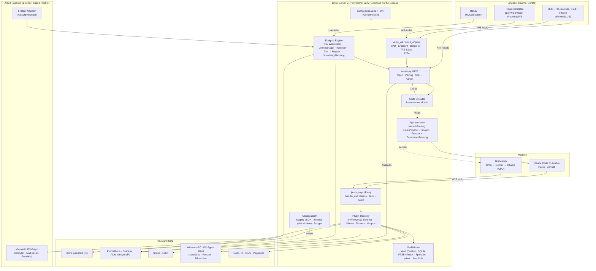

# Phase 0: Bestandsaufnahme Jarvis

Stand 02.11.2026, Branch `feat/voice-engine` (Commit `b85eb0d`). Deutsch, weil es der Arbeitsplan des
Nutzers ist. Ergänzt `VOICE-ANALYSE.md` (Sprachpipeline), `PORTING.md` (Windows-Stellen) und
`UMBAU-SERVER.md` (Server-Hardware und Umzug). Keine Code-Änderung in dieser Phase.

## 1. Kurzfassung

Jarvis ist in 19 Tagen (103 Commits seit 14.10.2026) von einem Browser-HUD zu einem Assistenten mit
100 Python-Modulen, 50 Werkzeugen, 42 lokalen Intent-Handlern, 629 Tests und einer Full-Duplex-Sprach-Engine
gewachsen. Die Grundarchitektur ist tragfähig: Router vor Modell, Werkzeuge über MCP, Rechte im Code,
Gedächtnis als Markdown. Was fehlt, ist weniger Funktion als **Betriebsreife**: kein strukturiertes Logging,
Metriken nur für die Sprach-Engine, Konfiguration über 333 Umgebungsvariablen und acht Dateien verteilt,
ein Werkzeug-Server mit 2000 Zeilen, Tests nur auf Windows gelaufen, und ein Commit mit der echten `.env`
in der Git-Historie. Die Phasen 2 bis 9 des Ausbaus setzen auf genau diesen Punkten auf.

| Kennzahl | Wert |
|---|---|
| Python-Module | 100 in `jarvis/<gruppe>/` + `server.py`, `paths.py` (34 979 Zeilen) |
| Größte Dateien | `jarvis_mcp.py` 2032, `server.py` 1278, `voice_engine.py` 1084, `router.py` 971 |
| HUD | 6831 Zeilen Vanilla JS/CSS, davon `app.js` 2919 |
| Werkzeuge / Gruppen | 50 Werkzeuge in 32 Gruppen (`jarvis_mcp.GROUPS`), alle mit Aktionsklasse |
| Lokale Handler | 42 (`router.LOCAL_HANDLERS`), Regex-basiert |
| Tests | 48 Dateien, 629 Tests, 88 s; **3 Fehler + 1 Error**, alle datumsgebunden (siehe 5) |
| Hintergrund-Threads | 17 Jobs über `background.loop`, 45 `Thread()`-Stellen, 40 Locks |
| Konfiguration | 333 verschiedene Umgebungsvariablen, 7 JSON-Dateien, `voice.yaml`, `state.json` |
| Fehlerbehandlung | 283 `except Exception`, kein `import logging`, 55 `print()` |
| Verbrauch (779 Läufe im Log) | Haiku 292, Sonnet 209, Groq-Notbetrieb 75, Ollama 21; Router-Treffer stehen als `local:*` ohne Modell |

## 2. Struktur und Pipeline (Ist)

```
Browser-HUD / iPad / iPhone              server.py (ThreadingHTTPServer, 127.0.0.1:8720, Token je Start)
  ui/app.js  ─── HTTP/NDJSON ───▶  /api/run ─▶ router.route ─▶ 42 lokale Handler (0 Tokens)
  ui/voice-client.js ── WS :8724 ─▶ voice_ws ─▶ voice_engine (VAD, Endpoint, Barge-in) ─▶ /api/run
  SSE /api/events ◀── events.publish ◀── watchers, scheduler, homelab_watch, 17 Hintergrundjobs
                                         └▶ router.llm_route ─▶ runtime.run_lean (claude -p, Pool 3)
                                                                   └─ MCP stdio ─▶ jarvis_mcp.py (50 Tools)
                                                                   └─ fallback_llm (Groq → Gemini → Ollama)
  Sonos ◀── sonos.py :8723 (LAN, Clips)      Echo ◀── alexa_voice (HA notify)      HA ◀── _ha() REST
```

- **Anfragepfad**: `server.py` → `router.route` (lokal) → sonst `llm_route` wählt Werkzeuggruppen per Regex
  und das Modell (Haiku für einfach, Sonnet für „smart“) → `commands.lean_system/lean_prefix` bauen den
  Kurz-Prompt → `runtime.run_lean` startet `claude -p` mit `--tools`, `--strict-mcp-config`, vorgewärmtem
  Prozess-Pool → jeder Werkzeugaufruf durch `jarvis_mcp.handle_call` (Klasse, Sperrliste, Taint, Audit, Größe).
- **Gedächtnis**: Obsidian-Vault (81 Notizen, 540 KB) mit Wissensgraph aus Schlagwörtern (`memory.search`
  = gewichtete Wortsuche, keine Vektoren), Gesprächsfenster 4 Runden in `state.json`, episodisches
  Gedächtnis nach Datum (`episodes.py`), Dokumentensuche SQLite FTS5 (`docsearch.py`), Antwort-Cache.
- **Proaktiv**: `events.py` (SSE, Ruhezeiten 22–7, Prioritäten normal/critical/alarm), `watchers.py` (30 s),
  `scheduler.py` (1 s), 17 Jobs. Hintergrundjobs ändern nichts selbst, sie legen Vorschläge an (`proposals.py`);
  zwei bewusste Ausnahmen (Buchungen vertrauter Absender, Lieferungen).
- **Sprache**: seit 02.11. Server-Engine (Silero VAD, Whisper-Partials, satzweise TTS, Barge-in 150 ms,
  `config/voice.yaml`, `/metrics`). Details und Messwerte in `VOICE-ANALYSE.md` und `docs/sprache.md`.
- **Plattform**: Windows-Teile hinter `hostos.py` begonnen (`PORTING.md` listet jede Stelle); PC-Steuerung
  (`pc.py`, `desktop.py`, `vision.py`, `overlay.py`) ist echt Windows; Autostart per `.bat` und Aufgabenplanung.

## 3. Abhängigkeiten

`requirements.txt` ist bewusst kurz (Standardbibliothek zuerst). Nicht alles, was importiert wird, steht drin:

| Paket | Genutzt von | In `requirements.txt` | Bewertung |
|---|---|---|---|
| faster-whisper, ctranslate2, nvidia-cublas/cudnn | `voice.py`, `voice_stt.py` | ja | GPU-Zeilen gehören in eine eigene Datei (Server ohne GPU) |
| piper-tts, onnxruntime, numpy, av | `tts_chain.py`, `voice_*` | nur piper (Rest transitiv) | `onnxruntime` für Silero wird nur zufällig mitinstalliert: explizit aufnehmen |
| websockets, pyyaml | Sprach-Engine | ja | ok |
| edge-tts, garminconnect, pypdf | Stimme, Garmin, Dokumente | ja | ok |
| **psutil** | `sysmon.py`, `infra.py`, `resources.py`, `desktop.py` | **nein** | fehlt; eine frische Installation auf dem Server bricht |
| **pycaw, comtypes** | `pc.py`, `desktop.py` | **nein** | nur Windows: in `requirements-windows.txt` |
| openwakeword, sounddevice, speexdsp | optional | nein (dokumentiert) | ok als Extras |
| torch, chatterbox (`.venv-tts`) | GPU-Stimme | `requirements-tts.txt` | bleibt getrennt |
| Node.js + `@anthropic-ai/claude-code` | Gehirn | docs/installation.md | ok |

Vorschlag: `requirements.txt` (Kern, läuft auf CPU überall), `requirements-gpu.txt`, `requirements-windows.txt`,
`requirements-tts.txt` (bleibt), `requirements-dev.txt` (coverage, ruff). Keine neue Laufzeitabhängigkeit nötig.

## 4. Konfiguration

| Ort | Inhalt | Problem |
|---|---|---|
| `.env` (333 Variablen) | Profil, Modelle, Stimmen, Hören, Wake, Mail, HA, Pi, NAS, Spotify, Zeiten, Schwellen | Geheimnisse und Verhalten vermischt; auf Modulebene beim Import gelesen (kein Reload, Tests patchen Module) |
| `config/home.json` | Räume, Aliase, Lautsprecher, Klima-Gruppen, Abwesenheit, Fokus | gut, aber fünf `.bak-*`-Kopien liegen daneben |
| `config/homelab.json`, `energy_coach.json`, `routines.json`, `profiles.json`, `scripts.json`, `learned.json`, `devices.json` | je ein Modul | sieben Dateien für dieselbe Aufgabe |
| `config/voice.yaml` | Sprach-Engine | das Zielformat: kommentiert, Defaults im Code |
| `state.json` (10 KB, 23 Schlüssel) | Fenster, Timer, Jobs, Layouts, Wohlbefinden … | 44 `update_state(lambda …)`-Stellen, eine Datei für alles |

Ziel (Querschnitt der Vorgabe): **eine** kommentierte `config/jarvis.yaml` mit Abschnitten je Modul und
Defaults im Code (wie `voice_config.py`), `.env` nur noch für Geheimnisse und Hostnamen. Mechanischer Umbau,
aber groß; Entscheidung 2 unten.

## 5. Code-Qualität, Tests, Fehlerbehandlung

**Stärken.** Einheitlicher Stil (Modul je Fähigkeit, einfache Funktionen, erklärende Kommentare), klare
Regeln in `CLAUDE.md`, jede Datei öffnet mit `encoding="utf-8"`, Pfade über `pathlib`, Tests isoliert
(`tests/isolate.py`), Router mit 691 Zeilen Tests, Policy-Test erzwingt Aktionsklassen.

**Technische Schulden**, nach Gewicht:

1. **`jarvis_mcp.py` (2032 Zeilen) ist Werkzeug-Server, Dispatcher, HA-Client, Windows-Aufrufe und
   Prompt-Texte in einem.** Neue Werkzeuge brauchen Einträge an vier Stellen (`TOOLS`, `GROUPS`,
   `policy.CLASSES`, `call_tool`). Der HA-Client existiert zweimal (`jarvis_mcp._ha`, `lists._ha`),
   `_has()` zweimal (`router`, `commands`). → Plugin-Registry (Phase 2).
2. **`router.py` (971 Zeilen Regex)** wächst linear mit jeder Fähigkeit; 42 Handler in fester Reihenfolge,
   Treffer hängen von der Position ab. Funktioniert, aber jede neue Fähigkeit erhöht das Risiko von
   Fehltreffern; es gibt keine Messung der Trefferquote außer `selfcheck.py`.
3. **Kein Logging-Framework.** 0 Module importieren `logging`; Fehler werden in 283 `except Exception`-Blöcken
   meist still geschluckt (gewollt für Robustheit, aber unsichtbar). Strukturierte Spuren gibt es nur in
   `usage.jsonl`, `audit.jsonl`, `voice_state.jsonl`, `crash.log`. Fehlerraten je Modul sind nicht messbar.
4. **`server.py` (1278 Zeilen)** ist handgeschriebenes HTTP: Routing per `if path ==`, Token-, Host- und
   Origin-Prüfung, SSE, NDJSON, Supervisor, Browser-Start. Solide, aber jede neue Route wächst dort hinein.
5. **Globaler Zustand**: Module halten Konfiguration und Caches in Modulvariablen (`_LAST`, `_POOL`, `_CODE`),
   `state.json` wird von 44 Stellen per Lambda geändert. Thread-sicher durch Locks, aber schwer zu testen und
   nicht in mehrere Prozesse (Docker-Dienste) zu trennen, ohne das vorher zu entflechten.
6. **Tests**: 629 grün bis auf vier, die seit Ende Oktober scheitern, weil ihre Fixtures feste Oktober-Daten
   tragen und `mail_events.scan` Vergangenes verwirft (`test_mail_events` ×3, `test_calendar_check` ×1).
   Behebung: `now` injizieren oder Daten relativ zu heute erzeugen. Keine Abdeckungsmessung (kein `coverage`);
   fünf Module ohne direkten Test (`billing`, `local_tts_server`, `voice_stt`, `voice_vad`, `voice_ws`).
   Die Suite lief noch nie auf Linux (3 `skipIf`-Stellen für Windows).
7. **HUD**: `app.js` mit 2919 Zeilen trägt Sprache, Karten, Layouts, Fetching; 13 Layouts in `tablet.js`,
   `stark.js`, `layouts*.js`. Keine Tests, kein Build. Für das alte iPad (Phase 8) ist Vanilla JS richtig,
   die Datei braucht aber eine Aufteilung nach Verantwortung.

## 6. Sicherheit

**Gut.** Rechte im Code statt im Prompt (`policy.py`: READ / LIMITED_WRITE / CONFIRM / BLOCKED, unbekannt =
CONFIRM), gesperrte HA-Domänen (`lock`, `alarm_control_panel`, `camera`, …), Klima nur über `climate_groups`
und 5–30 °C, Fremdinhalte in «FREMDE DATEN»-Markern mit Taint, eine Karte je Aufruf, Token je Start, Host- und
Origin-Prüfung, `LOCAL_ONLY`-Endpunkte, Geräte-Pairing mit SHA-256-Token, Audit-Log mit `redact`, Not-Aus,
`pi_run` mit Sperrliste, Sonos-Clipserver nur GET für private Adressen. Das entspricht schon weitgehend den
„Sicherheitsstufen“ aus Phase 2.

**Befunde.**

| # | Befund | Schwere | Vorschlag |
|---|---|---|---|
| S1 | Commit `f9f794f` („Echte .env mit Zugangsdaten“) liegt in der Historie aller Branches. `.env` ist heute untracked, aber jeder Klon trägt die Schlüssel (Stimmen-APIs, HA-Token, Mail-Passwörter, Spotify …). | hoch (privates Repo mildert) | Schlüssel rotieren; vor jeder Weitergabe `git filter-repo`; der `clean`-Branch-Weg bleibt Pflicht |
| S2 | Private Adressen als Standardwerte und in Docstrings (`jellyfin.py`, `paperless.py`, `unifi.py`, `sonos.py`: 10.0.0.x) | niedrig | in `.env.example` verlagern |
| S3 | Vertrauen per `client_address == 127.0.0.1` bricht auf dem Server (bereits in `UMBAU-SERVER.md`) | mittel (erst Phase 3) | `JARVIS_TRUSTED_IPS` + Test |
| S4 | `.env` im Klartext, Spotify-Token in `config/spotify_token.json`, Garmin-Tokens in `.garmin_tokens/` | niedrig (lokal) | Phase 3: Dateirechte 600, systemd `LoadCredential` oder Docker Secrets |
| S5 | Keine Rate-Begrenzung an `/api/run` für gepaarte Geräte; `/api/pair` schützt mit 5 Versuchen je Code | niedrig | ein Zähler je Gerät |
| S6 | `privacy.py` verwirft alles Berufliche (Wortliste). Phase 7 (Arbeitsassistent) steht dazu im Widerspruch. | Entscheidung | siehe Entscheidung 1 |
| S7 | `background:vision` ist mit 136 von 779 Läufen der zweithäufigste Modellaufruf (Sonnet). Jedes Bild geht zu Anthropic; die Karte gilt je Bild, aber Häufigkeit und Kosten fallen auf. | mittel | Zähler sichtbar machen, Budget (Querschnitt) |

## 7. Beobachtbarkeit und Kosten

Vorhanden: `usage.jsonl` (Tokens je Route/Modell/Gruppe, 779 Zeilen), `audit.jsonl`, `metrics_daily.json`,
`selfcheck.jsonl`, Token-Kachel im HUD, `/metrics` nur für die Sprach-Engine, `billing.py` über die Anthropic
Cost-API (greift beim Abo nicht). Prometheus auf dem Pi erreicht den PC nicht.

Fehlt für Leitprinzip 6 („messbar“): Anfragen je Route und Dauer, Fehler je Modul, Werkzeugaufrufe je Klasse,
Karten (gestellt/bestätigt/abgelehnt), Notbetrieb-Umschaltungen, Hintergrundjob-Dauer, Tokens als Gauge,
Kosten in € (für Groq/Gemini/ElevenLabs/Fish: Zeichen und Aufrufe), Budget-Warnung. Ein eigenes
Grafana-Dashboard „Jarvis“ setzt das voraus.

## 8. Abgleich mit den Phasen der Vorgabe

| Phase | Schon da | Fehlt |
|---|---|---|
| 1 Sprache | Engine, VAD, Endpointing, Barge-in, Metriken, Tests | iPad/iPhone an die Engine, Satellit, Sonos-AEC-Erprobung, RNNoise, echtes Mikro-Tuning |
| 2 Gehirn | Router (Stufe 0), Haiku/Sonnet (Stufe 1/2), Notbetrieb (Groq/Gemini/Ollama), Aktionsklassen, Audit, Persönlichkeit, Vault-Gedächtnis, Episoden, Lernregeln | Plugin-System mit Schema/Klasse/Timeout je Werkzeug, Langzeit-Gedächtnis mit Suche (SQLite/Vektoren), Kurzzeit-Zusammenfassung, Sprecher-Erkennung, Trennung privat/beruflich |
| 3 Server | Plan `UMBAU-SERVER.md`, `hostos.py`, Pairing, Tailscale für iPad | Linux-Lauf, PC-Agent, systemd/Compose, Secrets, Backups auf NAS, Watchdog, Selbstüberwachung |
| 4 HA & Energie | Räume/Aliase, Klima-Gruppen, Routinen per Sprache (eigene, nicht HA-Automationen), Energie-Coach, Stromkosten, Budget, `metrics_query` (PromQL fest) | HA-Automationen per Sprache anlegen, PV-Prognose mit Wetter-API, Noah-Master/Slave-SOC, natürlichsprachliche PromQL-Generierung mit Grafik |
| 5 Proaktiv | Watchers, Ruhezeiten, Prioritäten, Vorschläge, Morgen-Briefing (Echo), Handy-Push, Willkommen, Unwetter, Abmelden per Vorschlag | Ereignis-Engine für HA-Events/Alerts (heute Polling 30 s), Bündelung, Raum-Ausgabe nach Präsenz, „nur noch ab 2 kW“ per Sprache |
| 6 Präsenz & Multiroom | `speakers`, Sonos-Ansagen, Musik folgt per Befehl, Echo | mmWave/CSI-Fusion, Raumwissen, Arbitration mehrerer Mikros, Lautstärke nach Tageszeit je Raum |
| 7 Arbeit | IMAP lesen, Entwürfe (Karte), CalDAV iCloud, Recherche, Pläne, Fristen über Erinnerungen | Microsoft 365/Graph, Fristen-Wächter für Ausschreibungen, Diktat → Dokument, berufliches Gedächtnis (heute verboten) |
| 8 HUD | 13 Layouts, iPad-Pairing, Graph, Karten, Zustandsanzeige | Kamera-Streams, Grafiken aus Prometheus, Aufteilung von `app.js`, Tests |
| 9 Netz & IT | Pi/NAS/UniFi/Pi-hole-Status, neue Geräte, Lagebericht, Updates mit Karte, `pi_run` | Alerts aus Grafana/Prometheus sprechen, Ursachen-Rückfrage, Neustart nach Freigabe (teils über `pi_run` möglich) |

## 9. Zielarchitektur



Was gegenüber heute anders ist: (1) Werkzeuge registrieren sich selbst (ein Modul = ein Plugin mit Schema,
Klasse, Timeout, Gruppe), `jarvis_mcp.py` wird zum dünnen Dispatcher; (2) das Gedächtnis bekommt neben dem
Vault einen SQLite-Index mit Volltext (später Vektoren) und einen getrennten beruflichen Bereich; (3) eine
Ereignis-Engine ersetzt das 30-s-Polling durch HA-WebSocket und Alertmanager-Webhooks; (4) Logging und
Metriken für alle Module; (5) eine YAML-Konfiguration; (6) der Server ist Linux, der PC wird zum Agenten.

## 10. Priorisierte Umbauten

**P0 – Fundament (vor Phase 2, kleine Schritte, je einzeln testbar)**

Umgesetzt am 02.11.2026 nach Freigabe: #1 bis #4 (`jarvis/core/jarvis_log.py`, `jarvis/core/metrics.py`,
`requirements-*.txt`, `tests/test_metrics.py`; 637 Tests grün). #5 scheitert am PC an fehlendem WSL, #6 liegt beim Nutzer
(Liste der betroffenen Variablen unten bei Entscheidung 5).

| # | Umbau | Warum zuerst | Aufwand |
|---|---|---|---|
| 1 | Die vier datumsgebundenen Tests reparieren (`now` injizieren) | grüne Suite als Basis | S |
| 2 | Abhängigkeiten deklarieren und aufteilen (`psutil`, `onnxruntime`; `-gpu`, `-windows`, `-dev`) | Server-Installation | S |
| 3 | `logging` (JSON-Zeilen nach `logs/jarvis.log`, Level je Modul) statt `print` und stillen `except` | Fehler sichtbar | M |
| 4 | `/metrics` für den ganzen Server: Anfragen, Dauer, Fehler, Werkzeugaufrufe je Klasse, Karten, Notbetrieb, Tokens; Export aus `voice_metrics` verallgemeinern (ohne neue Abhängigkeit) | Leitprinzip 6, Grafana „Jarvis“ | M |
| 5 | Testsuite einmal unter WSL/Ubuntu laufen lassen, Windows-Annahmen markieren | Phase 3 vorbereiten | S–M |
| 6 | Schlüssel aus `f9f794f` rotieren; Entscheidung zur Historie (Entscheidung 5) | S1 | S |

**P1 – Agenten-Kern (Phase 2)**

| # | Umbau | Aufwand |
|---|---|---|
| 7 | Plugin-Registry: `jarvis/tools/<name>.py` exportiert `TOOLS = [{name, schema, class, timeout, group}]`; `jarvis_mcp`, `policy.CLASSES`, `GROUPS` lesen daraus; Test erzwingt Vollständigkeit | L |
| 8 | Konfiguration nach `config/jarvis.yaml` (Verhalten) + `.env` (Geheimnisse), Ladeweg wie `voice_config.py`, Reload ohne Neustart | L (mechanisch) |
| 9 | Gedächtnis: SQLite-Index (FTS5) über Vault + Episoden + Gesprächsprotokoll; Merken/Abfragen/Korrigieren/Löschen per Sprache als Werkzeuge; Vektoren optional später | M–L |
| 10 | Kurzzeit: Zusammenfassung ab N Runden statt harter Kappung bei 4 | S–M |
| 11 | Sprecher-Erkennung (optional, zuschaltbar): Stimm-Embedding am Server (z. B. ECAPA über onnxruntime), nur als zusätzliche Bedingung für CONFIRM | M |
| 12 | `router.py` in Handler-Module je Domäne zerlegen (gleiche Reihenfolge, gleiche Tests) | M |

**P2 – Server und Betrieb (Phase 3, Plan steht in `UMBAU-SERVER.md`)**

PC-Agent, `JARVIS_TRUSTED_IPS`, `start-jarvis.sh` + `jarvis.service`, Healthcheck-Endpunkt, Watchdog,
Backups auf die NAS, Secrets-Dateirechte, Tailscale, Parallelbetrieb eine Woche.

**P3 – Fähigkeiten (Phasen 4–9)**

Ereignis-Engine (HA-WebSocket, Alertmanager-Webhook), HA-Automationen per Sprache (Entwurf → Karte →
REST `config/automation`), PV-Prognose, Noah-SOC, PromQL aus Sprache mit Grafik ins HUD, Präsenz-Fusion,
Satelliten, M365 Graph, Fristen-Wächter, `app.js` aufteilen.

## 11. Entscheidungen, die Ihr Okay brauchen

1. **Berufliches Gedächtnis.** `privacy.py` wirft heute alles Berufliche weg, Phase 7 braucht das Gegenteil.
   Empfehlung: ein getrennter Speicher `vault-arbeit/` + eigene SQLite, eigene Werkzeuggruppe `work`, Standard
   **aus**, nur über ausdrücklich freigegebene Dienste (M365 Graph), nie in Reflexion/Vorschläge/Wochenrückblick
   gemischt, nie an Groq/Gemini (Notbetrieb nur Claude oder Ollama lokal). Die Wortliste bleibt für den privaten
   Speicher. Alternative: Arbeit ganz draußen lassen und Phase 7 streichen.
2. **Konfiguration nach YAML** (`config/jarvis.yaml`, `.env` nur Geheimnisse). Groß, berührt jedes Modul, aber
   ohne Verhaltensänderung und schrittweise möglich (Modul für Modul, Env bleibt als Fallback). Empfehlung: ja,
   in Phase 2 mit der Registry.
3. **Gedächtnis-Speicher.** Empfehlung: Vault-Markdown bleibt die Quelle (Obsidian, Herkunft, Papierkorb),
   SQLite FTS5 als Index (Standardbibliothek, wie `docsearch.py`). Vektorsuche erst, wenn FTS5 messbar nicht
   reicht; dann lokal (Ollama-Embeddings oder ein kleines ONNX-Modell), keine Cloud. Alternative: sofort
   Embeddings mit `sqlite-vec` (eine neue Abhängigkeit).
4. **Betrieb auf dem Server: systemd + venv statt Docker Compose** für Jarvis selbst. Gründe: Claude-CLI-Login
   (OAuth, Browser), Zugriff auf `models/`, Vault-Sync, ein Prozess mit Threads heute (eine Aufteilung in Dienste
   setzt P1 voraus). Compose nur für Extras (Ollama, später Satelliten-Bridge). Die Vorgabe nennt Compose mit
   getrennten Diensten; das wäre ein zweiter, späterer Schritt, wenn Registry und Konfiguration getrennt sind.
5. **Git-Historie mit `.env`.** Betroffen und am 02.11.2026 noch unverändert: `ELEVENLABS_API_KEY`, `FISH_AUDIO_API_KEY`,
   `GARMIN_PASSWORD`, `HA_TOKEN`, `ICLOUD_APP_PASSWORD`, `JARVIS_COST_KEY`, `MAIL_PASSWORD`, `SYNOLOGY_PASSWORD`.
   Empfehlung: Schlüssel rotieren (sofort, unabhängig von der Entscheidung) und die
   Historie **nicht** umschreiben, solange das Repo privat bleibt; vor jeder Weitergabe weiter den `clean`-Branch
   nutzen. Alternative: `git filter-repo` auf allen Branches (alle Klone müssen neu).
6. **Microsoft 365.** Braucht eine App-Registrierung im Tenant des Arbeitgebers (Admin-Zustimmung für
   `Mail.Read`, `Calendars.Read`) oder einen persönlichen Zugang. Bitte klären, ob der Arbeitgeber das zulässt;
   sonst bleibt für Phase 7 nur IMAP/CalDAV oder Export.
7. **Sprecher-Erkennung** als Bedingung für Bestätigungen: nützlich mit Raum-Mikrofonen, zusätzliche Fehlerquelle
   („nicht erkannt“ heißt Karte abgelehnt). Empfehlung: bauen, aber Standard aus, nur Hinweis statt Sperre.

## 12. Risiken

- **Tempo.** 100 Module in 19 Tagen; jede Phase fügt weitere hinzu. Ohne P0 (Logging, Metriken, grüne
  Suite, Linux-Lauf) wächst die Fehlersuche schneller als die Funktion.
- **Claude-Limits.** 75 Groq- und 21 Ollama-Läufe im Log heißen: der Notbetrieb springt regelmäßig ein. Mehr
  Hintergrundjobs mit Modell (Vision 136×) verschärfen das. Budget und Zähler (P0 #4) vor neuen Modell-Jobs.
- **Ein Prozess.** Server, Engine, 17 Jobs und Timer teilen einen Python-Prozess. Ein hängender Job oder eine
  Ausnahme in einem Thread ist heute nur im `crash.log` sichtbar. Watchdog und Healthcheck (P2) vorziehen.
- **Server ohne GPU.** Whisper `small` auf CPU ≈ 1,9 s je 7,5 s Audio (gemessen) gegen 0,24 s auf der GPU;
  das Ziel „< 800 ms bis zum ersten Wort“ hält auf dem i7-8700 nur mit Groq-Whisper oder einer A2000.
- **Arbeit und Datenschutz.** Phase 7 ohne Entscheidung 1 verletzt heute geltende Regeln.
