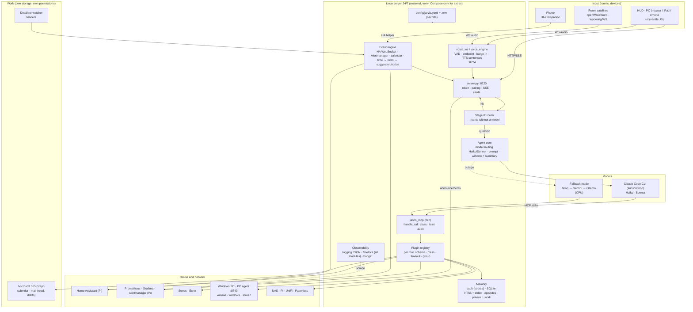

# Phase 0: Jarvis inventory

As of 2026-11-02, branch `feat/voice-engine` (commit `b85eb0d`). It complements `VOICE-ANALYSIS.md` (voice
pipeline), `PORTING.md` (Windows-specific places) and `SERVER-REBUILD.md` (server hardware and move). No code
changes in this phase.

## 1. Summary

In 19 days (103 commits since 2026-10-14) Jarvis has grown from a browser HUD into an assistant with
100 Python modules, 50 tools, 42 local intent handlers, 629 tests and a full-duplex voice engine. The basic
architecture holds up: router before the model, tools through MCP, permissions in code, memory as Markdown.
What is missing is less function than **operational maturity**: no structured logging, metrics only for the
voice engine, configuration spread over 333 environment variables and eight files, a tool server with 2000
lines, tests only ever run on Windows, and a commit with the real `.env` in the Git history. Phases 2 to 9 of
the build-out build on exactly these points.

| Figure | Value |
|---|---|
| Python modules | 100 in `jarvis/<group>/` + `server.py`, `paths.py` (34,979 lines) |
| Largest files | `jarvis_mcp.py` 2032, `server.py` 1278, `voice_engine.py` 1084, `router.py` 971 |
| HUD | 6831 lines of vanilla JS/CSS, of which `app.js` 2919 |
| Tools / groups | 50 tools in 32 groups (`jarvis_mcp.GROUPS`), all with an action class |
| Local handlers | 42 (`router.LOCAL_HANDLERS`), regex based |
| Tests | 48 files, 629 tests, 88 s; **3 failures + 1 error**, all tied to dates (see 5) |
| Background threads | 17 jobs through `background.loop`, 45 `Thread()` places, 40 locks |
| Configuration | 333 different environment variables, 7 JSON files, `voice.yaml`, `state.json` |
| Error handling | 283 `except Exception`, no `import logging`, 55 `print()` |
| Usage (779 runs in the log) | Haiku 292, Sonnet 209, Groq fallback 75, Ollama 21; router hits are logged as `local:*` without a model |

## 2. Structure and pipeline (current)

```
Browser HUD / iPad / iPhone              server.py (ThreadingHTTPServer, 127.0.0.1:8720, token per start)
  ui/app.js  ─── HTTP/NDJSON ───▶  /api/run ─▶ router.route ─▶ 42 local handlers (0 tokens)
  ui/voice-client.js ── WS :8724 ─▶ voice_ws ─▶ voice_engine (VAD, endpoint, barge-in) ─▶ /api/run
  SSE /api/events ◀── events.publish ◀── watchers, scheduler, homelab_watch, 17 background jobs
                                         └▶ router.llm_route ─▶ runtime.run_lean (claude -p, pool 3)
                                                                   └─ MCP stdio ─▶ jarvis_mcp.py (50 tools)
                                                                   └─ fallback_llm (Groq → Gemini → Ollama)
  Sonos ◀── sonos.py :8723 (LAN, clips)      Echo ◀── alexa_voice (HA notify)      HA ◀── _ha() REST
```

- **Request path**: `server.py` → `router.route` (local) → otherwise `llm_route` picks tool groups by regex
  and the model (Haiku for simple, Sonnet for "smart") → `commands.lean_system/lean_prefix` build the
  short prompt → `runtime.run_lean` starts `claude -p` with `--tools`, `--strict-mcp-config`, a pre-warmed
  process pool → every tool call goes through `jarvis_mcp.handle_call` (class, block list, taint, audit, size).
- **Memory**: Obsidian vault (81 notes, 540 KB) with a knowledge graph from keywords (`memory.search`
  = weighted word search, no vectors), conversation window of 4 turns in `state.json`, episodic memory by
  date (`episodes.py`), document search with SQLite FTS5 (`docsearch.py`), answer cache.
- **Proactive**: `events.py` (SSE, quiet hours 22–7, priorities normal/critical/alarm), `watchers.py` (30 s),
  `scheduler.py` (1 s), 17 jobs. Background jobs change nothing themselves, they file suggestions (`proposals.py`);
  two deliberate exceptions (bookings from trusted senders, deliveries).
- **Voice**: since 2026-11-02 a server engine (Silero VAD, Whisper partials, TTS sentence by sentence, barge-in
  150 ms, `config/voice.yaml`, `/metrics`). Details and measurements in `VOICE-ANALYSIS.md` and `docs/voice.md`.
- **Platform**: Windows parts started behind `hostos.py` (`PORTING.md` lists every place); PC control
  (`pc.py`, `desktop.py`, `vision.py`, `overlay.py`) is truly Windows; autostart through a `.bat` and Task Scheduler.

## 3. Dependencies

`requirements.txt` is deliberately short (standard library first). Not everything that is imported is listed:

| Package | Used by | In `requirements.txt` | Assessment |
|---|---|---|---|
| faster-whisper, ctranslate2, nvidia-cublas/cudnn | `voice.py`, `voice_stt.py` | yes | the GPU lines belong in their own file (server without a GPU) |
| piper-tts, onnxruntime, numpy, av | `tts_chain.py`, `voice_*` | only piper (rest transitive) | `onnxruntime` for Silero only gets installed by chance: add it explicitly |
| websockets, pyyaml | voice engine | yes | ok |
| edge-tts, garminconnect, pypdf | voice, Garmin, documents | yes | ok |
| **psutil** | `sysmon.py`, `infra.py`, `resources.py`, `desktop.py` | **no** | missing; a fresh installation on the server breaks |
| **pycaw, comtypes** | `pc.py`, `desktop.py` | **no** | Windows only: into `requirements-windows.txt` |
| openwakeword, sounddevice, speexdsp | optional | no (documented) | ok as extras |
| torch, chatterbox (`.venv-tts`) | GPU voice | `requirements-tts.txt` | stays separate |
| Node.js + `@anthropic-ai/claude-code` | brain | docs/installation.md | ok |

Proposal: `requirements.txt` (core, runs on a CPU anywhere), `requirements-gpu.txt`, `requirements-windows.txt`,
`requirements-tts.txt` (stays), `requirements-dev.txt` (coverage, ruff). No new runtime dependency needed.

## 4. Configuration

| Place | Content | Problem |
|---|---|---|
| `.env` (333 variables) | profile, models, voices, listening, wake word, mail, HA, Pi, NAS, Spotify, times, thresholds | secrets and behaviour mixed; read at module level on import (no reload, tests patch modules) |
| `config/home.json` | rooms, aliases, speakers, climate groups, absence, focus | good, but five `.bak-*` copies lie next to it |
| `config/homelab.json`, `energy_coach.json`, `routines.json`, `profiles.json`, `scripts.json`, `learned.json`, `devices.json` | one module each | seven files for the same job |
| `config/voice.yaml` | voice engine | the target format: commented, defaults in code |
| `state.json` (10 KB, 23 keys) | window, timers, jobs, layouts, wellbeing … | 44 `update_state(lambda …)` places, one file for everything |

Goal (cross-cutting part of the brief): **one** commented `config/jarvis.yaml` with a section per module and
defaults in code (like `voice_config.py`), `.env` only for secrets and host names. A mechanical rebuild,
but a big one; decision 2 below.

## 5. Code quality, tests, error handling

**Strengths.** A consistent style (one module per ability, simple functions, explanatory comments), clear
rules in `CLAUDE.md`, every file opens with `encoding="utf-8"`, paths through `pathlib`, isolated tests
(`tests/isolate.py`), the router with 691 lines of tests, the policy test enforces action classes.

**Technical debt**, by weight:

1. **`jarvis_mcp.py` (2032 lines) is tool server, dispatcher, HA client, Windows calls and
   prompt texts in one.** New tools need entries in four places (`TOOLS`, `GROUPS`,
   `policy.CLASSES`, `call_tool`). The HA client exists twice (`jarvis_mcp._ha`, `lists._ha`),
   `_has()` twice (`router`, `commands`). → plugin registry (phase 2).
2. **`router.py` (971 lines of regex)** grows linearly with every ability; 42 handlers in a fixed order,
   hits depend on the position. It works, but every new ability raises the risk of
   false hits; there is no measurement of the hit rate apart from `selfcheck.py`.
3. **No logging framework.** 0 modules import `logging`; errors are mostly swallowed silently in 283
   `except Exception` blocks (intended for robustness, but invisible). Structured traces exist only in
   `usage.jsonl`, `audit.jsonl`, `voice_state.jsonl`, `crash.log`. Error rates per module cannot be measured.
4. **`server.py` (1278 lines)** is hand-written HTTP: routing through `if path ==`, token, host and
   origin checks, SSE, NDJSON, supervisor, browser start. Solid, but every new route grows in there.
5. **Global state**: modules keep configuration and caches in module variables (`_LAST`, `_POOL`, `_CODE`),
   `state.json` is changed from 44 places through lambdas. Thread-safe through locks, but hard to test and
   impossible to split into several processes (Docker services) without untangling it first.
6. **Tests**: 629 green except four that have failed since the end of October because their fixtures carry
   fixed October dates and `mail_events.scan` discards the past (`test_mail_events` ×3, `test_calendar_check` ×1).
   Fix: inject `now` or create dates relative to today. No coverage measurement (no `coverage`);
   five modules without a direct test (`billing`, `local_tts_server`, `voice_stt`, `voice_vad`, `voice_ws`).
   The suite has never run on Linux (3 `skipIf` places for Windows).
7. **HUD**: `app.js` with 2919 lines carries voice, cards, layouts, fetching; 13 layouts in `tablet.js`,
   `stark.js`, `layouts*.js`. No tests, no build. For the old iPad (phase 8) vanilla JS is right,
   but the file needs splitting by responsibility.

## 6. Security

**Good.** Permissions in code instead of the prompt (`policy.py`: READ / LIMITED_WRITE / CONFIRM / BLOCKED,
unknown = CONFIRM), blocked HA domains (`lock`, `alarm_control_panel`, `camera`, …), climate only through
`climate_groups` and 5–30 °C, third-party content in «THIRD-PARTY DATA» markers with taint, one card per call,
token per start, host and origin checks, `LOCAL_ONLY` endpoints, device pairing with SHA-256 tokens, audit log
with `redact`, emergency stop, `pi_run` with a block list, Sonos clip server GET only for private addresses. That
already largely matches the "security levels" of phase 2.

**Findings.**

| # | Finding | Severity | Proposal |
|---|---|---|---|
| S1 | Commit `f9f794f` ("real .env with credentials") is in the history of all branches. `.env` is untracked today, but every clone carries the keys (voice APIs, HA token, mail passwords, Spotify …). | high (private repo softens it) | rotate the keys; `git filter-repo` before passing it on; the `clean` branch route stays mandatory |
| S2 | Private addresses as defaults and in docstrings (`jellyfin.py`, `paperless.py`, `unifi.py`, `sonos.py`: 10.0.0.x) | low | move them into `.env.example` |
| S3 | Trust through `client_address == 127.0.0.1` breaks on the server (already in `SERVER-REBUILD.md`) | medium (only phase 3) | `JARVIS_TRUSTED_IPS` + test |
| S4 | `.env` in plain text, Spotify token in `config/spotify_token.json`, Garmin tokens in `.garmin_tokens/` | low (local) | phase 3: file permissions 600, systemd `LoadCredential` or Docker secrets |
| S5 | No rate limit on `/api/run` for paired devices; `/api/pair` protects with 5 attempts per code | low | one counter per device |
| S6 | `privacy.py` drops everything work related (word list). Phase 7 (work assistant) contradicts that. | decision | see decision 1 |
| S7 | `background:vision` is, with 136 of 779 runs, the second most frequent model call (Sonnet). Every picture goes to Anthropic; the card applies per picture, but frequency and cost stand out. | medium | make the counter visible, budget (cross-cutting) |

## 7. Observability and costs

Present: `usage.jsonl` (tokens per route/model/group, 779 lines), `audit.jsonl`, `metrics_daily.json`,
`selfcheck.jsonl`, the token tile in the HUD, `/metrics` only for the voice engine, `billing.py` through the
Anthropic Cost API (does not apply to the subscription). Prometheus on the Pi does not reach the PC.

Missing for guiding principle 6 ("measurable"): requests per route and duration, errors per module, tool calls
per class, cards (asked/confirmed/declined), fallback switches, background job duration, tokens as a gauge,
costs in € (for Groq/Gemini/ElevenLabs/Fish: characters and calls), a budget warning. A dedicated
Grafana dashboard "Jarvis" depends on that.

## 8. Comparison with the phases of the brief

| Phase | Already there | Missing |
|---|---|---|
| 1 Voice | engine, VAD, endpointing, barge-in, metrics, tests | iPad/iPhone on the engine, satellite, Sonos AEC trial, RNNoise, tuning with a real mic |
| 2 Brain | router (stage 0), Haiku/Sonnet (stage 1/2), fallback mode (Groq/Gemini/Ollama), action classes, audit, personality, vault memory, episodes, learned rules | plugin system with schema/class/timeout per tool, long-term memory with search (SQLite/vectors), short-term summary, speaker recognition, separation of private and work |
| 3 Server | plan `SERVER-REBUILD.md`, `hostos.py`, pairing, Tailscale for the iPad | Linux run, PC agent, systemd/Compose, secrets, backups to the NAS, watchdog, self-monitoring |
| 4 HA & energy | rooms/aliases, climate groups, routines by voice (own ones, not HA automations), energy coach, electricity costs, budget, `metrics_query` (fixed PromQL) | creating HA automations by voice, PV forecast with a weather API, Noah master/slave SOC, natural-language PromQL generation with a chart |
| 5 Proactive | watchers, quiet hours, priorities, suggestions, morning briefing (Echo), phone push, welcome, severe weather, switching off by suggestion | event engine for HA events/alerts (polling every 30 s today), bundling, room output by presence, "only from 2 kW from now on" by voice |
| 6 Presence & multiroom | `speakers`, Sonos announcements, music follows by command, Echo | mmWave/CSI fusion, room knowledge, arbitration of several mics, volume by time of day per room |
| 7 Work | reading IMAP, drafts (card), CalDAV iCloud, research, plans, deadlines through reminders | Microsoft 365/Graph, deadline watcher for tenders, dictation → document, work memory (forbidden today) |
| 8 HUD | 13 layouts, iPad pairing, graph, cards, state display | camera streams, charts from Prometheus, splitting `app.js`, tests |
| 9 Network & IT | Pi/NAS/UniFi/Pi-hole status, new devices, situation report, updates with a card, `pi_run` | speaking alerts from Grafana/Prometheus, asking back about causes, restart after approval (partly possible through `pi_run`) |

## 9. Target architecture



What is different from today: (1) tools register themselves (one module = one plugin with schema,
class, timeout, group), `jarvis_mcp.py` becomes a thin dispatcher; (2) next to the vault the memory gets a
SQLite index with full text (vectors later) and a separate work area; (3) an event engine replaces the 30 s
polling with HA WebSocket and Alertmanager webhooks; (4) logging and metrics for all modules; (5) one YAML
configuration; (6) the server is Linux, the PC becomes an agent.

## 10. Prioritised rebuilds

**P0 – foundation (before phase 2, small steps, each testable on its own)**

Done on 2026-11-02 after approval: #1 to #4 (`jarvis/core/jarvis_log.py`, `jarvis/core/metrics.py`,
`requirements-*.txt`, `tests/test_metrics.py`; 637 tests green). #5 fails on the PC for lack of WSL, #6 is with
the user (list of the affected variables below under decision 5).

| # | Rebuild | Why first | Effort |
|---|---|---|---|
| 1 | Repair the four date-bound tests (inject `now`) | a green suite as the base | S |
| 2 | Declare and split dependencies (`psutil`, `onnxruntime`; `-gpu`, `-windows`, `-dev`) | server installation | S |
| 3 | `logging` (JSON lines to `logs/jarvis.log`, level per module) instead of `print` and silent `except` | errors visible | M |
| 4 | `/metrics` for the whole server: requests, duration, errors, tool calls per class, cards, fallback mode, tokens; generalise the export from `voice_metrics` (without a new dependency) | guiding principle 6, Grafana "Jarvis" | M |
| 5 | Run the test suite once under WSL/Ubuntu, mark Windows assumptions | prepare phase 3 | S–M |
| 6 | Rotate the keys from `f9f794f`; decision on the history (decision 5) | S1 | S |

**P1 – agent core (phase 2)**

| # | Rebuild | Effort |
|---|---|---|
| 7 | Plugin registry: `jarvis/tools/<name>.py` exports `TOOLS = [{name, schema, class, timeout, group}]`; `jarvis_mcp`, `policy.CLASSES`, `GROUPS` read from it; a test enforces completeness | L |
| 8 | Configuration in `config/jarvis.yaml` (behaviour) + `.env` (secrets), loading like `voice_config.py`, reload without restart | L (mechanical) |
| 9 | Memory: SQLite index (FTS5) over vault + episodes + conversation log; remembering/querying/correcting/deleting by voice as tools; vectors optionally later | M–L |
| 10 | Short term: a summary from N turns instead of a hard cut at 4 | S–M |
| 11 | Speaker recognition (optional, switchable): voice embedding on the server (e.g. ECAPA through onnxruntime), only as an additional condition for CONFIRM | M |
| 12 | Split `router.py` into handler modules per domain (same order, same tests) | M |

**P2 – server and operations (phase 3, the plan is in `SERVER-REBUILD.md`)**

PC agent, `JARVIS_TRUSTED_IPS`, `start-jarvis.sh` + `jarvis.service`, health check endpoint, watchdog,
backups to the NAS, secret file permissions, Tailscale, a week of parallel operation.

**P3 – abilities (phases 4–9)**

Event engine (HA WebSocket, Alertmanager webhook), HA automations by voice (draft → card →
REST `config/automation`), PV forecast, Noah SOC, PromQL from speech with a chart in the HUD, presence fusion,
satellites, M365 Graph, deadline watcher, splitting `app.js`.

## 11. Decisions that need your okay

1. **Work memory.** `privacy.py` throws away everything work related today; phase 7 needs the opposite.
   Recommendation: a separate store `vault-work/` + its own SQLite, its own tool group `work`, default
   **off**, only through explicitly approved services (M365 Graph), never mixed into reflection/suggestions/weekly
   review, never to Groq/Gemini (fallback mode only Claude or Ollama locally). The word list stays for the
   private store. Alternative: keep work out entirely and drop phase 7.
2. **Configuration in YAML** (`config/jarvis.yaml`, `.env` only secrets). Big, touches every module, but
   without a change in behaviour and possible step by step (module by module, env stays as a fallback).
   Recommendation: yes, in phase 2 together with the registry.
3. **Memory store.** Recommendation: vault Markdown stays the source (Obsidian, provenance, trash),
   SQLite FTS5 as the index (standard library, like `docsearch.py`). Vector search only when FTS5 measurably
   is not enough; then locally (Ollama embeddings or a small ONNX model), no cloud. Alternative: embeddings
   right away with `sqlite-vec` (one new dependency).
4. **Operation on the server: systemd + venv instead of Docker Compose** for Jarvis itself. Reasons: Claude CLI
   login (OAuth, browser), access to `models/`, vault sync, one process with threads today (splitting into
   services needs P1 first). Compose only for extras (Ollama, later a satellite bridge). The brief names
   Compose with separate services; that would be a second, later step once registry and configuration are separated.
5. **Git history with `.env`.** Affected and still unchanged on 2026-11-02: `ELEVENLABS_API_KEY`, `FISH_AUDIO_API_KEY`,
   `GARMIN_PASSWORD`, `HA_TOKEN`, `ICLOUD_APP_PASSWORD`, `JARVIS_COST_KEY`, `MAIL_PASSWORD`, `SYNOLOGY_PASSWORD`.
   Recommendation: rotate the keys (right away, regardless of the decision) and **do not** rewrite the
   history as long as the repo stays private; before passing it on, keep using the `clean` branch.
   Alternative: `git filter-repo` on all branches (all clones have to be made again).
6. **Microsoft 365.** Needs an app registration in the employer's tenant (admin consent for
   `Mail.Read`, `Calendars.Read`) or personal access. Please clarify whether the employer allows that;
   otherwise phase 7 only has IMAP/CalDAV or export.
7. **Speaker recognition** as a condition for confirmations: useful with room microphones, an additional
   source of errors ("not recognised" means the card is declined). Recommendation: build it, but off by
   default, only a hint instead of a block.

## 12. Risks

- **Pace.** 100 modules in 19 days; every phase adds more. Without P0 (logging, metrics, green
  suite, Linux run) troubleshooting grows faster than the function.
- **Claude limits.** 75 Groq and 21 Ollama runs in the log mean: the fallback mode steps in regularly. More
  background jobs with a model (vision 136×) make that worse. Budget and counters (P0 #4) before new model jobs.
- **One process.** Server, engine, 17 jobs and timers share one Python process. A hanging job or an
  exception in a thread is only visible in `crash.log` today. Bring watchdog and health check (P2) forward.
- **Server without a GPU.** Whisper `small` on the CPU ≈ 1.9 s per 7.5 s of audio (measured) against 0.24 s on
  the GPU; the goal "< 800 ms to the first word" only holds on the i7-8700 with Groq Whisper or an A2000.
- **Work and privacy.** Phase 7 without decision 1 breaks rules that apply today.
