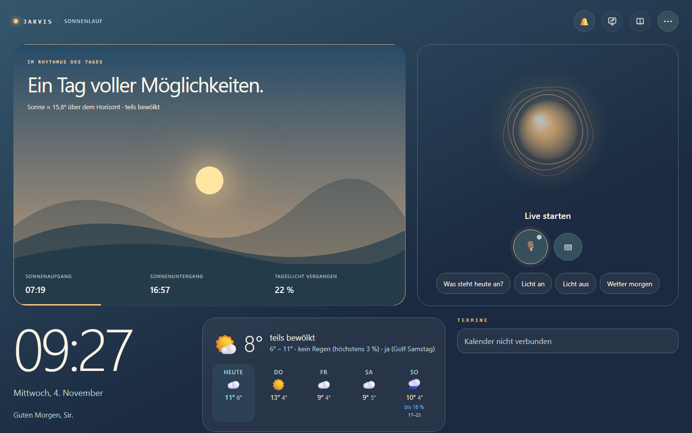
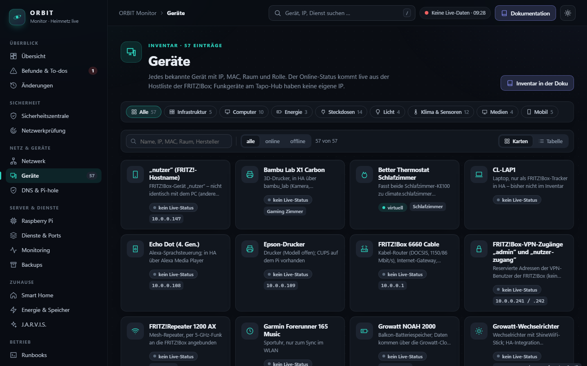
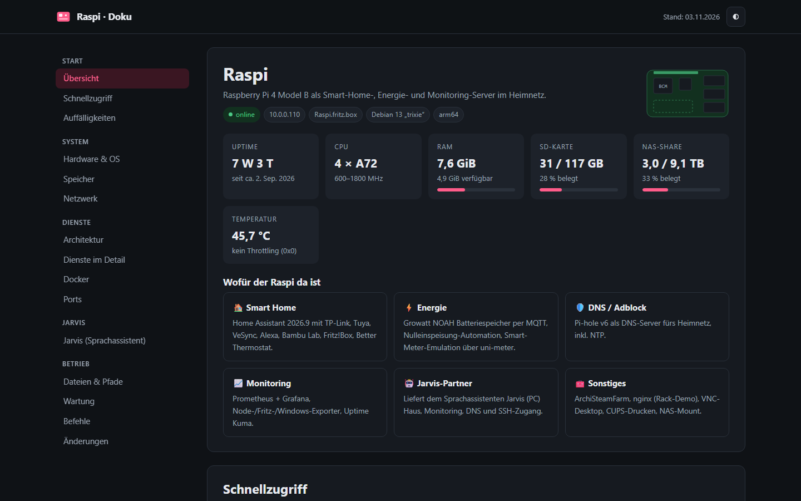
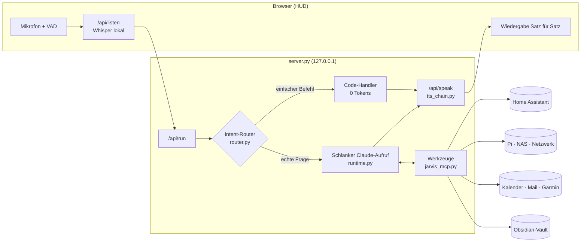

<div align="center">

# J.A.R.V.I.S.

**Persönlicher Sprachassistent mit Gedächtnis, Smart-Home-Steuerung und HUD — angetrieben von Claude Code**


-2ea44f)

</div>

---

JARVIS ist ein selbst gehosteter Sprachassistent im Stil des Iron-Man-Computers. Man spricht frei im Browser, er antwortet mit natürlicher Stimme, steuert das Smart Home, kennt Kalender, Postfach und Heimnetz, und er baut sich ein **dauerhaftes Gedächtnis** in einem Obsidian-Vault auf.

Das Sprachmodell ist die **Claude-Code-CLI** im Abo-Modus. Es gibt also keine API-Abrechnung pro Token. Damit das Kontingent lange reicht, beantwortet ein **lokaler Intent-Router** einfache Befehle komplett ohne LLM. Alles andere läuft als **schlanker, zustandsloser Aufruf** mit eigenem Kurz-Prompt und nur den Werkzeugen, die die Anfrage wirklich braucht.

## Screenshots

Alle Bilder stammen aus einer Instanz mit Beispielkonfiguration (`JARVIS_RUNTIME=mock`, nur die `*.example.json`) und aus den anonymisierten Kopien der Pi-Seiten unter `pi/`. Es sind keine persönlichen Daten darauf.

**HUD am PC** – Ansicht „Sonnenlauf“ mit Tagesverlauf, Wetter, Terminen und den Schnellbefehlen:



**ORBIT Monitor auf dem Raspberry Pi** (Port 8092) – Geräteinventar mit Live-Status aus der FRITZ!Box; das HUD verlinkt die Seite oben rechts:



**Pi-Dokumentation** (Port 8091) – Übersicht mit Hardware, Diensten und dem Abschnitt zu Jarvis:



## Inhalt

- [Screenshots](#screenshots)
- [Highlights](#highlights)
- [Was alles möglich ist](#was-alles-möglich-ist)
- [Architektur](#architektur)
- [Schnellstart](#schnellstart)
- [Konfiguration](#konfiguration)
- [Bedienung](#bedienung)
- [Sprachausgabe: Anbieter-Kette](#sprachausgabe-anbieter-kette)
- [Sprach-Engine: Zuhören, Unterbrechen, Weitersprechen](#sprach-engine-zuhören-unterbrechen-weitersprechen)
- [Notbetrieb: Ersatz-Kette](#notbetrieb-ersatz-kette)
- [Ressourcen, Kontext, Aufgaben und Gedächtnis](#ressourcen-kontext-aufgaben-und-gedächtnis)
- [Kontrolle, Persönlichkeit und Alltag](#kontrolle-persönlichkeit-und-alltag)
- [Lernfähige Module](#lernfähige-module)
- [Effizienz: Router und schlanker Modus](#effizienz-router-und-schlanker-modus)
- [Gedächtnis](#gedächtnis)
- [Unterwegs: iPhone und iPad](#unterwegs-iphone-und-ipad)
- [Sicherheitsmodell](#sicherheitsmodell)
- [Projektstruktur](#projektstruktur)
- [Entwicklung und Diagnose](#entwicklung-und-diagnose)
- [Roadmap](#roadmap)

---

## Highlights

| | |
|---|---|
| 🎙️ **Freihändig sprechen** | Live-Mikrofon mit Pausen- und Satzende-Erkennung, Push-to-Talk, Unterbrechen durch Reinreden: er hält an, hört zu und macht weiter, wenn nichts kommt. Optional mit Aktivierungswort („Jarvis …“ oder lokal per openWakeWord); ohne „Jarvis“ wird nichts bearbeitet oder protokolliert. |
| ⏰ **Timer, Wecker, Erinnerungen** | *„Timer 10 Minuten für die Nudeln“*, *„Weck mich morgen um halb sieben“*, *„Erinnere mich in 20 Minuten an die Wäsche“*, *„Mach das Licht in einer Stunde aus“*. Lokal, ohne Tokens, übersteht Neustarts. |
| 📣 **Meldet sich selbst** | Waschmaschine fertig, Termin in 15 Minuten bzw. „Zeit loszufahren“ (mit Fahrzeit), Paket kommt heute, Speicher voll, NAS-Problem, neues Gerät im WLAN. Mit Ruhezeiten. |
| 📦 **Unterwegs und Post** | *„Wann muss ich los?“* (Fahrzeit zum nächsten Termin über OpenStreetMap), *„Kommt heute ein Paket?“* (aus den Versandmails). Lokal, ohne Tokens. |
| 🖥️ **PC-Steuerung** | *„Lautstärke auf 30 Prozent“*, *„Ton aus“*, *„Öffne Spotify“*, *„Sperr den Bildschirm“*. Spotify wird leiser, solange Jarvis zuhört oder spricht, auf jedem Gerät des Kontos; nachts spricht er leiser. |
| 📉 **Wird sparsamer** | Merkt sich Formulierungen, die Claude einmal auflösen musste („Leselampe aus“), und schaltet sie danach selbst. Gleiche Fragen innerhalb von 5 Minuten kommen aus dem Zwischenspeicher. *„Verbrauchsbericht“* sagt, wie viel lokal lief. |
| 🗣️ **Aussprache** | NAS, Pi, kWh & Co. werden richtig gesprochen; eigene Wörter per *„Sprich Tuya als Tuja aus“*. |
| 🛒 **Listen und Routinen** | Einkaufs- und To-do-Liste per Sprache (Home Assistant oder Vault-Notiz). Routinen wie „Gute Nacht“: ein Satz, mehrere Aktionen, per Sprache angelegt. |
| 🛡️ **Kontrolliert und ehrlich** | Feste Regeln im Code statt im Prompt, Schutz vor fremden Anweisungen in Mails und Webseiten, Audit-Log, Not-Aus, prüfbare Herkunft jeder Erinnerung, ehrliche Rückmeldung beim Schalten. |
| 🎭 **Persönlichkeit** | Standard, Profi, Technisch, Locker per Zuruf; getippte Fragen ausführlich, gesprochene kurz. |
| 🪟 **Windows** | Fenster anordnen, Arbeitsbereiche, Dateien und Zwischenablage, Bildschirmtext per lokaler OCR, freigegebene Skripte. |
| 🎓 **Lernt dazu** | Bewertet seine Gespräche selbst, schlägt sonntags feste Regeln vor, macht einen Wochenrückblick mit Mustern aus Schlaf, Schritten, Stress und Golf, meldet Homelab-Ausfälle nur bei Relevanz und schlägt zweimal pro Woche eine neue Fähigkeit vor. Ohne Arbeitsthemen, Änderungen nur per Karte. |
| 🛟 **Notbetrieb** | Fällt Claude aus oder ist das Limit erreicht, übernimmt eine kostenlose Kette: Groq → Gemini → Ollama, mit denselben Werkzeugen und Bestätigungskarten. |
| 🧠 **Echtes Gedächtnis** | Notizen nach Themen, automatisches Gesprächsprotokoll, selbstständiges Merken und Vergessen (Ablaufdaten, Papierkorb). |
| ⚡ **Lokaler Intent-Router** | Licht, Steckdosen, Musik, Uhrzeit, Wetter, Energie- und Systemstatus ohne LLM, mit Antwort in Millisekunden. |
| 🪶 **Schlanke LLM-Aufrufe** | Eigener Prompt statt Claude-Code-Standard, Werkzeuge nach Bedarf, automatische Modellwahl (Haiku/Sonnet). In Messungen **über 25× weniger Tokens** als ein Standard-Aufruf. |
| 🔊 **Ausfallsichere Stimme** | Kette aus Cloud-, lokalen GPU- und Gratis-Stimmen. Erschöpfte Anbieter werden bis zum Reset übersprungen, ohne hörbaren Abbruch. |
| 🏠 **Smart Home** | Home Assistant: schalten, Zustände abfragen, Energie (Solar/Speicher), Raumklima, Luftqualität. Optional der volle HA-MCP-Server für Automationen und Verlauf. |
| 🛰️ **Heimnetz** | Status von Raspberry Pi und Synology-NAS, Geräteliste, Wächter für neue Geräte im WLAN. *„Lagebericht“* fasst Uptime Kuma, die Sicherheitszentrale auf dem Pi und den Energie-Kreislauf zusammen und meldet Ausfälle, dringende Sicherheitsbefunde und eine hängende Nulleinspeisung von selbst. |
| 📅 **Alltag** | Kalender (CalDAV/iCloud), Postfach (IMAP, nur lesen), Garmin-Gesundheitsdaten, Spotify, Websuche. |
| 🖥️ **HUD** | Dashboard mit Wetter- und Aktivitäts-Ampel, Haus, Gesundheit, Systeme, Post, 3D-Wissensgraph und Verbrauchsanzeige. |
| 🔐 **Kontrolliert** | Nur `localhost`, Bestätigungskarten für Systemeingriffe, geschützte Geräte, kein Selbstumbau zur Laufzeit. |

---

## Was alles möglich ist

Die Architektur trennt **Router** (Regeln), **Werkzeuge** (MCP-Server) und **Gedächtnis** (Markdown). Neue Fähigkeiten lassen sich deshalb meist mit wenigen Zeilen ergänzen.

**Im Alltag**
- *„Guten Morgen“* liefert ein Tagesbriefing mit Wetter, Terminen, Energie, fast leeren Batterien und neuen Mails.
- *„Kann ich heute noch eine Runde laufen / golfen?“* ergibt eine Ampel aus Wetter, Wind, Tageslicht und Arbeitszeit.
- *„Was steht morgen an?“* bzw. *„Trag mir Freitag um zehn den Zahnarzt ein“* (mit Bestätigung).
- *„Hab ich wichtige Mails?“* bringt eine Zusammenfassung ohne Newsletter.
- *„Merk dir, dass Anna am 3. Mai Geburtstag hat“* legt eine Notiz unter `Personen/Anna` an.
- *„Timer 8 Minuten für die Pizza“*, *„Wie lange noch?“*, *„Weck mich um 6:45“*, *„Schlummern“*, *„Wecker aus“*
- *„Erinnere mich morgen um 9 daran, Anna anzurufen“*, *„Welche Erinnerungen habe ich?“*
- *„Setz Milch und Eier auf die Einkaufsliste“*, *„Was steht auf der Einkaufsliste?“*, *„Streich die Milch“ … „von der Einkaufsliste“*
- *„Wenn ich Gute Nacht sage, mach alle Lichter aus und sag mir, wann der Wecker klingelt“* legt eine Routine an. Danach läuft *„Gute Nacht“* ohne LLM.

**Zuhause**
- *„Mach das Licht im Wohnzimmer auf 40 Prozent“*, *„Ist die Waschmaschine noch an?“*, *„Szene Kino“*
- *„Wie viel liefert die Solaranlage, und wie voll ist der Speicher?“*
- *„Was kostet mich der PC im Monat?“*, *„Wer zieht Standby-Strom?“*: Stromkosten aus den Zählern der Steckdosen (Preis `JARVIS_POWER_PRICE`); Standby misst der Energie-Coach über mehrere Tage.
- Verlässt du die Wohnung und es läuft noch Licht, Musik oder ein Gerät aus `config/home.json` → `away_check`, kommt eine Nachricht aufs Handy und ein Vorschlag „Ausschalten“, den du in Jarvis auf einer Karte bestätigst. Von selbst schaltet er nichts.
- Sonntags ab 18 Uhr: Wochenbericht fürs Heimnetz (Ausfälle, Sicherheitsbewertung, Internet-Abbrüche, Verbrauch und Sonnenstrom), gesprochen und als Notiz unter `Erinnerungen/Homelab`.
- *„Welche Sicherheitsbefunde sind offen?“*, *„Nimm den Echo-Befund für 30 Tage als Ausnahme“* (Karte), *„Starte eine Sicherheitsprüfung“*.
- Kommst du nach mindestens 20 Minuten heim: *„Willkommen zurück. Während du weg warst: …“* mit dem, was Jarvis in der Zeit gemeldet hat.
- Amtliche Warnungen des Deutschen Wetterdienstes (über Bright Sky) meldet er von selbst, ab „markant“; schwere auch nachts und aufs Handy. *„Gibt es Unwetterwarnungen?“*
- Gewohnheiten im Haus: Schaltest du ein Licht an mindestens 4 von 10 Tagen zur gleichen Zeit, schlägt Jarvis samstags eine Routine vor (*„Gute Nacht“*), angelegt erst nach der Karte. Ist ein Licht viel länger an als sonst, sagt er es einmal.
- *„Sag im Wohnzimmer: Essen ist fertig“* spricht über den Echo Dot, im Schlafzimmer über den Sonos (`config/home.json` → `speakers`).
- *„Mach die Musik vom Schlafzimmer im Wohnzimmer an“*, *„Musik ins Schlafzimmer“* schiebt die Spotify-Wiedergabe auf den Lautsprecher des Raums (Spotify Connect, läuft dort weiter; braucht das Spotify-Login). Welcher Spotify-Name zum Raum gehört, steht in `config/home.json` → `speakers` → `spotify`; fehlt er, gilt der Raumname (Sonos und Alexa-Gruppen heißen in Spotify meist wie der Raum). Ohne Raum geht auch ein Gerätename, etwa *„Musik auf den PC“*.
- *„Öffne Netflix auf dem Fernseher“*, *„Fernseher pause/lauter/leiser“* über Alexa am Fire TV — nur feste Befehle und App-Namen (`config/home.json` → `tv`).
- Antworten aus dem Echo: am HUD-Knopf 🔈 „Echo Wohnzimmer“ wählen — was du am PC tippst oder sagst, spricht dann Alexa (mit Alexas Stimme, Satz für Satz; kostet keine Sprach-Guthaben).
- Morgen-Briefing: geht morgens im Wohnzimmer das erste Mal etwas an (LED, Fernseher, oder du sprichst mit dem Echo), sagt der Echo einmal Wetter, Warnungen, Termine, Sonnen-Tipp, Meldungen der Nacht und ungelesene Mails (`config/home.json` → `morning_briefing`).
- Rückfragen: nach *„Licht im Wohnzimmer an“* reichen zwei Minuten lang *„heller“*, *„dunkler“*, *„auf 30 Prozent“*, *„wieder aus“*; nach *„TV an“* auch *„und im Schlafzimmer auch“*.
- *„Energie-Tipp“*, *„Wann soll ich die Spülmaschine anmachen?“*: Der Energie-Coach sagt aus Akkustand, Hausverbrauch und Sonnenvorhersage, wann heute oder morgen Strom übrig ist und was dann laufen sollte. Ist der Akku voll und Überschuss da, meldet er sich einmal am Tag von selbst. Er schaltet nie selbst. Steckdosen, die beim ersten Blick aus waren (z. B. der Boiler), gelten als selten genutzt und werden nie vorgeschlagen; *„Den Boiler nutze ich oft“* ändert das.
- *„Welche Batterien muss ich tauschen?“*
- Mit dem HA-MCP-Server: *„Warum ist es im Schlafzimmer so kalt? Zeig mir den Verlauf.“*

**Technik und Netzwerk**
- *„Wie geht es dem Pi / dem NAS?“* liefert Temperatur, Speicher und Laufzeit, außerdem den Plattenstatus mit Warnung ab 85 %.
- *„Ist ein unbekanntes Gerät im WLAN?“* Neue Geräte meldet der Wächter von selbst.
- *„Starte die Container auf dem Pi neu“* (Werkzeug `pi_run`: ein Befehl per SSH, immer mit Bestätigungskarte; offensichtlich zerstörerische Befehle lehnt es ab).
- *„Lagebericht“*, *„Läuft alles?“*, *„Wie ist die Sicherheitslage?“*, *„Läuft die Nulleinspeisung?“* liefern lokal und ohne Tokens den Stand aus Uptime Kuma (Statusseite `jarvis`), der ORBIT-Sicherheitszentrale und Home Assistant (`config/homelab.json` → `energy`).

**Smarter im Alltag** (seit Oktober 2026)
- *„Was habe ich dich letzte Woche zum Drucker gefragt?“*, *„Worüber haben wir gestern gesprochen?“* beantwortet der Router aus dem Gesprächsprotokoll (0 Tokens). *„Wie war mein Schlaf, als ich das letzte Mal krank war?“* bekommt das Werkzeug `memory_timeline`: je Tag Gespräche, Garmin, Meldungen, Ausfälle und Speicherstände, nach Datum verknüpft (`episodes.py`).
- **Deine Gewohnheiten:** Fragst du an mindestens vier Tagen zur gleichen Zeit dasselbe (*„Wann muss ich los?“* dienstags um 7:40), schlägt Jarvis samstags vor, es dir von selbst zu sagen, oder, wenn das Modell antworten muss, die Antwort drei Minuten vorher in den Zwischenspeicher zu holen, damit sie sofort und ohne Tokens kommt. Erst die Karte richtet es ein. *„Welche Gewohnheiten kennst du?“*, *„Vergiss die Gewohnheit …“* (`user_habits.py`).
- **Garmin als Auslöser:** Schlaf-Score unter 60, Stress ab 50 oder Body Battery unter 30 am Morgen machen den Vormittag „schonend“: kurzes, ruhiges Briefing, kein Sarkasmus, Vorschläge und Energie-Tipps nur gezeigt statt gesprochen, Stimme etwas leiser. Abends ab 21 Uhr bei Body Battery unter 25 einmal der Hinweis auf einen frühen Abend, mit dem Auslöser der Gute-Nacht-Routine. *„Wie geht es mir heute?“* (`wellbeing.py`).
- **Vor dem Losfahren:** Hat ein Termin einen Ort, meldet Jarvis 30 Minuten vor der Losfahrzeit, was zu Hause noch läuft (wie beim Verlassen) und welche Thermostate er auf die Abwesenheitstemperatur stellen würde (`config/home.json` → `departure`; `climate_away: 0` schaltet sie stattdessen aus). Der Vorschlag liegt dann schon bereit: *„ausschalten“* genügt, dazu die Karte, oder der Ja-Knopf auf dem Handy (`departure.py`).
- **Strombudget:** `JARVIS_POWER_BUDGET_EUR` (oder `budget_eur` in `config/energy_coach.json`): *„Liege ich im Budget?“*, und ab dem fünften Tag des Monats einmal am Tag ab 18 Uhr die Meldung, wenn die Hochrechnung drüber liegt, mit dem größten Verursacher.
- **Wartungskalender:** Zertifikate, die bald ablaufen, Docker-Images auf dem Pi, die zu alt sind, das Alter des letzten NAS-Backups, Platten, die nicht „normal“ sind (`config/homelab.json` → `maintenance`). *„Was steht im Wartungskalender?“*, *„Wann läuft das Zertifikat ab?“*, täglich eine Meldung je fälligem Punkt (`maintenance.py`).
- **Paperless-ngx:** *„Was zahle ich für die Haftpflicht?“*, *„Wann läuft der Handyvertrag?“*: Volltextsuche in der gescannten Post, Dokumente lesen (`PAPERLESS_URL`, `PAPERLESS_TOKEN`). Fremde Inhalte, nur lesend.
- **UniFi:** *„Wer ist gerade im WLAN?“*, *„Laufen alle Access Points?“* (`UNIFI_URL` mit API-Schlüssel oder Benutzer; `unifi.py`).
- **Jellyfin:** *„Was habe ich zuletzt geschaut?“*, *„Serie auf dem Fernseher weiterschauen“*, *„Such den Film Heat“*; Abspielen auf jedem Gerät mit Jellyfin-App (`JELLYFIN_URL`, `JELLYFIN_API_KEY`, `JELLYFIN_USER`, `JELLYFIN_TV`).
- **Stimme nach Tageszeit:** Ab 21 Uhr spricht er leiser und etwas langsamer, in den Ruhezeiten flüstert er (Stimmen mit Regie-Tags bekommen `[whispers]`), und das Modell antwortet dann in höchstens zwei Sätzen. *„Flüstermodus an“* / *„Sprich wieder normal“* schalten von Hand bis zum Morgen (`daytime.py`).
- **Rückfrage mit Gedächtnis:** *„Mach Wohnzimmer an“* bei einer Lampe und einer Steckdose: Jarvis fragt einmal *„Meinen Sie die Lampe oder die Steckdose?“*, führt die Antwort aus und merkt sie sich für diese Formulierung; danach fragt er nie wieder und braucht kein Modell (`learning.py` → `choices`, zu sehen unter *„Was hast du gelernt?“*).
- **Handy als Karte:** Vorschläge beim Verlassen und vor dem Losfahren kommen mit Ja/Nein-Knöpfen aufs Handy (Home-Assistant-App). Die Antwort läuft über einen Helfer in Home Assistant zurück und zählt wie die Karte; siehe [Handy](#handy-ja-und-nein-von-unterwegs) (`phone_actions.py`).
- **Fokus-Sitzungen:** *„Fokus 45 Minuten“*: Meldungen werden gesammelt statt gesprochen (Wecker klingeln), die Fokus-Playlist startet (`config/home.json` → `focus`), nach zehn Minuten in YouTube, Netflix oder Reddit kommt einmal ein Hinweis, am Ende die Zusammenfassung mit dem, was inzwischen anlag. *„Fokus beenden“*, *„Wie lange noch Fokus?“* (`focus.py`).
- **Selbstkontrolle:** Stellst du eine Frage innerhalb von 25 Sekunden umformuliert noch einmal, zählt das als Fehlschlag der ersten Antwort, samt dem Handler oder Modell, das sie gab. Die Lernschleife sieht diese Stellen, *„Wie gut warst du diese Woche?“* nennt sie (`selfcheck.py`).
- **Token-Kachel:** Im Raum-Display zeigt die Kachel „Tokens“ die Woche, den Anteil lokal erledigter Anfragen und den Trend zur Vorwoche; das Blatt listet die teuersten wiederholten Fragen, also die Kandidaten für den Router.
- **Routinen-Vorschau:** *„Was passiert, wenn ich Gute Nacht sage?“*, *„Was macht die Routine Feierabend?“* zählt die Schritte auf, ohne etwas zu schalten.

**Erweiterungsideen** (siehe [Roadmap](#roadmap))
- Kamera- oder Bildschirm-Kontext auf Anfrage
- Raum-Mikrofone (ESP32/Satelliten), mehrere Nutzerprofile per Sprecher-Erkennung
- Weitere Werkzeuggruppen: Proxmox, Fahrzeug-APIs, Fitness-Plattformen
- Eigene Stimme per Sprachprobe (lokal), Mehrsprachigkeit

---

## Architektur



| Komponente | Aufgabe |
|---|---|
| `server.py` | HTTP-Server (nur `127.0.0.1`), HUD, API-Endpunkte, Bestätigungskarten, Verbrauchsprotokoll, Selbst-Neustart bei Codeänderungen |
| `router.py` | Intent-Router: lokale Handler, Wahl der Werkzeuggruppen und des Modells |
| `runtime.py` | Startet `claude -p` schlank (`--system-prompt`, `--tools`, `--strict-mcp-config`, `--setting-sources ""`, `--no-session-persistence`, `--effort`) mit vorgewärmtem Prozess-Pool |
| `commands.py` | Prompts, Gesprächsfenster, Zustandsdatei, Slash-Befehle |
| `jarvis_mcp.py` | MCP-Server mit allen Werkzeugen in Gruppen, Bestätigungs-Schranke, Ergebnis-Obergrenze |
| `memory.py` | Vault → Wissensgraph, Kern-Erinnerungen, Protokoll, Aufräumen |
| `voice.py` · `tts_chain.py` | Spracherkennung und Sprachausgabe-Kette mit Adaptern |
| `local_tts_server.py` | Lokale GPU-Stimme (Chatterbox Multilingual) in eigener Umgebung |
| `briefing.py` · `dashboard.py` | Tagesbriefing, Netzwerk-Wächter, HUD-Daten |
| `icloud_calendar.py` · `billing.py` | CalDAV-Kalender, API-Guthaben (Cost API) |
| `jarvis_profile.py` | Profil und Geräte-Zuordnung aus `.env` und `config/home.json` |
| `scheduler.py` | Timer, Wecker, Erinnerungen und geplante Befehle: deutsche Zeitangaben lesen, klingeln lassen |
| `lists.py` · `routines.py` | Einkaufs-/To-do-Liste (HA-To-do oder Vault-Notiz), Routinen aus `config/routines.json` |
| `events.py` · `watchers.py` | Push-Kanal zum HUD (Server-Sent Events, Ruhezeiten) und die Regeln für Meldungen von selbst |
| `wakeword.py` | Aktivierungswort: Text-Erkennung oder openWakeWord am Mikrofon des PCs |
| `voice_engine.py` · `voice_ws.py` | Full-Duplex-Sprach-Engine: Zustandsmaschine, Silero VAD, adaptives Satzende, Barge-in, Fortsetzen; WebSocket für Browser und Satelliten (`config/voice.yaml`) |
| `fallback_llm.py` | Notbetrieb: Ersatz-Kette Groq → Gemini → Ollama mit Jarvis-Werkzeugen |
| `learning.py` · `answer_cache.py` | Gelernte Formulierungen (`config/learned.json`), Verbrauchsbericht, Antwort-Zwischenspeicher |
| `commute.py` · `parcels.py` | Fahrzeit zu Terminen (Nominatim + OSRM), Paketstatus aus Versandmails |
| `pc.py` · `pronounce.py` | Lautstärke, Apps, Bildschirmsperre, Spotify-Ducking (pycaw); Aussprache-Lexikon |
| `spotify.py` | Spotify-Web-API: Pause beim Aktivierungswort, danach weiter; play/pause/next auf jedem Gerät |
| `ui/` | HUD (Vanilla JS, 3D-Wissensgraph ohne Abhängigkeiten) |

---

## Schnellstart

**Voraussetzungen:** Windows 11 · Python 3.12 · Node.js · ein Claude-Abo. Optional: NVIDIA-GPU (CUDA 12.8) für Whisper `large-v3-turbo` und die lokale Stimme.

```powershell
# 1  Claude Code installieren und anmelden (Abo, kein API-Key)
npm.cmd install -g @anthropic-ai/claude-code
claude auth login

# 2  Python-Umgebung
py -3.12 -m venv .venv
.venv\Scripts\python.exe -m pip install -r requirements.txt
# mit NVIDIA-GPU zusätzlich: -r requirements-gpu.txt · auf dem Windows-PC: -r requirements-windows.txt

# 3  Konfiguration
copy .env.example .env                      # Werte eintragen
copy config\home.example.json config\home.json   # HA-Entity-IDs eintragen (optional)
mkdir vault\Erinnerungen

# 4  Start
start-jarvis.bat
```

**Mit dem PC starten (optional):** eine Verknüpfung auf `start-jarvis.bat` im Autostart-Ordner (`shell:startup`, Arbeitsordner das Repo, Fenster minimiert) startet Jarvis beim Anmelden. Abschalten im Task-Manager unter „Autostart-Apps“ oder die Verknüpfung löschen.

**Lokale Stimmen (optional)**

```powershell
# Piper (CPU, sofort einsatzbereit)
mkdir models\piper
curl -L -o models\piper\de_DE-thorsten-high.onnx      https://huggingface.co/rhasspy/piper-voices/resolve/v1.0.0/de/de_DE/thorsten/high/de_DE-thorsten-high.onnx
curl -L -o models\piper\de_DE-thorsten-high.onnx.json https://huggingface.co/rhasspy/piper-voices/resolve/v1.0.0/de/de_DE/thorsten/high/de_DE-thorsten-high.onnx.json

# Chatterbox Multilingual (GPU, ~5 GB) — Details in requirements-tts.txt
py -3.12 -m venv .venv-tts
.venv-tts\Scripts\python.exe -m pip install torch torchaudio --index-url https://download.pytorch.org/whl/cu128
.venv-tts\Scripts\python.exe -m pip install --no-deps chatterbox-tts
.venv-tts\Scripts\python.exe -m pip install -r requirements-tts.txt
# Sprachprobe (~10 s, eigene Rechte): models\voice\reference.wav
```

Der Server startet die GPU-Stimme automatisch, sobald `.venv-tts` existiert.

---

## Konfiguration

Alle Einstellungen stehen kommentiert in [`.env.example`](.env.example). Persönliche Daten gehören ausschließlich in `.env` und `config/home.json`, beide sind in `.gitignore`.

| Bereich | Variablen | Zweck |
|---|---|---|
| Profil | `JARVIS_USER_NAME`, `JARVIS_PLACE`, `JARVIS_WEATHER_LAT/LON`, `JARVIS_TIMEZONE`, `JARVIS_BROWSER` | Anrede, Ort, Browser |
| Gehirn | `JARVIS_LEAN`, `JARVIS_LOCAL_ROUTER`, `JARVIS_MODEL_SIMPLE/SMART`, `JARVIS_EFFORT`, `JARVIS_MAX_OUTPUT_TOKENS`, `JARVIS_HISTORY_TURNS` | Router, Modellwahl, Kontextgröße |
| Stimme | `TTS_CHAIN`, `TTS_ANNOUNCE_SWITCH`, `FISH_AUDIO_*`, `ELEVENLABS_*`, `AZURE_*`, `GOOGLE_TTS_*`, `EDGE_*`, `LOCAL_TTS_URL` | Anbieter-Reihenfolge und Zugänge |
| Hören | `JARVIS_STT`, `WHISPER_LOCAL_*` | Spracherkennung |
| Aktivierungswort | `JARVIS_WAKE` (`off`/`text`/`oww`), `JARVIS_WAKE_*`, `JARVIS_FOLLOWUP_S` | „Jarvis …“ statt Dauer-Mikrofon. Ohne „Jarvis“ wird nichts bearbeitet oder protokolliert; `JARVIS_FOLLOWUP_S` > 0 erlaubt kurz Folgefragen ohne „Jarvis“ (Standard: aus) |
| Von selbst melden | `JARVIS_PROACTIVE`, `JARVIS_QUIET_HOURS`, `JARVIS_EVENT_LEAD_MIN`, `JARVIS_STORAGE_FULL` | Meldungen und Ruhezeiten (Wecker klingeln immer) |
| Listen | `JARVIS_SHOPPING_LIST`, `JARVIS_TODO_LIST` | HA-To-do-Entity, leer = Notiz unter `vault/Erinnerungen/Listen/` |
| Notbetrieb | `JARVIS_FALLBACK` (`groq,gemini,ollama`), `GROQ_API_KEY`, `GROQ_MODEL`, `GEMINI_API_KEY`, `GEMINI_MODEL`, `OLLAMA_URL`, `OLLAMA_MODEL`, `JARVIS_FALLBACK_PRIVATE` | Ersatz-Kette, wenn Claude ausfällt; siehe [Notbetrieb](#notbetrieb-ersatz-kette) |
| Sparen | `JARVIS_CACHE_S` (Standard 300, 0 = aus) | Gleiche Lese-Fragen so lange aus dem Zwischenspeicher |
| Pendeln | `JARVIS_HOME_LAT/LON` (sonst Wetter-Koordinaten), `JARVIS_TRAFFIC_FACTOR` (1.25), `JARVIS_COMMUTE_BUFFER_MIN` (5), `JARVIS_LEAVE_WARN_MIN` (5) | Startpunkt, Verkehrszuschlag, Puffer, Vorwarnung |
| PC und Lautstärke | `JARVIS_DUCK` (0.3, 0 = aus), `JARVIS_DUCK_APPS` (spotify.exe), `JARVIS_NIGHT_VOLUME` (0.5) | Musik leiser beim Sprechen, Stimme in den Ruhezeiten; eigene Apps in `config/apps.json` |
| Spotify | `JARVIS_SPOTIFY_CLIENT_ID`, `JARVIS_SPOTIFY_HOLD` (1), `JARVIS_SPOTIFY_HOLD_MAX_S` (120), `JARVIS_SPOTIFY_HOLD_MODE` (leise), `JARVIS_SPOTIFY_QUIET_FACTOR` (0.3), `JARVIS_SPOTIFY_QUIET_PCT` (20) | Bei „Jarvis“ und bei jeder Ansage, auch wenn er sich von selbst meldet, geht die Musik auf dem Gerät des Kontos, das gerade spielt (auch Handy an der Anlage), auf ein Drittel ihrer Lautstärke, höchstens 20 %, und kommt danach auf die alte Lautstärke zurück; hat man sie zwischendurch von Hand verstellt, bleibt sie so. Mit `JARVIS_SPOTIFY_HOLD_MODE=pause` hält sie stattdessen an, ebenso auf Geräten, deren Lautstärke Spotify nicht setzen kann; Musikbefehle gehen übers Konto. Einmalig App auf developer.spotify.com (Redirect URI `http://127.0.0.1:8722/callback`), dann `scripts\spotify_login.py` |
| Aussprache | `config/aussprache.json` | Eigene Einträge, entsteht per Sprache |
| Dienste | `ICLOUD_*`, `MAIL_*`, `HA_*`, `SYNOLOGY_*`, `JARVIS_PI_*`, `GARMIN_*`, `PAPERLESS_*`, `UNIFI_*`, `JELLYFIN_*` | Integrationen; jede ist optional |
| Smarter | `JARVIS_USER_HABITS` (1), `JARVIS_WELLBEING` (1), `JARVIS_WB_SLEEP_LOW/STRESS_HIGH/BATTERY_LOW` (60/50/30), `JARVIS_WB_BATTERY_EVENING` (25), `JARVIS_DEPARTURE_PREP_MIN` (30), `JARVIS_POWER_BUDGET_EUR` (0 = aus), `JARVIS_MAINTENANCE` (1), `JARVIS_WHISPER_HOURS` (= Ruhezeiten), `JARVIS_LATE_FROM` (21), `JARVIS_LATE_VOLUME` (0.8), `JARVIS_FOCUS_WARN_MIN` (10), `JARVIS_FOCUS_DISTRACT`, `JARVIS_SELFCHECK_SECONDS` (25), `JARVIS_PHONE_ACTION_ENTITY` | Gewohnheiten, Garmin-Auslöser, Losfahren, Budget, Wartung, Stimme nach Tageszeit, Fokus, Selbstkontrolle, Handy-Rückkanal |
| Geräte | `config/home.json` | Zuordnung der Dashboard-Felder (Solar, Speicher, Räume, Router, Luft) zu Home-Assistant-Entities, dazu `appliances` (Leistungsmesser für „… ist fertig“) und `device_aliases` (weitere Wörter je Gerät, z. B. „Wohnzimmer“ und „Lampe“ für ein Licht, das in Home Assistant nur „LED“ heißt; greift ohne Neustart nach spätestens 5 Minuten) |
| Routinen | `config/routines.json` | Entsteht per Sprache; Format in `config/routines.example.json` |

> **Wichtig:** `ANTHROPIC_API_KEY` nie setzen. Claude Code würde sonst per API statt über das Abo abrechnen. Der Server entfernt die Variable vorsorglich aus der Umgebung der Kindprozesse.

---

## Bedienung

| Aktion | So geht’s |
|---|---|
| Live-Modus | Klick auf **Live**. Der Button zeigt den Zustand: *Hört zu*, *Höre dich*, *Denkt*, *Spricht*, *Mikrofon blockiert*. Mit Aktivierungswort: *Sag „Jarvis“*, nach „Jarvis“ bzw. nach jeder Antwort kurz *Ich höre …*. |
| Timer und Wecker | Countdown oben in der Leiste. Es klingelt, dann spricht er. Reinreden, `Esc` oder **Stop** beendet das Klingeln, *„Schlummern“* gibt 9 Minuten. |
| Meldungen | Erscheinen mit gelbem Rand im Gespräch und werden vorgelesen; in den Ruhezeiten nur angezeigt. |
| Push-to-Talk | Live-Button halten, sprechen, loslassen. |
| Unterbrechen | Einfach reinreden: Nach 60 ms Stimme wird er leiser, nach 150 ms hält er an und hört zu (Sonos: ≈ 1 s wegen dessen Puffer). Sagst du etwas, ist das die neue Frage; „Stopp“ beendet die Antwort. Sagst du nichts, nur „mhm“, oder hört das Mikro bloß ihn selbst aus dem Sonos, macht er nach 1,5 s mit dem angefangenen Satz weiter. Läuft Fernsehen oder Sport, zählt eine neue Frage nur mit „Jarvis“. Außerdem `Esc` bzw. Leertaste. Details: [Sprach-Engine](#sprach-engine-zuhören-unterbrechen-weitersprechen) |
| Mini-Fenster | Verlässt du den Jarvis-Tab, steht unten rechts auf dem Desktop ein kleiner Roboter-Panda über allen Fenstern, darunter eine Leiste mit „Spricht / Hört zu / Denkt nach“, der letzten Zeile, **■ Stopp** und **🎙 Mikro**. Der Panda spielt den Zustand vor (Mund beim Sprechen, Ohren hoch beim Zuhören, schräger Kopf beim Nachdenken, schläft bei Pause) und zieht ein Gesicht passend zur Antwort: aus dem Ton-Tag (`[dry]` → kritisch, `[amused]` → fröhlich, `[sighs]` → besorgt …) oder aus Wörtern wie „leider“, „Fehler“, „erledigt“. Er folgt der Maus mit den Augen, freut sich über einen Klick (fünf schnelle Klicks: Pirouette) und lässt sich per Ziehen verschieben. Zurück im Tab verschwindet er. Ein eigenes Fenster des Servers, kein Browser-Bild-im-Bild; `JARVIS_OVERLAY=0` schaltet es ab, `JARVIS_OVERLAY_STYLE=karte` bringt die alte Karte mit Orb zurück |
| 3D-Drucker | *„Wie weit ist der Drucker?“*, *„Welches Filament ist im AMS?“*, *„Wie heiß ist die Düse?“* — lokal aus Home Assistant (Integration [ha-bambulab](https://github.com/greghesp/ha-bambulab)), 0 Tokens. Jarvis sagt von selbst Bescheid, wenn ein Druck fertig ist, fehlschlägt, aus einem Grund anhält (Filament leer, erste Schicht, Filamentsalat …) oder der Drucker einen Fehler meldet. Er liest nur, steuern tut er den Drucker nie. `JARVIS_PRINTER=0` schaltet es ab |
| Updates | *„Gibt es Updates?“* prüft FRITZ!Box und andere Home-Assistant-Geräte, NAS (DSM und Pakete) und Pi (Pakete, Pi-hole). *„Installier das Pi-hole-Update“* — jedes Gerät nur mit Freigabe-Karte, nie automatisch. DSM selbst und Docker bleiben Handarbeit, der Fire TV aktualisiert sich im Standby selbst |
| Homelab | *„Wie schnell ist das Internet?“*, *„Wie viel hat der Pi-hole blockiert?“*, *„Wann war die CPU heute am höchsten?“* — Live-Werte und Verläufe aus Prometheus (FRITZ!Box, Pi, PC, Home Assistant; dieselben Daten wie in Grafana) und aus Pi-hole. Kachel „Homelab“ im HUD. Pi-hole braucht ein App-Passwort in `PIHOLE_PASSWORD`; `PROMETHEUS_URL` und `PIHOLE_URL` nur, wenn nicht auf dem Pi |
| Live-Leiste | Unter der Kopfzeile: CPU, GPU, VRAM, GPU-Temperatur, RAM und Netzwerk ↓/↑ **dieses PCs**, alle 2 Sekunden, mit Verlauf der letzten 2 Minuten. Ohne NVIDIA-Karte fallen die GPU-Felder weg |
| Neustart | **⟳ Neustart** oben im HUD startet den Server neu (mit Rückfrage, nur am PC) und liest dabei die `.env` neu — z. B. nach einem neuen Passwort |
| Nachschlagen | Weiß Jarvis etwas nicht und steht es weder in den Notizen noch in seinen Werkzeugen, sucht er im Web, statt „weiß ich nicht“ zu sagen. Private Daten kommen nie in die Suche. `JARVIS_WEB_ALWAYS=0` beschränkt das auf Sätze mit „such“, „google“, „finde heraus“ … |
| Pakete | Versandmails aller Konten (Shop, Paketdienst, Sendungsnummer) werden zu einem **ganztägigen Termin** „📦 Shop · DHL“ am erwarteten Liefertag. Den Tag liefern am besten die **Ankündigungsmails der Paketdienste** — kostenlos, ohne Fremddienst: Mailadresse einmal bei DHL (Post & DHL App, Paketankündigung), DPD (myDPD/Predict), Hermes, GLS (FlexDelivery) und UPS (My Choice) hinterlegen. Jarvis versteht „morgen“, „Montag, 26. Oktober“, „am Mittwoch“ und Zeitfenster („zwischen 10:15 und 11:15 Uhr“) und ordnet die Ankündigung über die Sendungsnummer der Bestellung zu. **Amazon** geht ohne Anmeldung bei Amazon: die Mails „Bestellt“ (mit Liefertag), „In Zustellung“ (mit Zeitfenster), „Versuchte Zustellung“ und „Geliefert“ werden über die Bestellnummer zu einer Sendung „📦 Amazon: Artikel“; Prime Video und Konto-Mails bleiben draußen. Optional: `TRACK17_API_KEY` (17TRACK, alle Dienste) oder `DHL_API_KEY`. Steht am Liefertag schon ein ähnlicher Eintrag im Kalender (etwa selbst eingetragen), legt er keinen zweiten an. Verschiebt sich der Tag, wandert der Termin mit; nach der Zustellung heißt er „✓ zugestellt“. Morgens am Liefertag und bei „abholbereit“ sagt Jarvis Bescheid. *„Wo bleibt mein Paket?“* · *„Termine rückgängig“*. Sofortlieferdienste (Uber Eats, Flink, …) bleiben draußen |
| Mehrere Postfächer | Weitere Konten als `MAIL2_IMAP_HOST`, `MAIL2_USER`, `MAIL2_PASSWORD`, `MAIL2_NAME` (bis `MAIL9_`). Posteingang, Zähler, Briefing, Termine und Pakete gelten für alle; ein Konto, das gerade nicht antwortet, hält die anderen nicht auf. Gelesen werden nur Mails der letzten **24 Stunden** (`JARVIS_MAIL_LOOKBACK_HOURS`) — Posteingang, Termine und Pakete schauen nie weiter zurück |
| Termine aus Mails | *„Trag mir die Buchungen aus meinen Mails ein“* — Jarvis liest die Kalenderanhänge der Bestätigungen der letzten 24 Stunden (PC CADDIE, golftimer, Golf House …), lässt Vergangenes, Storniertes und schon Eingetragenes weg (gleicher Tag, ähnlicher Titel — auch wenn Sie es selbst eingetragen haben), nennt Überschneidungen mit anderen Terminen und trägt die künftigen nach **einer** Sammelkarte in `ICLOUD_DEFAULT_CALENDAR` ein. Alle 30 Minuten (7–22 Uhr) schaut er von selbst nach: Buchungen **vertrauter Absender** (`JARVIS_MAIL_EVENTS_TRUSTED`, Standard PC CADDIE, golftimer, Golf House) trägt er sofort ein und sagt Bescheid — *„Termine rückgängig“* nimmt sie wieder heraus; bei allen anderen nennt er ausdrücklich Absender und Termin und dass der Absender nicht auf der Vertrauensliste steht, und schlägt sie nur vor. `JARVIS_MAIL_EVENTS_DAILY=0` schaltet das ab |
| Bestätigen | Karte anklicken oder „bestätigt“ / „nein“ sagen. Ein bloßes „ja“ zählt bewusst nicht. |
| Tippen | Eingabefeld, `Enter` |
| Befehle | `/new`, `/status`, `/recall <Begriff>`, `/graph`, `/help` |
| API-Guthaben | ✎ im Verbrauchsfeld: Stand eintragen, Ausgaben werden über die Cost API abgezogen |

---

## Sprachausgabe: Anbieter-Kette

```
Fish Audio ─▶ ElevenLabs ─▶ Lokal (Chatterbox GPU · Piper CPU) ─▶ Azure ─▶ Google ─▶ Edge
```

- **Einheitliches Interface:** Jeder Anbieter ist ein Adapter mit `configured()`, `synth()` und `balance()`. Die Reihenfolge steht in `TTS_CHAIN`.
- **Erschöpft** (402, Quota-/Credit-Fehler, ungültiger Key, Guthaben-API meldet 0): Der Anbieter ist bis zum Reset gesperrt, und das übersteht auch Neustarts. Als Reset gilt das Datum laut API, bei Free Tiers der Monatsanfang, bei ungültigem Key 6 h, sonst 24 h. Danach steht er automatisch wieder an seinem Platz.
- **Vorübergehend** (Netzwerk, Timeout, 5xx): Nur der aktuelle Satz wechselt den Anbieter und wird vollständig neu erzeugt. Es entsteht kein hörbarer Abbruch.
- **Transparenz:** Das Dashboard zeigt den aktiven Anbieter mit Restguthaben und die gesperrten Anbieter samt Datum. Beim Wechsel gibt es optional eine kurze Ansage.
- **Ton-Tags** wie `[dry]` werden von Anbietern umgesetzt, die sie beherrschen, und für alle anderen entfernt.
- Die Kette ist reiner Code, sie verbraucht keine LLM-Tokens.

---

## Sprach-Engine: Zuhören, Unterbrechen, Weitersprechen

Seit 02.11.2026 läuft das Gespräch nicht mehr im Browser, sondern in einer **Full-Duplex-Engine auf dem
Server** (`jarvis/voice/voice_engine.py`). Der Browser schickt das Mikrofon als 20-ms-Frames über einen
WebSocket (`ws://127.0.0.1:8724`) und spielt zurückkommende Sätze ab; alles andere (Sprachaktivität,
Satzende, Unterbrechen, Weitersprechen, Modellaufruf) entscheidet der Server. Dieselbe Schnittstelle
bekommt später ein Raum-Satellit auf dem Linux-Server. Die Analyse, die zu dem Umbau führte, steht in
[`VOICE-ANALYSE.md`](VOICE-ANALYSE.md).

### Zustandsmaschine

```
IDLE → LISTENING → THINKING → SPEAKING → ( INTERRUPTED → LISTENING | RESUMING → SPEAKING ) → IDLE
```

Jeder Wechsel steht mit Zeitstempel und Auslöser in `logs/voice_state.jsonl` und im HUD-Protokoll. Das
Mikrofon bleibt in SPEAKING offen.

| Zustand | Was passiert |
|---|---|
| LISTENING | **Silero VAD** (ONNX, ~0,1 ms je Frame) erkennt Sprache; alle ~0,7 s ein **Partial** aus Whisper (nur auf der GPU). Das Satzende ist **adaptiv**: fertiger Satz 450 ms, Frage 350 ms, unfertig („und dann, ähm,“) 1350 ms, ohne Text 700 ms; wer nach dem Senden weiterspricht, lehrt die Engine, 100 ms länger zu warten (bis +600 ms). Danach Whisper mit Beam 5, Aktivierungswort-Prüfung, Anfrage an `/api/run` (Router, Cache, Claude, Notbetrieb wie bisher). |
| THINKING | Sprache kurz nach dem Senden: der laufende Aufruf wird abgebrochen, beide Hälften werden zusammengeklebt. Nach 1,2 s ohne erstes Wort ein leiser Denk-Ton. |
| SPEAKING | Sätze entstehen aus dem Token-Strom (`voice_tts.py`), der erste Satz schon am ersten Komma („Guten Abend, Sir,“). Jeder Satz wird **einmal** synthetisiert und behalten. Reinreden: nach 60 ms Sprache Lautstärke auf 20 %, nach 150 ms Pause → INTERRUPTED (gemessen 143–218 ms bis zur Pause). |
| INTERRUPTED | Der Clip wird transkribiert und eingeordnet: **Geräusch / eigenes Echo** → weiter; **Rückmeldung** („mhm“, „ja“, „genau“) → weiter; **Stopp-Wort** → Ende; **ein Wort ohne Namen** → weiter; **echte Äußerung** → neue Anfrage, mit dem Hinweis „unterbrochen nach Satz N von M“ im Kontext; **nichts gesagt** nach 1,5 s → weiter. |
| RESUMING | Der unterbrochene Satz läuft vom Satzanfang, danach der Rest, ohne neue Synthese. |

Ins Gesprächsfenster (`state.json` → `window`) kommt bei einer Unterbrechung nur der **tatsächlich
gesprochene** Teil plus `[unterbrochen]`, nicht der geplante Rest.

### Gemessen (dieser PC, RTX 5080, Piper als Stimme, Router-Antwort)

| Stufe | Wert |
|---|---|
| Ende der Äußerung bis Satzende gilt | 350–470 ms |
| Whisper `large-v3-turbo` final | 130–160 ms |
| Router | 7–20 ms |
| Piper, erster Ton | 130–160 ms (2,2 s beim allerersten Satz: Modell laden) |
| **Ende der Äußerung bis erstes Wort** | **≈ 0,8–0,9 s** (Router), bei Claude plus dessen erster Satz (1–3 s) |
| Reinreden bis Pause | 143–218 ms |

`scripts/voice_scenarios.py` spielt die Aufnahmen aus `tests/fixtures/voice/` durch die echte Engine
(Silero, Whisper, Stimme) mit einem Fake-Modell und druckt Zustände, Transkripte und Metriken.

### Konfiguration

Alles steht kommentiert in [`config/voice.yaml`](config/voice.yaml) (PyYAML; `JARVIS_VOICE_CONFIG` zeigt
auf eine andere Datei; fehlende Schlüssel fallen auf die Standardwerte in `voice_config.py` zurück):

| Block | Wichtigste Werte |
|---|---|
| `engine` | `enabled` (false = alte Browser-Pipeline), `bind`/`port` (8724), `preroll_ms`, `debug_audio` (Segmente als WAV nach `logs/voice_debug/`) |
| `vad` | `start_threshold` 0,55 (Nutzer startet), `barge_threshold` 0,70 (Nutzer unterbricht), `min_speech_ms`, `max_speech_ms` |
| `endpoint` | `base_ms`, `unfinished_extra_ms`, `question_bonus_ms`, `no_text_ms`, `max_ms`, `learn_step_ms`/`learn_max_ms`, `continue_window_ms`, `partial_every_ms`, `turn_model` (optionales ONNX-Turn-Modell) |
| `stt` | `partials` (auto/true/false), `final_beam`, `vocabulary` (wird mit `WHISPER_LOCAL_PROMPT` und den Raum-, Geräte- und Lautsprechernamen aus `config/home.json` zu Whispers Prompt) |
| `wake` | `conversation_s` (Konversationsmodus nach jeder Antwort, ×1,6 nach einer Frage), `window_s`, `barge_needs_name_with_ambience` |
| `barge` | `duck_ms`, `duck_gain`, `confirm_ms`, `fade_ms`, `clip_silence_ms`, `resume_after_ms`, `backchannel`, `stop_words`, `echo_text_ratio`, `sonos_duck_via_ha` |
| `tts` | `first_chunk_min_chars`/`first_chunk_max_chars`, `min_chunk_chars`, `gap_ms`, `provider_timeout_s` |
| `llm` | `thinking_cue_after_ms`, `first_word_target_ms` |
| `metrics` | `file` (`logs/voice_metrics.jsonl`), `prometheus` (GET `/metrics`) |

Einmalig: `.venv\Scripts\python.exe scripts\fetch_voice_models.py` lädt Silero VAD nach `models/`
(ohne die Datei läuft ein Pegel-VAD). Die Engine braucht `websockets` und `pyyaml` (`requirements.txt`).

### Metriken

`logs/voice_metrics.jsonl` hat je Gespräch eine Zeile (`wait_ms`, `stt_ms`, `llm_first_ms`,
`first_sentence_ms`, `tts_first_ms`, `first_word_ms`, `barge_react_ms`, `interrupted`, `spoken`).
`GET http://localhost:8720/metrics` liefert dasselbe als Prometheus-Text (Histogramme, Zähler
`jarvis_voice_barge_ins_total{outcome="…"}`, `jarvis_voice_echo_false_alarms_total`,
`jarvis_voice_user_continued_total`, `jarvis_voice_late_first_word_total`) für Grafana auf dem Pi;
`GET /api/voice/metrics` als JSON fürs HUD.

### Lautsprecher im Raum

| Ausgabe | Unterbrechen | Fortsetzen |
|---|---|---|
| PC / iPad selbst | 150 ms bis Pause (Ducking ab 60 ms), Browser-Echo-Unterdrückung kennt den eigenen Ausgang | am Satzanfang, ohne neue Synthese |
| Sonos | Stream wird gekappt, die Lautstärke über Home Assistant gesenkt; der Sonos puffert selbst 0,5–1,5 s, also ≈ 1 s bis Stille. Das Echo der eigenen Stimme filtert ein Pegelmodell plus Textabgleich (`EchoGuard`); ein speexdsp-Canceller wird benutzt, wenn das Paket installiert ist (nicht getestet) | am Satzanfang, die Durchsage startet neu |
| Echo (Alexa) | Alexa-TTS ist weder stopp- noch referenzierbar: nur eine Äußerung **mit „Jarvis“** zählt | – |

### Tuning-Protokoll

Erst `logs/voice_state.jsonl` und `logs/voice_metrics.jsonl` ansehen (oder
`scripts/voice_scenarios.py`), dann **einen** Wert ändern, Datei speichern (sie wird beim nächsten
Gespräch neu gelesen), zehn Sätze sprechen.

| Symptom | Wert | Richtung |
|---|---|---|
| Antwortet mitten in meinem Satz | `endpoint.base_ms` | +100 ms; bei Denkpausen `unfinished_extra_ms` +300 ms; prüfen, ob `partials` laufen (HUD meldet „Partials“ beim Start, sonst gilt `no_text_ms`) |
| Antwortet zu spät | `endpoint.base_ms` | −50 ms, `question_bonus_ms` −50 ms; `learn_max_ms` begrenzen |
| Hört Satzanfänge nicht | `vad.start_threshold` | 0,55 → 0,45; `engine.preroll_ms` +200 |
| Reagiert auf Husten, Tastatur, Fernseher | `vad.start_threshold` | → 0,65; `vad.min_speech_ms` → 300 |
| Stockt beim Sprechen ohne Reinreden | `vad.barge_threshold` | 0,70 → 0,80; `barge.confirm_ms` → 250; bei Sonos `barge.echo_text_ratio` → 0,5 |
| Reinreden wird nicht bemerkt | `vad.barge_threshold` | → 0,60; `barge.confirm_ms` → 120 |
| Nach „mhm“ hört er auf | `barge.backchannel` | das Wort ergänzen (so wie Whisper es schreibt, siehe `barge_text` im HUD-Protokoll) |
| Wartet nach einer Unterbrechung zu lange / zu kurz | `barge.resume_after_ms` | 1500 ± 500 |
| Knackt bei Pause/Weiter | `barge.fade_ms` | 30 → 60 |
| Erster Ton kommt spät | `tts.first_chunk_max_chars` | 70 → 50; Stimme in `TTS_CHAIN` prüfen (Piper streamt, Fish streamt, Chatterbox nicht) |
| Versteht Fachbegriffe falsch | `stt.vocabulary` | Begriff ergänzen (oder `WHISPER_LOCAL_PROMPT`) |
| Spricht ohne „Jarvis“ bei Fernsehen los | `wake.barge_needs_name_with_ambience` | true lassen; `JARVIS_WAKE=Jarvis` |

---

## Notbetrieb: Ersatz-Kette

Ist das Claude-Kontingent erschöpft, startet die CLI nicht oder bricht ein Aufruf ab, bevor ein Wort gesagt ist, antwortet die erste verfügbare Stufe dieser Kette:

| Stufe | Modell | Kosten | Hinweis |
|---|---|---|---|
| **Groq** | gpt-oss-120b (`GROQ_MODEL`) | Gratis-Tarif, Key auf console.groq.com | sehr schnell, keine Nutzung der Daten fürs Training |
| **Gemini** | Gemini 3.5 Flash (`GEMINI_MODEL`) | Gratis-Tarif, Key auf aistudio.google.com | Google darf Gratis-Anfragen fürs Training nutzen, deshalb **nie** bei Mail, Kalender, Gesundheit oder dem Tagesbriefing |
| **Ollama** | `qwen2.5:7b-instruct` lokal | kostenlos, offline | letzter Rettungsanker |

- Die Ersatz-Modelle bekommen **dieselben Jarvis-Werkzeuge** wie Claude (die Gruppen, die der Router wählt). `jarvis_mcp.py` läuft dafür als Kindprozess, und was bei Claude eine Bestätigungskarte braucht (z. B. `calendar_add`), braucht sie auch hier. Nicht verfügbar sind nur `pc` (PowerShell) und der volle HA-MCP-Server.
- Meldet ein Anbieter sein eigenes Limit (HTTP 429), wird er bis zur genannten Wartezeit übersprungen; ein ungültiger Key oder ein nicht mehr angebotenes Modell für sechs Stunden (Grund im Tooltip).
- Hat ein Anbieter schon ein Werkzeug benutzt und fällt dann aus, übernimmt **kein** zweiter, damit nichts doppelt geschaltet wird.
- Anbieter ohne Key werden einfach übersprungen. `JARVIS_FALLBACK=ollama` stellt das alte Verhalten wieder her, `off` schaltet den Notbetrieb ab.
- `JARVIS_FALLBACK_PRIVATE` (Standard `groq,ollama`) legt fest, wer private Anfragen sehen darf.
- Im Verbrauchsprotokoll stehen die Antworten als `fallback:groq`, `fallback:gemini` bzw. `fallback:ollama`.

```
GROQ_API_KEY=...
GEMINI_API_KEY=...
```

---

## Ressourcen, Kontext, Aufgaben und Gedächtnis

Weitere Ausbaustufen auf der bestehenden Architektur. Alle laufen ohne LLM, außer wo vermerkt, und lassen sich einzeln abschalten.

| Modul | Datei | Was es tut | Befehle |
|---|---|---|---|
| **Resource Manager** | `resources.py` | Misst VRAM, RAM, Ollama, GPU-Stimme und Whisper mit echten Werten. Hält eine Reserve frei (`JARVIS_VRAM_RESERVE_MB`). Wird es knapp, gibt er nur im Leerlauf Speicher ab: erst Ollama entladen, dann die GPU-Stimme pausieren (Piper spricht), dann Whisper auf die CPU. Später holt er alles wieder zurück. Ein Gespräch unterbricht er nie. | *„Wie voll ist die Grafikkarte?“* · HUD: Zeile „GPU-Budget“ |
| **Skill Factory** | `skill_factory.py` | Gelernte Formulierungen sind zuerst ein **Entwurf**. Ab der 2. Wiederholung kommt ein Vorschlag, aktiviert wird erst nach Prüfung (Gerät vorhanden und schaltbar, keine Kollision mit Routinen) und Bestätigungskarte. Jede Version wird gespeichert und lässt sich zurücknehmen. | *„Was hast du gelernt?“*, *„Nimm die Regel Leselampe zurück“* |
| **Context Engine** | `context.py` | Fragt Zeit, Kalender, Wetter, Timer, fällige Pläne, Warnungen, PC und Haus parallel ab, mit Zeitlimit und Cache. Veraltete oder fehlende Quellen werden markiert. Jede LLM-Anfrage bekommt eine kurze „Lage“. | *„Wie sieht mein Tag aus?“* (lokal) |
| **Task Engine** | `tasks.py` | Prüfungen in Schritten (NAS, Pi, Netzwerk, PC, Smart Home, alles). Jeder Schritt hat Zeitlimit, Wiederholung und eigene Ergebnisprüfung, Abbruch ist jederzeit möglich. Am Ende gibt es einen Bericht mit Wiederherstellungsplan. Repariert wird **nie** automatisch. | *„Prüf mein NAS“*, *„Systemcheck“*, *„Brich die Prüfung ab“* |
| **Memory Intelligence** | `memory_intel.py` | Doppeltes wird nicht gespeichert. Ein Widerspruch (z. B. ein anderer Wohnort, ein anderes Datum) wird **nie** überschrieben, Jarvis fragt nach. Namen von Personen, Projekten und Geräten werden zu Links im Graphen. Herkunft „vermutet“ und ein Ablaufdatum pro Eintrag sind möglich. | *„Prüf mein Gedächtnis“* |
| **Monitoring** | `monitoring.py` | Speicherprognose für NAS, Systemplatte und Pi-Karte mit Datenbasis und Sicherheit. Wiederkehrende Ausfälle werden benannt. Gleiche Meldungen aus mehreren Quellen werden zusammengefasst, höchstens 6 gesprochene Hinweise pro Stunde. | *„Wann ist das NAS voll?“* |
| **Dokumentensuche** | `docsearch.py` | Lokaler Volltext-Index (SQLite FTS5) über die freigegebenen Ordner und `JARVIS_DOC_ROOTS`, mit Fundstelle und Position (bei PDF die Seite). | *„Was steht im Handbuch zum Flusensieb?“* |
| **Vision** | `vision.py` | Beschreibt den Bildschirm mit Claude, wenn die lokale Texterkennung nicht reicht (Aufbau, wo ein Knopf ist). Nur auf Nachfrage, mit **Karte je Bild**. Gesperrt bei Passwort-, Bank- und Chat-Fenstern. Das Bild geht ohne Werkzeuge an Claude und wird danach gelöscht. Ohne Claude bleibt Vision aus. | *„Wo finde ich in diesem Fenster die Einstellung?“* |

| Variable | Standard | Zweck |
|---|---|---|
| `JARVIS_RESOURCES`, `JARVIS_VRAM_RESERVE_MB`, `JARVIS_VRAM_HYSTERESIS_MB` | `1`, `1500`, `1000` | Resource Manager, freie Reserve, Abstand fürs Zurückholen |
| `JARVIS_TTS_VRAM_MB`, `JARVIS_WHISPER_VRAM_MB` | `4000`, `1800` | Bedarf der GPU-Stimme und von Whisper (Einstellung, keine Messung) |
| `JARVIS_OLLAMA_IDLE_S`, `JARVIS_OLLAMA_SMALL_MODEL` | `180`, leer | Ollama nach Leerlauf entladen; kleineres Modell bei knappem Speicher |
| `JARVIS_SKILL_MIN_SEEN` | `2` | Ab so vielen Wiederholungen wird ein Entwurf vorgeschlagen |
| `JARVIS_CONTEXT_TIMEOUT` | `4` | Zeitlimit je Kontextquelle in Sekunden |
| `JARVIS_TASK_STEP_TIMEOUT`, `JARVIS_TASK_MAX_RUNNING` | `45`, `2` | Zeitlimit je Prüfschritt, gleichzeitige Prüfungen |
| `JARVIS_FORECAST_WINDOW`, `JARVIS_FORECAST_WARN_DAYS` | `30`, `60` | Prognosezeitraum, Warnschwelle in Tagen |
| `JARVIS_DEDUP_SECONDS`, `JARVIS_SAY_PER_HOUR` | `1800`, `6` | Gleiche Meldung zusammenfassen, gesprochene Hinweise pro Stunde |
| `JARVIS_HOME_IGNORE` | Wechselrichter, Internet-Zugriffsschalter | Entities, die der Smart-Home-Check übergeht (Regex) |
| `JARVIS_DOCSEARCH`, `JARVIS_DOC_ROOTS`, `JARVIS_DOC_MAX_FILES`, `JARVIS_DOC_MAX_MB` | `1`, leer, `5000`, `20` | Dokumentensuche, weitere Ordner, Grenzen |
| `JARVIS_VISION`, `JARVIS_VISION_MODEL`, `JARVIS_VISION_MAX_WIDTH` | `1`, `sonnet`, `1600` | Bildbeschreibung an/aus, Modell, maximale Bildbreite |

Lokale Daten (in `.gitignore`): `logs/tasks.json`, `logs/metrics_daily.json`, `logs/docindex.sqlite`, `config/learned.history.jsonl`.

---

## Kontrolle, Persönlichkeit und Alltag

Sechs Ausbaustufen, jede mit eigenen Tests. Die Regeln dahinter stehen in [SECURITY.md](SECURITY.md), der Aufbau in [ARCHITECTURE.md](ARCHITECTURE.md).

**Vertrauen und Sicherheit**
- Jedes Werkzeug hat eine feste Klasse im Code (`policy.py`): Lesen, kleine Änderung, nur mit Karte, gesperrt. Schlösser, Alarmanlagen und Kameras schaltet Jarvis nie.
- Mails, Webseiten, Kalender, Dateien, Zwischenablage und Bildschirm gelten als **fremde Daten**: Sie werden markiert, und danach braucht jede Änderung im selben Auftrag eine Karte.
- *„Was hast du heute gemacht?“* liest das Audit-Log (`logs/audit.jsonl`).
- *„Jarvis, stopp alles“* / *„Not-Aus“*: Offene Karten werden abgelehnt, Claude gestoppt, Meldungen und Geplantes pausieren zwei Stunden. Wecker klingeln weiter. *„Weitermachen“* hebt es auf.
- Gedächtnis: Jeder neue Eintrag trägt Herkunft und Datum (*gesagt* oder *abgeleitet*). Dazu *„Was weißt du über mich?“*, *„Warum hast du das gespeichert?“*, *„Korrigiere: …“*, *„Vergiss das mit …“* (mit Karte, landet im Papierkorb) und *„Exportier mein Gedächtnis“*. Ein tägliches Backup liegt in `backups/`.
- Beim Schalten liest Jarvis den Zustand zurück und sagt ehrlich, wenn ein Gerät nicht reagiert.

**Persönlichkeit**
- *„Profi-Modus“*, *„sei mal locker“*, *„technischer Modus für zwei Stunden“*, *„zurück zum Normalen“*, *„welcher Modus?“*: lokal, ohne Tokens. Eigene Profile in `config/profiles.json`.
- In jedem Profil gilt: kein Witz bei Ausfällen und schlechten Nachrichten, Unsicherheit wird offen gesagt.
- **Getippte** Fragen bekommen ausführliche Antworten mit Listen, vorgelesen wird nur der erste Absatz.

**Windows und Bildschirm**
- *„Spotify nach rechts“*, *„Browser links und Code rechts auf Monitor 2“*: lokal. Ein Arbeitsbereich ist eine Routine mit Schritten wie *„Öffne Discord“* und *„Discord nach rechts“*.
- *„Such die Packliste“*, *„Lies mir die Datei vor“*: nur in Desktop, Dokumente und Downloads (`JARVIS_FILE_ROOTS`). Text, Code und Word, keine Arbeitsdateien.
- *„Was habe ich kopiert?“*, *„Was steht in der Fehlermeldung auf meinem Bildschirm?“*: Die Texterkennung ist lokal, das Bild verlässt den PC nicht. Bei sichtbarem Passwortmanager, Banking oder Messenger lehnt Jarvis ab.
- Skripte nur aus `config/scripts.json`, immer mit Karte.

**Infrastruktur und Smart Home**
- *„Wie geht's dem PC?“* zeigt CPU, RAM, GPU, VRAM (mit den Programmen dahinter) und Platten. *„Warum ist das Internet langsam?“* prüft Router, Internet, DNS und Webseiten und sagt, wo das Problem liegt.
- *„Laufen die Backups?“* fragt Hyper Backup auf dem NAS ab. Der Jarvis-Benutzer braucht dafür Leserechte auf die Aufgaben.
- *„Sind alle Sensoren online?“* meldet nicht erreichbare Geräte, schwache Batterien und stille Sensoren.
- Der Homelab-Beobachter überwacht jetzt auch GPU-Temperatur und Systemplatte, prüft täglich die Backups, führt eine Ereignis-Historie und schickt Kritisches aufs Handy (`JARVIS_PHONE_NOTIFY`).

**Organisation und Recherche**
- *„Schreib Anna eine Mail, ob es bei Samstag bleibt“* legt einen **Entwurf** im Postfach an, mit Karte. Gesendet wird nie.
- *„Was muss ich für morgen wissen?“* liefert Termine mit Fahrzeit, Losfahrzeit und passenden Notizen. Arbeitstermine werden nur gezählt.
- *„Recherchier gründlich …“* liefert Quellen mit Datum, nennt Widersprüche, kennzeichnet Vermutungen und speichert das Ergebnis unter `Recherchen/`.
- *„Sag Bescheid, wenn es Neues zu … gibt“*: höchstens 5 Themen und höchstens 2 Prüfungen am Tag. Jarvis meldet sich nur, wenn es wirklich Neues gibt.
- *„Plan mir den Umzug über zwei Wochen“* legt `Projekte/Umzug` an, mit Checkliste und einer Erinnerung pro Schritt.

**HUD**
- Unter „CLI“ steht, wer zuletzt geantwortet hat und warum (z. B. *Haiku · home · simple* oder *lokal · Router, 0 Tokens*).
- Eine Wellenform zeigt das echte Mikrofon- bzw. Stimmsignal, ohne Fake-Animation.
- 🔔 oben rechts öffnet die Meldungszentrale: Meldungen, Homelab-Ausfälle, offene Vorschläge, Not-Aus.
- **⛶ Zentrale** ist eine Vollbild-Kommandozentrale ohne Eingabe (z. B. für den Zweitmonitor, auch per `?view=wall`). **▭ Mini** zeigt nur Gespräch und Stimme (`?view=mini`).
- Bei „Systeme“ gibt es eine Zeile für diesen PC.

| Variable | Standard | Zweck |
|---|---|---|
| `JARVIS_PAUSE_HOURS` | `2` | Dauer des Not-Aus |
| `JARVIS_AUDIT_DAYS`, `JARVIS_BACKUP_KEEP` | `90`, `14` | Audit-Log und Vault-Backups aufheben |
| `JARVIS_VERIFY_SECONDS` | `2.5` | So lange wartet Jarvis auf den neuen Gerätezustand |
| `JARVIS_FILE_ROOTS` | Desktop, Dokumente, Downloads | Freigegebene Ordner, kommagetrennt |
| `JARVIS_SCREEN_BLOCK` | leer | Weitere Fenstertitel, bei denen der Bildschirm nicht gelesen wird |
| `JARVIS_PHONE_NOTIFY`, `JARVIS_PHONE_PUSH` | leer, `critical` | HA-Notify-Dienst fürs Handy, was gepusht wird (`critical`, `all`, `off`) |
| `JARVIS_WATCH_MAX`, `JARVIS_WATCH_PER_DAY` | `5`, `2` | Beobachtete Themen und Prüfungen pro Tag |
| `JARVIS_PLAN_REMIND` | `09:00` | Uhrzeit der Erinnerungen in Plänen |
| `config/profiles.json`, `config/scripts.json`, `config/homelab.json` | — | Eigene Profile, freigegebene Skripte, wichtige Geräte (Vorlagen `*.example.json`) |

---

## Lernfähige Module

Vier Module laufen im Hintergrund, jedes in einer eigenen Datei. Für alle gilt:
- **Keine Arbeitsthemen:** Was nach Arbeit aussieht, wird weder protokolliert noch ausgewertet oder gespeichert (`privacy.py`, eigene Begriffe in `JARVIS_WORK_TERMS`). Das gilt auch für das Gesprächsprotokoll und für `memory_save`.
- **Änderungen nur mit Karte:** Hintergrundjobs ändern nichts selbst. Sie legen einen Vorschlag ab (`proposals.py`), Jarvis erwähnt ihn im nächsten Gespräch, erklärt auf Deutsch, was passiert und warum, und erst die Bestätigungskarte (`proposal_accept`) führt ihn aus. Die Erklärung steht auch auf der Karte.
- **Erst der Kalender, dann der Vorschlag:** Bevor Jarvis einen Termin zum Eintragen vorschlägt oder selbst einträgt (`calendar_add`, Termine aus Mails, Lieferungen), liest der Code den Kalender für diesen Tag (`icloud_calendar.check`). Steht dort schon ein Termin mit ähnlichem Titel, kommt kein Vorschlag und keine Karte; überschneidet er sich mit einem anderen, steht das auf der Karte und in der Ansage.

| Modul | Datei | Was es tut | Wann |
|---|---|---|---|
| **Lernschleife** | `reflection.py` | Bewertet nach jedem Gespräch, was gut lief und was korrigiert wurde, und schreibt das in die Notiz **Lernprotokoll**. Verdichtet die Woche zu Regeln; bestätigte Regeln stehen in **Vorlieben** unter „Gelernte Regeln“ und gelten ab dann in jedem Gespräch. *„Streich die Regel …“* entfernt eine wieder. | 30 min nach dem letzten Wortwechsel; Regeln sonntags ab 19 Uhr |
| **Wochenrückblick** | `weekly_review.py` | Holt täglich Schlaf, Schritte, Stress, Body Battery und Golfrunden von Garmin, sonntags Rückblick mit Vergleich zur Vorwoche und Mustern (im Code berechnet, mit Anzahl der Tage). Essenszeiten, Alkohol und Kaffee notiert Jarvis, wenn man sie sagt (*„Hab um 22 Uhr gegessen“*). Notiz: **Gesundheit/Wochenrückblick JJJJ-KWnn** | Abruf ab 9 Uhr; Rückblick sonntags ab 18 Uhr |
| **Homelab-Beobachter** | `homelab_watch.py` | Home Assistant, Pi (Dienste, Container, Temperatur, Speicherkarte, Last), NAS und wichtige Geräte aus `config/homelab.json`. Meldet Ausfälle erst nach zwei Prüfungen, einmal pro Vorfall plus Entwarnung, nachts nur Kritisches, auffällige Werte nach festen Grenzen und nach einer Lernwoche auch gegen die eigenen Normalwerte. Neue WLAN-Geräte meldet weiterhin der bestehende Wächter. 0 Tokens. | alle 5 Minuten |
| **Vorschläge** | `suggestions.py` | Schlägt eine neue Fähigkeit vor, die zu den Gewohnheiten der letzten zwei Wochen passt, mit Begründung. Routinen und Erinnerungen richtet er nach der Karte selbst ein; was neuen Code bräuchte, wird nur notiert. Liste mit Status in der Notiz **Vorschläge**. | dienstags und freitags 18:30 |

Hintergrundjobs nutzen Claude Haiku (`JARVIS_BACKGROUND_MODEL`) als eigenen kurzen Aufruf, ohne Werkzeuge und ohne den Gesprächsablauf zu blockieren; ist Claude am Limit, nur Groq oder Ollama (nie Gemini). Verbrauch steht in `logs/usage.jsonl` als `background:…`, geschätzt 30–60k Tokens pro Woche.

| Variable | Standard | Zweck |
|---|---|---|
| `JARVIS_WORK_TERMS` | leer | Eigene Arbeitsbegriffe (Firma, Kollegen, Kunden, Projekte), kommagetrennt |
| `JARVIS_REFLECT`, `JARVIS_REVIEW`, `JARVIS_HOMELAB`, `JARVIS_SUGGEST` | `1` | Modul an/aus |
| `JARVIS_REFLECT_IDLE_MIN`, `JARVIS_REFLECT_WEEK_HOUR`, `JARVIS_MAX_RULES` | `30`, `19`, `20` | Lernschleife |
| `JARVIS_REVIEW_HOUR`, `JARVIS_LATE_MEAL`, `JARVIS_PATTERN_DAYS` | `18`, `21:00`, `42` | Wochenrückblick |
| `JARVIS_HOMELAB_SECONDS`, `JARVIS_HOMELAB_CONFIRM`, `JARVIS_HOMELAB_MAX_PER_DAY` | `300`, `2`, `2` | Beobachter; Geräte und Grenzen in `config/homelab.json` (Vorlage `config/homelab.example.json`) |
| `JARVIS_SUGGEST_DAYS`, `JARVIS_SUGGEST_TIME` | `1,4`, `18:30` | Vorschläge (Montag = 0) |
| `JARVIS_BACKGROUND_MODEL`, `JARVIS_PROPOSAL_DAYS` | `haiku`, `7` | Modell der Hintergrundjobs, Verfall offener Vorschläge |

Lokale Daten (alle in `.gitignore`): `logs/health_daily.json`, `logs/proposals.json`, `logs/homelab_baseline.json`, `config/homelab.json`.

---

## Effizienz: Router und schlanker Modus

Ein Standard-Aufruf von Claude Code schickt bei jeder Anfrage ~35.000 Tokens Grundlast mit:

| Bestandteil | Tokens |
|---|---|
| Eingebaute Werkzeuge | ~19.700 |
| Standard-Prompt | ~3.400 |
| Konnektoren | ~2.000 |
| Projekt-Prompt | (variabel) |

Dazu kommt bei jedem Werkzeug ein zusätzlicher Zwischenschritt.

**Messung** (Input-Tokens pro Anfrage, `scripts/measure_tokens.py`):

| Anfrage | Standard | JARVIS | Weg |
|---|---:|---:|---|
| Uhrzeit | 34.575 | **0** | lokal |
| Energiestatus | 110.515 | **0** | lokal |
| Wetter | 194.243 | **0** | lokal |
| Frage ans Gedächtnis | 34.999 | **3.981** | Haiku |
| Postfach | 110.851 | **9.591** | Haiku |
| Web-Recherche | 151.973 | **10.827** | Sonnet |

**Bausteine:**
- **Intent-Router** mit Regeln statt LLM. Fragen und Befehle werden getrennt, geschützte Geräte nie automatisch ausgeschaltet.
- **Eigener Prompt** (~1.300 Tokens): Stabiles steht vorn, damit der Prompt-Cache greift. Dynamisches (Uhrzeit, letzte Wortwechsel, passende Notizen) wandert in die Nachricht.
- **Werkzeuggruppen** (`memory`, `web`, `home`, `mail`, `calendar`, `systems`, `health`, `music`, `pc`): Pro Anfrage werden nur die passenden geladen, direkt und ohne Tool-Search.
- **Zustandslos:** kein wachsender Sitzungsverlauf, sondern ein gleitendes Fenster der letzten Wortwechsel.
- **Ergebnis-Obergrenze** pro Werkzeug, Haiku/Sonnet-Auswahl, `--effort low`, gedeckelte Antwortlänge.
- **Hintergrundjobs ohne LLM:** Dashboard, Netzwerk-Wächter, Briefing-Fakten.

Jede Anfrage landet in `logs/usage.jsonl` (Route, Modell, Gruppen, Input/Cache/Output, API-Aufrufe).

---

## Gedächtnis

```
vault/
├─ Erinnerungen/     Profil · Befehle · Vorlieben · Websites · Wissen · Netzwerk · Smart Home
│  ├─ Personen/      eine Notiz pro Person
│  ├─ Projekte/      eine Notiz pro Vorhaben
│  └─ Netzwerk-Geräte/   automatisch vom Netzwerk-Wächter angelegt
├─ Gespraeche/       Tagesprotokolle (automatisch)
└─ Papierkorb/       abgelaufene Notizen, nach 30 Tagen gelöscht
```

- **Obsidian-kompatibel:** Frontmatter mit `type`, `wichtigkeit` und optional `ablauf`, Verknüpfungen per `[[Wikilink]]`. Daraus entsteht der 3D-Graph im HUD.
- **Gezielter Abruf statt Komplett-Kontext:** Im Prompt stehen nur Profil und Befehle. Alles andere holt Jarvis über `memory_search` (Volltext, gewichtet) und `memory_read`.
- **Selbstständiges Merken** über `memory_save`, ohne dass man „merk dir“ sagen muss.
- **Vergessen mit System:** Ablaufdaten, dann der Papierkorb, dann die Löschung.

---

## Unterwegs: iPhone und iPad

Der PC bleibt das Gehirn. iPhone und iPad greifen über [Tailscale](https://tailscale.com) (privates VPN, kostenlos für den Privatgebrauch) per HTTPS zu, von überall und ohne offenen Port im Router.

**Einmalig einrichten**

1. Tailscale auf dem PC installieren und anmelden, dann die Tailscale-App auf iPhone/iPad mit demselben Konto.
2. In der Tailscale-Verwaltung unter *DNS* „MagicDNS“ und „HTTPS Certificates“ einschalten.
3. In `.env`: `JARVIS_REMOTE=1` und Jarvis neu starten. Der Zugang für Geräte läuft dann auf `127.0.0.1:8721` (`JARVIS_REMOTE_PORT`).
4. Auf dem PC einmal: `tailscale serve --bg 8721`. Tailscale zeigt die Adresse, z. B. `https://mein-pc.tailXXXX.ts.net`.

**Gerät koppeln**

1. Auf dem iPhone oder iPad die Adresse in Safari öffnen, *Teilen → Zum Home-Bildschirm* (iPhone: Teilen unten, iPad: oben rechts).
2. Jarvis vom Home-Bildschirm öffnen (die App hat eine eigene Anmeldung, getrennt von Safari).
3. Am PC im HUD auf **📱 Geräte → Neuen Code**, den sechsstelligen Code auf dem Gerät eingeben. Er gilt fünf Minuten und nur einmal.

Unter **📱 Geräte** stehen alle gekoppelten Geräte, ✕ sperrt eines sofort aus.

**Auf dem Handy:** Tippen auf den Mikrofon-Knopf schaltet Live an und aus, Gedrückthalten ist Push-to-Talk. Das Mikrofon startet nie von selbst, es gibt kein Tagesbriefing, und Meldungen erscheinen still (der PC liest sie vor). Das Aktivierungswort hört nur am PC.

**Auf dem iPad:** Eine eigene Ansicht statt der Kommandozentrale, wie ein ruhiges Raum-Display. Links stehen eine große Uhr mit Begrüßung, das Wetter jetzt und für fünf Tage und die nächsten Termine der Woche. Rechts leuchtet eine Kugel, die zeigt, was Jarvis gerade tut: wartet auf „Jarvis“, hört zu, denkt, spricht. Alles passt auf einen Bildschirm, ohne Scrollen: Mikro-Knopf, Schnellbefehle und eine Reihe Kacheln sind immer sichtbar, weitere Termine scrollen in ihrem Kasten. Jarvis' Antworten stehen hier nicht als Text, er spricht sie; nur eine Freigabe-Karte erscheint unter der Kugel, damit man sie antippen kann. Darunter stehen groß deine Frage und seine Antwort, dazu der Mikro-Knopf, ⌨ zum Tippen und ein paar Schnellbefehle. Unten zeigen Kacheln Solar, Speicher, Räume, Luft, Post, Schlaf und Technik (NAS, Pi, Internet). Antippen einer Kachel oder des Wetters öffnet ein Blatt mit allen Details: einzelne Batterien, Soll-Temperaturen, die neuesten Mails, Garmin-Werte, Zustand der Geräte. Beim Wetter steht für jeden Tag gleich, wann es regnet, wie wahrscheinlich und wie viel (z. B. „Regen 6–12 Uhr (30–100 %), 23–24 Uhr (18 %) · ~1,8 mm“). Als Regenstunde zählt jede Stunde ab 30 %, mit vorhergesagter Menge schon ab 10 %, in der Vorschau unter jedem Tag die Uhrzeiten. Das Blatt zeigt für heute und die nächsten vier Tage dieselbe Zeile und darunter die 24 Stunden als Balken. Passt nicht alles auf den Bildschirm, lässt sich die Seite scrollen. Im ⋯-Menü liegen Station, Neustart und der Weg zurück zur klassischen Ansicht mit Gedächtnis-Graph. **Layout pro Gerät:** In der klassischen Ansicht neben dem Namen JARVIS, im Raum-Display unter ⋯, wählt ein Auswahlfeld das Layout für genau dieses Gerät: *Raum-Display*, *Stark-HUD* oder *Klassisch mit Gedächtnis-Graph*. So bekommt das iPad am Bett ein ruhiges Display, ein Wandmonitor die Werkstatt-Optik, der Schreibtisch-PC die Kommandozentrale. Solange ein Gerät nichts gewählt hat, zeigt es *Sonnenlauf · Tag & Mond* – das ist überall der Standard, und die gespeicherte Wahl des Servers gilt vor allem, was die Seite lokal behalten hat. Zum Ansehen geht auch `?view=tablet`, `?view=stark` oder `?view=classic` (nicht aus einer Home-Bildschirm-App heraus, dort zählt die gespeicherte Wahl).

**Stark-HUD:** Dieselben Teile wie das Raum-Display (Mikro, Antworten, Freigabe-Karten, Kacheln, Detailblätter) im Iron-Man-Stil: schwarzes Glas, Cyan, abgeschrägte Ecken, Raster und Wabenfeld. Oben eine Tagesleiste des Monats, links Uhr mit Sekunden, Wetter und Termine, in der Mitte ein Arc Reactor als Avatar, rechts der Maschinenraum als Instrumente: CPU, RAM, VRAM und Platte des PCs als Ringe, Netzwerk, Pi-hole, Energie und der Zustand von NAS, Containern und Internet. Der Reaktor glüht mit seiner Stimme, beim Zuhören wird er gold und Klammern schließen sich, beim Denken läuft ein Licht durch die Spulen, bei Problemen wird er rot. Im Hochformat steht der Reaktor oben, Tag und Systeme nebeneinander darunter. Im Hochformat stehen die Bereiche untereinander. Am PC lässt sich die Ansicht mit `?view=tablet` ansehen. Anders als am Handy ist das Mikrofon bei jedem Start an und hört auf „Jarvis“, auch nach einem Neustart. Ausschalten gilt nur bis zum nächsten Laden. Kommst du nach mehr als zwei Sekunden in die App zurück, lädt sie neu, weil iOS ihr im Hintergrund das Mikrofon wegnimmt. Will iOS einmal getippt werden, zeigt der ganze Bildschirm „Tippen, damit Jarvis zuhört“. Briefing und Meldungen verhalten sich wie auf dem Handy.

**iPad als Station (Bildschirm und Mikrofon):** Für ein iPad, das fest an einem Platz steht. **🎙 Station** antippen: Das iPad zeigt die Kommandozentrale, der Bildschirm bleibt an, und das Mikrofon hört ab sofort auf „Jarvis …“. Die Antwort kommt aus dem iPad. Die Einstellung gilt nur für dieses Gerät und bleibt nach dem Neustart erhalten. Lädt die Seite neu (z. B. nach einem Jarvis-Neustart), will iOS manchmal einmal getippt werden. Dann zeigt der Bildschirm „Tippen, damit Jarvis zuhört“. Meldungen bleiben still, die liest der PC vor. Hören PC-Mikrofon und iPad denselben Satz, entscheidet der Raum: `config/home.json` → `mic_rooms` nennt pro Raum der Präsenzmelder das Gerät, dessen Mikrofon zählt (`{"Schlafzimmer": "iPad"}`, der Name aus der Geräte-Kopplung). Bin ich im Schlafzimmer, nimmt das iPad den Satz, der PC wartet nach seinem Satzende kurz (`JARVIS_MIC_HOLD_S`, 1,5 s), ob das iPad denselben Satz beendet hat (`JARVIS_MIC_SAME_S`, 3 s), und lässt ihn dann fallen („das iPad hört zu“ im Protokoll). Hört nur der PC etwas, etwa weil das iPad gesperrt ist, antwortet er nach der Wartezeit; in anderen Räumen und ohne verbundenes iPad bleibt alles wie bisher.

**Antwort über Sonos:** Pro Gerät wählbar, wo Jarvis antwortet. Auf dem iPad unter ⋯ (am PC in der Werkzeugleiste) schaltet **🔈 Ton hier** auf **🔊 Sonos Schlafzimmer** und wieder zurück. Dann kommt jede Antwort auf eine Frage von diesem Gerät, getippt oder gesprochen, als Durchsage aus dem Sonos. Wie bei Alexa geht Musik auf dem Sonos schon beim „Jarvis“ bzw. beim Abschicken auf `JARVIS_SONOS_QUIET` (Standard 12 %), egal ob sie über Spotify, AirPlay oder die Sonos-App läuft. Nach der Antwort kommt die alte Lautstärke zurück, außer jemand hat inzwischen selbst am Regler gedreht. Der Sonos fängt schon mit dem ersten fertigen Satz an (etwa 1–2 Sekunden danach), alle weiteren Sätze laufen in dieselbe Durchsage hinein, Lücken überbrückt Stille. So fährt die Musik zwischen den Sätzen nicht hoch. Die Lautsprecher stehen in `JARVIS_SONOS` (`media_player.x=Name`, mehrere mit Komma), die Lautstärke in `JARVIS_SONOS_VOLUME` und während der Ruhezeit in `JARVIS_SONOS_NIGHT_VOLUME`. Der Sonos holt sich den Clip selbst vom PC über einen zweiten kleinen Server im Heimnetz (`JARVIS_SONOS_PORT`, Standard 8723). Klappt die Durchsage nicht, spricht das Gerät selbst. Meldungen von selbst liest weiter der PC vor.

**Jarvis weiß, in welchem Raum ich bin:** Drei Präsenzmelder (SONOFF SNZB-06P24, Zigbee, 24 GHz) in Bad, Schlafzimmer und Wohnzimmer melden an Home Assistant. Dort setzt die Automation *„Jarvis: Wo ist Nutzer“* den Helfer `input_select.nutzer_raum` auf **Wohnzimmer**, **Schlafzimmer** (Bad und Schlafzimmer zählen als ein Raum, sie liegen nebeneinander) oder **Unbekannt**. Der zuletzt angesprungene Melder gewinnt. Sieht kein Melder jemanden (Schlaf, Gaming-Zimmer), bleibt der letzte Raum stehen; auf Unbekannt geht es nur, wenn `person.nutzer` nicht zu Hause ist. Jarvis liest den Helfer (`config/home.json` → `presence_room`, höchstens alle 10 s, `JARVIS_PRESENCE_TTL_S`) und: (1) der Ausgabe-Knopf hat eine weitere Stellung **🔊 Wo ich bin** – die Antwort kommt aus dem Lautsprecher des Raums, in dem ich gerade bin (Echo im Wohnzimmer, Sonos im Schlafzimmer), und aus dem Gerät selbst, wenn mich kein Melder sieht (etwa am PC im Gaming-Zimmer). Ein Gerät, das nie etwas gewählt hat, steht automatisch darauf; **🔈 Ton hier** bleibt als bewusste Wahl. (2) Das Modell bekommt im `<kontext>` den Aufenthaltsort, „Sag durch: …“ ohne Raum und „hol die Musik zu mir“ gehen in diesen Raum. (3) Ohne Jarvis und ohne PC: Die HA-Automation *„Jarvis: Musik wandert mit“* nimmt die Musik mit – läuft im alten Raum etwas und ich wechsle den Raum, geht sie per Spotify Connect auf den Lautsprecher dort (HA-Spotify-Integration `media_player.spotify_nutzer`, `select_source`; nahtlos, gleiche Stelle). Im Wohnzimmer ist das Ziel das Spotify-Gerät „Wohnzimmer“, das ist die Soundbar (`config/home.json` → `speakers.Wohnzimmer.spotify`); fehlt sie in Spotifys Geräteliste, wird es dreimal im Abstand von ein paar Sekunden versucht (`JARVIS_MUSIC_ROOM_TRIES`, `JARVIS_MUSIC_ROOM_PAUSE_S`), erst dann springt der schlechtere Echo Dot allein ein (`spotify_fallback`); die HA-Automation macht es genauso. Nie der Echo über Alexa-Befehle. (4) *„Jarvis: Vögel im Bad“*: Springt der Bad-Melder an und läuft gerade keine Musik, spielt der Sonos im Schlafzimmer nebenan Vogelgezwitscher in Schleife (lokale Datei `www/jarvis/voegel.ogg` in der HA-Konfiguration, 7 Minuten „Birdsong morning 01“ von Matutinho, Wikimedia Commons, CC BY-SA 4.0); vorher ein Sonos-Snapshot, nach dem Bad ein Restore, also wieder der Zustand davor. Läuft Musik, gewinnt die Musik; nachts (23–6 Uhr) bleiben die Vögel aus. (5) Alle diese Automationen schalten nur, wenn `person.nutzer` zu Hause ist – die Melder allein tun nichts; springt einer an, während das Handy seit 10 Minuten weg ist, kommt stattdessen eine Push-Nachricht aufs Handy (*„Jarvis: Bewegung zu Hause ohne Handy“*). (6) *„Jarvis: Gute Nacht“*: zwischen 22 und 3 Uhr, Wohnzimmer 10 Minuten leer und ich im Schlafzimmer oder Bad → Wohnzimmer-LED aus, der Sonos sagt kurz gute Nacht; die TV-Steckdose bleibt an, an ihr hängt die Soundbar. Morgens löst der erste Bad-Besuch das Morgen-Briefing aus, gesprochen in dem Raum, in dem ich bin. Bin ich abends nicht zu Hause, geht nichts an – eine Anwesenheits-Simulation mit der LED gab es kurz, sie ist auf Wunsch wieder raus. (7) *„Jarvis: Heizung folgt mir“*: nur Wohnzimmer und Schlafzimmer, das Gaming-Zimmer bleibt unangetastet. Bin ich in einem der beiden Räume und sein Raumsensor zeigt unter 17 °C, gehen die Kasa-Ventile dort an – immer mit 20 °C, meinem Standard; eine per Jarvis geänderte Temperatur gilt bis zum nächsten Einschalten. Bin ich 20 Minuten nicht mehr in dem Raum, gehen seine Ventile aus; ist das Handy 15 Minuten nicht zu Hause, gehen beide Räume aus. Schlafzimmer fest: täglich um 23 Uhr aus (bis 6 Uhr kein Nachheizen), um 6 Uhr an mit 20 °C, wenn ich zu Hause bin; wochentags bin ich meist bis 7:30 Uhr aus dem Haus, dann greift „Handy weg“. Der Schalter `input_boolean.jarvis_heizung_folgt_mir` setzt die Regel außer Kraft (Sommer, Besuch). Aus-und-wieder-an kostet nichts extra: Die Wärme, die ein Raum braucht, hängt an seiner Temperatur – jede Stunde kühler ist gespart, das Wiederaufheizen holt nur einen Teil davon zurück. (8) HA zählt die Zeit pro Raum (`sensor.zeit_wohnzimmer_7_tage`, `sensor.zeit_schlafzimmer_7_tage`, dazu heute und die Bad-Besuche), der Wochenrückblick bekommt daraus eine Zeile. Steht der Sonos im Schlafzimmer gerade nicht in Spotifys Geräteliste (nur solange er spielt), spielt stattdessen die Alexa im Sonos Era 100 denselben Titel über Spotify weiter und der alte pausiert; dann geht die Stelle in der Playlist verloren.

Damit der Bildschirm anbleibt, braucht es iPadOS 18.4 oder neuer. Bei älteren Versionen *Einstellungen → Anzeige & Helligkeit → Automatische Sperre → Nie* setzen.

**Aktivierungswort auf dem Gerät:** Einmal am PC `.venv\Scripts\python.exe scripts\fetch_wakeword.py` ausführen. Das Skript lädt onnxruntime-web (MIT) und die openWakeWord-Modelle (Apache 2.0), zusammen etwa 14 MB, prüft ihre Prüfsummen und legt sie in `ui/vendor/` ab (nicht im Repo). iPad und iPhone erkennen „Jarvis“ dann selbst. Ein Clip geht nur noch an den PC, wenn das Gerät etwas wie „Jarvis“ gehört hat. Gespräche im Raum, Telefonate und der Fernseher bleiben auf dem Gerät. Das Modell ist auf das englische „Hey Jarvis“ trainiert und erkennt das am sichersten. Ein deutsches „Jarvis“ allein liegt knapp über der Schwelle `JARVIS_WAKE_LOCAL_THRESHOLD` (Standard 0,02). Ein Clip bis 8 Sekunden, also eine normale Bitte, muss nur über 0,004 liegen, weil das Modell ein deutsches „Jarvis“ schlecht erkennt (gemessen 0,005 bis 0,07; Geräusche ohne „Jarvis“ liegen bei 0). Ist sich das iPad sicher (ab 0,06 bei kurzen Clips), zählt das auch dann, wenn Whisper den Namen falsch schreibt. Der PC prüft danach weiter den Text. Was die Erkennung auf iPad und iPhone tut (bereit, verworfen oder an den PC, mit Wert, Schwelle und Länge, nie Worte), steht am PC in `logs/wake_device.log`. Daran lässt sich die Schwelle einstellen. Das iPad lädt die Dateien einmal und behält sie. Fehlen sie, prüft der PC wie bisher alles.

**Nur „Jarvis“ statt „Hey Jarvis“:** Das Skript lädt außerdem zwei Community-Modelle, die auf ein bloßes „Jarvis“ trainiert sind ([fwartner/home-assistant-wakewords-collection](https://github.com/fwartner/home-assistant-wakewords-collection), MIT): `jarvis_v1` hört mehr und irrt öfter, `jarvis_v2` umgekehrt. Welches Modell entscheidet, steht in `JARVIS_WAKE_LOCAL_MODEL` (Standard `hey_jarvis`). Die anderen laufen auf dem Gerät mit und stehen nur im Log: Jede Zeile in `logs/wake_device.log` zeigt dann den Wert jedes Modells, z. B. `hey_jarvis 0.012 · jarvis_v1 0.640 · jarvis_v2 0.210`. Einen Abend normal reden, dann das Modell mit den klarsten Werten bei „Jarvis“ eintragen und die Schwelle danach setzen. Die Werte oben gelten für `hey_jarvis`.

**Musik, Sport, Fernseher im Hintergrund:** Jarvis merkt es auf zwei Wegen. Home Assistant meldet laufende Mediaplayer (alle 20 Sekunden, Sport erkennt er an Titel, Sender oder App wie DAZN oder Sky Sport). Und das Mikrofon hört, wenn es etwa zehn Sekunden lang fast ohne Pause laut ist, denn Menschen machen Pausen. Dann wird die Erkennung strenger: „Jarvis“ zählt nur noch am Satzanfang oder -ende, nicht mitten im Satz eines Kommentators, und die niedrige Hürde für ein kurzes „Jarvis“ entfällt. Das Display zeigt zum Beispiel „Sport läuft · sag „Hey Jarvis““, denn „Hey Jarvis“ kommt immer sicher durch. `JARVIS_AMBIENCE=0` schaltet die Home-Assistant-Abfrage ab, `JARVIS_AMBIENCE_IGNORE` nimmt Player aus, die nie im Raum zu hören sind.

**Ton ohne Antippen:** iOS lässt eine Webseite erst nach einer Berührung Töne abspielen. Läuft das Mikrofon schon, spielt Jarvis seine Stimme stattdessen über dessen Audio-Kanal ab, dafür muss niemand tippen. Der erste Satz kommt dann etwa eine Sekunde später, weil er erst ganz geladen wird.

Gesperrt hört das iPad nicht zu, denn iOS schaltet das Mikrofon einer gesperrten Web-App ab. Für den Dauerbetrieb also *Automatische Sperre → Nie*, am besten zusätzlich mit *Geführtem Zugriff* (Bedienungshilfen).

**Nachtbild:** Solange der Sensor `station_night` in `config/home.json` an ist, wird die Station schwarz und zeigt nur noch eine kaum sichtbare Uhr. Standard ist `binary_sensor.ipad_focus` aus der Home-Assistant-App: Er ist an, solange auf dem iPad ein Fokus läuft, also auch der Schlaf-Fokus aus dem Schlafplan. Das Mikrofon hört weiter. Während eines Gesprächs scheint das HUD gedimmt durch, und Antippen zeigt es für 20 Sekunden. Die Hintergrundbeleuchtung kann eine Webseite nicht steuern. Dafür zwei Kurzbefehl-Automationen auf dem iPad anlegen: *Fokus Schlafen aktiviert → Helligkeit 0 %* und *deaktiviert → Helligkeit 60 %*. Im Schlaf-Fokus den *Ruhebildschirm* ausschalten, sonst sperrt iOS das iPad. Der Sensor kommt über die Abfrage der Dashboard-Werte, das Umschalten dauert also bis zu einer Minute.

**Akku schonen mit einer smarten Steckdose:** Das Ladegerät hängt an einer Tapo-Steckdose (`switch.steckdose_ipad`). Die Home-Assistant-Automation *iPad-Station: Laden zwischen 30 und 95 %* schaltet sie ab 95 % aus und unter 30 % wieder an. Den Akkustand melden zwei Kurzbefehl-Automationen auf dem iPad (*Kurzbefehle → Automation → Batteriestand*: „steigt über 95 %“ bzw. „fällt unter 30 %“, *Sofort ausführen*, Aktion *Inhalte von URL abrufen*, Methode POST). Sie rufen die beiden Webhooks der Automation auf, die URLs stehen in Home Assistant in der Automation. Alternativ genügt die Home-Assistant-App auf dem iPad (`sensor.ipad_battery_level`). Bleibt die Steckdose zehn Stunden aus, schaltet sie zur Sicherheit wieder ein.

### Handy: Ja und Nein von unterwegs

Vorschläge, die unterwegs zählen (*„Ausschalten“* beim Verlassen, *„Vor dem Losfahren ausschalten“*), schickt Jarvis mit zwei Knöpfen aufs Handy (`JARVIS_PHONE_NOTIFY`, Home-Assistant-App). Ein Tipp auf **Ja, machen** gilt wie die Karte im HUD: Jarvis führt den Vorschlag aus, sagt es und schreibt es ins Audit (`card`, Quelle `phone`). Der Rückweg läuft über Home Assistant, einmalig einzurichten:

1. *Einstellungen → Geräte & Dienste → Helfer → Text* anlegen: `input_text.jarvis_phone_action` (oder ein anderer Name in `JARVIS_PHONE_ACTION_ENTITY`).
2. Eine Automation: Auslöser *Ereignis* `mobile_app_notification_action`; Aktion *input_text.set_value* auf den Helfer mit Wert `{{ trigger.event.data.action }}`.

Jarvis liest den Helfer alle 30 Sekunden mit den anderen Zuständen, führt `JARVIS_YES_<id>` bzw. `JARVIS_NO_<id>` aus und leert ihn wieder. Nur Vorschläge, die Jarvis selbst angelegt hat und die noch offen sind, lassen sich so bestätigen; jeder Wert wird genau einmal verarbeitet.

---

## Sicherheitsmodell

- **Nur lokal:** Der Server bindet an `127.0.0.1`. Jede Anfrage braucht ein pro Start erzeugtes Token, Host und Origin werden geprüft.
- **Fernzugriff nur gekoppelt:** Der Geräte-Port (`JARVIS_REMOTE=1`) bindet ebenfalls nur an `127.0.0.1` und ist nur über `tailscale serve` erreichbar. Ohne gekoppeltes Gerät gibt es dort nur die Kopplungsseite. Ein Code wird nach fünf Fehlversuchen verworfen. In `config/devices.json` liegen nur Hashes der Geräte-Schlüssel. Kopplung, Geräteliste und Bestätigungs-Schnittstelle sind nur am PC erreichbar. Optional beschränkt `JARVIS_REMOTE_HOSTS` die erlaubten Hostnamen (Standard: `*.ts.net`).
- **Bestätigungskarten:** Systemeingriffe laufen über Claude Codes `--permission-prompt-tool` zu einer Karte im HUD. Dazu gehören Shell-Befehle, Kalender-Einträge und Schreiben außerhalb des Vaults. Ohne Antwort wird nach 75 s abgelehnt.
- **Geschützte Geräte:** Router, PC, Server und Kühlschrank schaltet der Router nie selbst aus. Home Assistant schaltet `light`, `switch`, `fan`, `media_player` und `scene`; Thermostate nur für die in `config/home.json` unter `climate_groups` eingetragenen `climate.*`-Entities, mit Solltemperatur von 5–30 °C oder einem unterstützten Heizmodus `heat`, `off` oder `auto`.
- **Fragen schalten nie:** „Ist … an?“ wird gelesen, nie ausgeführt.
- **Kein Selbstumbau:** Zur Laufzeit gibt es keine Werkzeuge zum Bearbeiten von Code.
- **Daten bleiben lokal:** `.env`, `config/home.json`, `vault/`, `logs/`, `state.json` und Modelle stehen in `.gitignore`. Spracherkennung und GPU-Stimme laufen offline.

---

## Projektstruktur

```
├─ server.py           Start (Supervisor + HTTP-Server), lädt paths.py
├─ paths.py            macht die Ordner unter jarvis/ importierbar (Importnamen bleiben kurz)
├─ jarvis/
│  ├─ core/            router · runtime · commands · events · scheduler · background · jarvis_profile ·
│  │                   personality · context · tasks · focus
│  ├─ safety/          policy · privacy · audit · emergency · proposals
│  ├─ tools/           jarvis_mcp (Werkzeug-Server) · desktop · infra · assistant · pc · lists · routines ·
│  │                   devices · dashboard · commute · parcels · icloud_calendar · billing · paperless ·
│  │                   unifi · jellyfin · phone_actions · power_costs
│  ├─ memory/          memory · memory_tools · memory_intel · learning · skill_factory · answer_cache ·
│  │                   reflection · docsearch · episodes · selfcheck
│  ├─ voice/           voice · tts_chain · local_tts_server · wakeword · pronounce · vision · daytime ·
│  │                   voice_engine · voice_ws · voice_vad · voice_endpoint · voice_stt · voice_tts ·
│  │                   voice_dsp · voice_wake · voice_state · voice_metrics · voice_config
│  ├─ llm/             fallback_llm · resources
│  └─ watch/           watchers · homelab_watch · monitoring · briefing · weekly_review · suggestions ·
│                      user_habits · wellbeing · departure · maintenance
├─ ui/                 index.html · app.js · voice-client.js · graph.js · styles.css · pair.html
├─ scripts/            measure_tokens.py · lean_probe.py · mail_to_trash.py · router_report.py ·
│                      install-autostart.ps1 · ocr_screen.ps1
├─ tests/              ein Testmodul pro Bereich, isolate.py zuerst (ohne Haus, Claude, Netz und Ton)
├─ config/             *.example.json (eigene Dateien bleiben lokal) · voice.yaml (Sprach-Engine)
├─ CLAUDE.md · ARCHITECTURE.md · SECURITY.md · ROADMAP.md · BESTANDSAUFNAHME.md
├─ requirements.txt · requirements-gpu.txt · requirements-windows.txt · requirements-tts.txt · requirements-dev.txt
└─ start-jarvis.bat
```

---

## Entwicklung und Diagnose

```powershell
# Tests: Router, Timer, Listen, Routinen (Home Assistant wird simuliert, nichts wird geschaltet)
.venv\Scripts\python.exe -m unittest discover -s tests -v

# Token-Messung: Bestandteile, Standard-Anfragen, schlanker Weg
.venv\Scripts\python.exe scripts\measure_tokens.py components
.venv\Scripts\python.exe scripts\measure_tokens.py new

# Was geht noch ans LLM, was hat der Router gelernt?
.venv\Scripts\python.exe scripts\router_report.py 30

# Autostart bei der Anmeldung (Aufgabenplanung, ohne Adminrechte); -Remove entfernt ihn
powershell -ExecutionPolicy Bypass -File scripts\install-autostart.ps1

# Router + schlanken Aufruf ohne Server testen
.venv\Scripts\python.exe scripts\lean_probe.py "Wie geht es dem NAS?"

# Testinstanz neben der laufenden (eigener Port, eigene Zustandsdatei)
set JARVIS_PORT=8721& set JARVIS_STATE=%TEMP%\state_test.json& .venv\Scripts\python.exe server.py
```

| Symptom | Ursache / Lösung |
|---|---|
| Live-Button tut nichts | `F5`. Bei „Mikrofon blockiert“ in der Adressleiste das Mikrofon freigeben. |
| Wird mitten im Satz abgeschnitten | `endpoint.base_ms` / `unfinished_extra_ms` in `config/voice.yaml` erhöhen (siehe Tuning-Protokoll); ohne Engine: `SILENCE_MS` in `ui/app.js` |
| Stockt beim Sprechen, ohne dass jemand reinredet | `vad.barge_threshold` in `config/voice.yaml` erhöhen; ohne Engine: `BARGE_FACTOR` in `ui/app.js` |
| HUD meldet keine Engine („Sprach-Engine aus“ im Startbanner) | Port 8724 belegt oder `websockets` fehlt: `pip install websockets pyyaml`; `engine.enabled` in `config/voice.yaml` |
| Keine Stimme | Feld **STIMME** im Dashboard zeigt gesperrte Anbieter und den Grund |
| GPU-Stimme startet nicht | `logs/local_tts.log`; der erste Start lädt ~3 GB |
| Hoher Verbrauch | `logs/usage.jsonl` nach Route, Modell und Gruppen auswerten |
| Was ist schiefgelaufen? | `logs/jarvis.log` (JSON-Zeilen, Warnungen und Fehler aller Module; `JARVIS_LOG_DEBUG=router` für ein Modul auf DEBUG) und `http://localhost:8720/metrics` (Zähler je Route, Karte, Job, Modul) |
| Reagiert nicht auf „Jarvis“ | `JARVIS_WAKE` prüfen. Bei `oww` zeigt das Startbanner, ob openWakeWord läuft; sonst gilt die Text-Erkennung. `JARVIS_WAKE_THRESHOLD` senken. |
| Meldungen nur angezeigt, nicht gesprochen | Ruhezeit (`JARVIS_QUIET_HOURS`) |
| Notbetrieb meldet sich nicht | Tooltip auf „Brain“ in der Kopfzeile zeigt je Anbieter den Grund (Key fehlt, Limit bis …, Ollama aus). Ollama: `ollama pull qwen2.5:7b-instruct` |
| Jarvis startet ständig neu | `logs/crash.log`; nach fünf Abstürzen in zehn Minuten hört der Supervisor auf |
| Falsche Fahrzeit | `JARVIS_HOME_LAT/LON` auf die Wohnadresse setzen (Standard sind die Wetter-Koordinaten) |
| Gelernte Formulierung falsch | Eintrag in `config/learned.json` löschen |

---

## Roadmap

Der Plan je Ausbauphase steht in `ROADMAP.md`, die Bestandsaufnahme vom 02.11.2026 in `BESTANDSAUFNAHME.md`. Hier die Funktionsliste:

- [x] Aktivierungswort („Jarvis …“) als Alternative zum Dauer-Mikrofon, Folgefragen ohne Aktivierungswort
- [x] Sprach-Engine auf dem Server: Silero VAD, adaptives Satzende mit Partials, Unterbrechen in 150 ms, Weitersprechen am Satzanfang, Metriken für Grafana
- [ ] Sprach-Engine für iPad/iPhone (WebSocket über `tailscale serve`) und Raum-Satellit mit openWakeWord
- [ ] Echo-Unterdrückung für den Sonos mit Referenzsignal (speexdsp) im Alltag erproben
- [x] Timer, Wecker, Erinnerungen und geplante Befehle
- [x] Meldungen von selbst (Geräte fertig, Termine, Speicher, NAS, neue Geräte) mit Ruhezeiten
- [x] Einkaufs- und To-do-Liste, Routinen per Sprache
- [x] Notbetrieb mit kostenloser Ersatz-Kette (Groq, Gemini, Ollama) inklusive Werkzeugen
- [x] Automatisierte Tests für den Router
- [x] Pendelzeiten, Paketstatus, PC-Steuerung, Ducking, Aussprache, lernender Router, Antwort-Cache
- [x] Autostart und Neustart nach Absturz
- [x] Lernschleife, Wochenrückblick, Homelab-Beobachter, Vorschlagsmodul
- [x] Aktionsklassen, Audit-Log, Not-Aus, Gedächtnis-Kontrolle, Schutz vor fremden Anweisungen
- [x] Persönlichkeitsprofile, Fenster/Dateien/Bildschirm, PC- und Netzwerk-Diagnose, Mail-Entwürfe, Recherche, Pläne, Meldungszentrale
- [x] Resource Manager, Skill Factory mit Freigabe, Context Engine, Task Engine, Memory Intelligence, Prognosen, Dokumentensuche
- [x] PDF in der Dokumentensuche (pypdf), Bildbeschreibung auf Nachfrage mit Karte je Bild
- [ ] Maus- und Tastatursteuerung (bewusst nicht gebaut; nur als eigene, streng kontrollierte Erweiterung)
- [ ] Größeres lokales Modell nur im Notbetrieb (VRAM teilen mit der GPU-Stimme)
- [ ] Zentrale Bedienung: Bildschirm, Raum-Mikrofone, Sprecher-Erkennung (bewusst ausgelassen: ein Nutzer)
- [x] Zugriff vom Handy: Vorschläge mit Ja/Nein-Knöpfen, Antwort über Home Assistant
- [x] Fokus-Sitzungen mit Ablenkungs-Hinweisen
- [ ] Bildschirm- und Kamera-Kontext auf Anfrage
- [ ] Mehrere Nutzerprofile und Raum-Satelliten (ESP32)
- [ ] Linux/macOS-Startskripte
- [x] Weitere Werkzeuggruppen: Paperless (Dokumente), UniFi (Netzwerk-Controller), Jellyfin (Medienserver)
- [ ] Hypervisor (Proxmox)
- [x] Episodisches Gedächtnis (Gespräche, Garmin, Meldungen und Ausfälle je Tag), Gewohnheiten des Users, Garmin als Auslöser, Vorbereitung vors Losfahren, Strombudget, Wartungskalender, Stimme nach Tageszeit, Rückfrage mit Gedächtnis, Selbstkontrolle, Token-Kachel, Routinen-Vorschau
- [x] Lagebericht aus Uptime Kuma, Sicherheitszentrale und Energie-Kreislauf, mit Meldungen von selbst
- [x] Energie-Coach: Sonnenüberschuss vorhersagen, verschiebbare Geräte vorschlagen, selten genutzte Steckdosen merken
- [x] Stromkosten je Gerät und Standby, Check beim Verlassen der Wohnung, Wochenbericht fürs Heimnetz, Sicherheitsbefunde per Sprache
- [x] Willkommen zurück, Unwetter-Warnungen, Gewohnheiten im Haus (Routinen-Vorschläge, zu lange an), Durchsagen in anderen Räumen, Fire TV per Sprache
- [x] Antworten über den Echo, Morgen-Briefing im Wohnzimmer, Rückfragen beim Schalten (heller, wieder aus, im Schlafzimmer auch)
- [x] Automatisierte Tests für die Stimmen-Kette

---

<sub>Ursprünglich inspiriert von <a href="https://github.com/Itsme23476/jarvis-claude-code">jarvis-claude-code</a>. Für eine eigenständige Weitergabe vorher die Lizenzlage der Vorlage klären.</sub>
