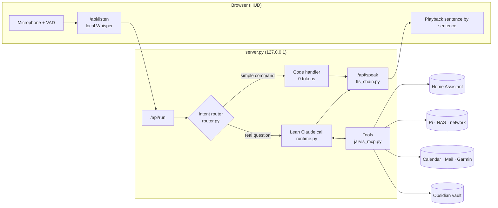

<div align="center">

# J.A.R.V.I.S.

**Personal voice assistant with memory, smart home control and an HUD — powered by Claude Code**


-2ea44f)

</div>

---

JARVIS is a self-hosted voice assistant in the style of the Iron Man computer. You talk to it hands-free in the browser, it answers with a natural voice, controls the smart home, knows your calendar, inbox and home network, and builds up a **persistent memory** in an Obsidian vault.

The language model is the **Claude Code CLI** on a subscription, so there is no per-token API billing. To make the quota last, a **local intent router** answers simple commands without any LLM at all. Everything else runs as a **lean, stateless call** with its own short prompt and only the tools the request actually needs.

> **Language:** Jarvis listens and speaks **German**. The router patterns, time parsing and spoken replies are German, so the example commands below are German with an English translation. Code, comments and docs are English.

## Contents

- [Highlights](#highlights)
- [What it can do](#what-it-can-do)
- [Architecture](#architecture)
- [Quick start](#quick-start)
- [Configuration](#configuration)
- [Usage](#usage)
- [Speech output: provider chain](#speech-output-provider-chain)
- [Fallback mode: stand-in chain](#fallback-mode-stand-in-chain)
- [Efficiency: router and lean mode](#efficiency-router-and-lean-mode)
- [Memory](#memory)
- [On the go: iPhone and iPad](#on-the-go-iphone-and-ipad)
- [Security model](#security-model)
- [Project structure](#project-structure)
- [Development and diagnostics](#development-and-diagnostics)
- [Roadmap](#roadmap)

---

## Highlights

| | |
|---|---|
| 🎙️ **Hands-free** | Live microphone with pause and end-of-sentence detection, push-to-talk, barge-in. Optional wake word ("Jarvis …" or locally via openWakeWord) and follow-up questions without addressing it again. |
| ⏰ **Timers, alarms, reminders** | "Timer 10 minutes for the pasta", "Wake me tomorrow at 6:30", "Remind me about the laundry in 20 minutes", "Turn the light off in an hour". Local, no tokens, survives restarts. |
| 📣 **Speaks up on its own** | Washing machine done, appointment in 15 minutes or "time to leave" (with travel time), parcel arriving today, storage full, NAS problem, new device on the Wi-Fi. With quiet hours. |
| 📦 **Commute and parcels** | "When do I have to leave?" (travel time to the next appointment via OpenStreetMap), "Is a parcel coming today?" (from shipping mails). Local, no tokens. |
| 🖥️ **PC control** | "Volume to 30 percent", "Mute", "Open Spotify", "Lock the screen". Spotify ducks while Jarvis talks; at night it speaks more quietly. |
| 📉 **Gets cheaper over time** | Remembers phrasings Claude had to resolve once ("reading lamp off") and handles them itself afterwards. Identical questions within 5 minutes come from a cache. A "usage report" says how much ran locally. |
| 🗣️ **Pronunciation** | NAS, Pi, kWh & co. are spoken correctly; add your own words by voice ("pronounce Tuya as Tuja"). |
| 🛒 **Lists and routines** | Shopping and to-do list by voice (Home Assistant or a vault note). Routines like "good night": one phrase, several actions, created by voice. |
| 🛟 **Fallback mode** | If Claude is down or the limit is reached, a free chain takes over: Groq → Gemini → Ollama, with the same tools and confirmation cards. |
| 🧠 **Real memory** | Notes by topic, automatic conversation log, remembers and forgets on its own (expiry dates, trash). |
| ⚡ **Local intent router** | Lights, sockets, music, time, weather, energy and system status without an LLM, answered in milliseconds. |
| 🪶 **Lean LLM calls** | Own prompt instead of the Claude Code default, tools on demand, automatic model choice (Haiku/Sonnet). Measured at **more than 25× fewer tokens** than a default call. |
| 🔊 **Fail-safe voice** | A chain of cloud, local GPU and free voices. Exhausted providers are skipped until their reset, without an audible break. |
| 🏠 **Smart home** | Home Assistant: switching, reading states, energy (solar/battery), room climate, air quality. Optionally the full HA MCP server for automations and history. |
| 🛰️ **Home network** | Status of a Raspberry Pi and a Synology NAS, device list, watcher for new devices on the Wi-Fi. |
| 📅 **Everyday** | Calendar (CalDAV/iCloud), inbox (IMAP, read-only), Garmin health data, Spotify, web search. |
| 🖥️ **HUD** | Dashboard with weather and activity traffic light, home, health, systems, mail, 3D knowledge graph and usage meter. |
| 🔐 **Under control** | `localhost` only, confirmation cards for system changes, protected devices, no self-modification at runtime. |

---

## What it can do

The architecture separates the **router** (rules), **tools** (MCP server) and **memory** (Markdown), so new abilities usually take only a few lines.

**Everyday**
- *„Guten Morgen“* (good morning) gives a daily briefing with weather, appointments, energy, nearly empty batteries and new mail.
- *„Kann ich heute noch eine Runde laufen?“* (can I still go for a run today?) gives a traffic light from weather, wind, daylight and working hours.
- *„Was steht morgen an?“* (what's on tomorrow?) or *„Trag mir Freitag um zehn den Zahnarzt ein“* (add the dentist on Friday at ten — with confirmation).
- *„Hab ich wichtige Mails?“* (any important mail?) gives a summary without newsletters.
- *„Merk dir, dass Anna am 3. Mai Geburtstag hat“* (remember that Anna's birthday is on May 3rd) creates a note under `Personen/Anna`.
- *„Timer 8 Minuten für die Pizza“*, *„Wie lange noch?“*, *„Weck mich um 6:45“*, *„Schlummern“* (snooze), *„Wecker aus“* (alarm off)
- *„Erinnere mich morgen um 9 daran, Anna anzurufen“* (remind me to call Anna tomorrow at 9), *„Welche Erinnerungen habe ich?“*
- *„Setz Milch und Eier auf die Einkaufsliste“* (put milk and eggs on the shopping list), *„Was steht auf der Einkaufsliste?“*
- *„Wenn ich Gute Nacht sage, mach alle Lichter aus und sag mir, wann der Wecker klingelt“* (when I say good night, turn off all lights and tell me when the alarm rings) creates a routine. After that, *„Gute Nacht“* runs without an LLM.

**Home**
- *„Mach das Licht im Wohnzimmer auf 40 Prozent“* (living room light to 40 percent), *„Ist die Waschmaschine noch an?“*, *„Szene Kino“* (cinema scene)
- *„Wie viel liefert die Solaranlage, und wie voll ist der Speicher?“* (solar output and battery level)
- *„Welche Batterien muss ich tauschen?“* (which batteries need replacing?)
- With the HA MCP server: *„Warum ist es im Schlafzimmer so kalt? Zeig mir den Verlauf.“* (why is the bedroom so cold? show me the history)

**Tech and network**
- *„Wie geht es dem Pi / dem NAS?“* (how is the Pi / the NAS?) reports temperature, storage and uptime, plus disk health with a warning from 85 %.
- *„Ist ein unbekanntes Gerät im WLAN?“* (unknown device on the Wi-Fi?) The watcher also reports new devices on its own.
- *„Starte die Container auf dem Pi neu“* (restart the containers on the Pi — SSH, with confirmation).

**Ideas for extensions** (see [Roadmap](#roadmap))
- Focus sessions with distraction hints, camera or screen context
- Room microphones (ESP32/satellites), several user profiles via speaker recognition
- More tool groups: Paperless, Jellyfin/Plex, Proxmox, UniFi, vehicle APIs, fitness platforms
- Your own voice from a voice sample (local), more languages

---

## Architecture



| Component | Role |
|---|---|
| `server.py` | HTTP server (`127.0.0.1` only), HUD, API endpoints, confirmation cards, usage log, self-restart on code changes |
| `router.py` | Intent router: local handlers, choice of tool groups and model |
| `runtime.py` | Starts `claude -p` lean (`--system-prompt`, `--tools`, `--strict-mcp-config`, `--setting-sources ""`, `--no-session-persistence`, `--effort`) with a pre-warmed process pool |
| `commands.py` | Prompts, conversation window, state file, slash commands |
| `jarvis_mcp.py` | MCP server with all tools in groups, confirmation gate, result size cap |
| `memory.py` | Vault → knowledge graph, core memories, log, cleanup |
| `voice.py` · `tts_chain.py` | Speech recognition and the speech output chain with adapters |
| `local_tts_server.py` | Local GPU voice (Chatterbox Multilingual) in its own environment |
| `briefing.py` · `dashboard.py` | Daily briefing, network watcher, HUD data |
| `icloud_calendar.py` · `billing.py` | CalDAV calendar, API credit (Cost API) |
| `jarvis_profile.py` | Profile and device mapping from `.env` and `config/home.json` |
| `scheduler.py` | Timers, alarms, reminders and scheduled commands: parses German time expressions, rings |
| `lists.py` · `routines.py` | Shopping/to-do list (HA to-do or vault note), routines from `config/routines.json` |
| `events.py` · `watchers.py` | Push channel to the HUD (server-sent events, quiet hours) and the rules for proactive messages |
| `wakeword.py` | Wake word: text detection or openWakeWord on the PC microphone |
| `fallback_llm.py` | Fallback mode: stand-in chain Groq → Gemini → Ollama with the Jarvis tools |
| `learning.py` · `answer_cache.py` | Learned phrasings (`config/learned.json`), usage report, answer cache |
| `commute.py` · `parcels.py` | Travel time to appointments (Nominatim + OSRM), parcel status from shipping mails |
| `pc.py` · `pronounce.py` | Volume, apps, screen lock, Spotify ducking (pycaw); pronunciation lexicon |
| `ui/` | HUD (vanilla JS, dependency-free 3D knowledge graph) |

---

## Quick start

**Requirements:** Windows 11 · Python 3.12 · Node.js · a Claude subscription. Optional: NVIDIA GPU (CUDA 12.8) for Whisper `large-v3-turbo` and the local voice.

```powershell
# 1  Install Claude Code and sign in (subscription, no API key)
npm.cmd install -g @anthropic-ai/claude-code
claude auth login

# 2  Python environment
py -3.12 -m venv .venv
.venv\Scripts\python.exe -m pip install -r requirements.txt

# 3  Configuration
copy .env.example .env                           # fill in your values
copy config\home.example.json config\home.json   # HA entity IDs (optional)
mkdir vault\Erinnerungen

# 4  Start
start-jarvis.bat
```

**Local voices (optional)**

```powershell
# Piper (CPU, works right away)
mkdir models\piper
curl -L -o models\piper\de_DE-thorsten-high.onnx      https://huggingface.co/rhasspy/piper-voices/resolve/v1.0.0/de/de_DE/thorsten/high/de_DE-thorsten-high.onnx
curl -L -o models\piper\de_DE-thorsten-high.onnx.json https://huggingface.co/rhasspy/piper-voices/resolve/v1.0.0/de/de_DE/thorsten/high/de_DE-thorsten-high.onnx.json

# Chatterbox Multilingual (GPU, ~5 GB) — details in requirements-tts.txt
py -3.12 -m venv .venv-tts
.venv-tts\Scripts\python.exe -m pip install torch torchaudio --index-url https://download.pytorch.org/whl/cu128
.venv-tts\Scripts\python.exe -m pip install --no-deps chatterbox-tts
.venv-tts\Scripts\python.exe -m pip install -r requirements-tts.txt
# Voice sample (~10 s, one you have the rights to): models\voice\reference.wav
```

The server starts the GPU voice automatically as soon as `.venv-tts` exists.

---

## Configuration

Every setting is documented in [`.env.example`](.env.example). Personal data belongs only in `.env` and `config/home.json`; both are in `.gitignore`.

| Area | Variables | Purpose |
|---|---|---|
| Profile | `JARVIS_USER_NAME`, `JARVIS_PLACE`, `JARVIS_WEATHER_LAT/LON`, `JARVIS_TIMEZONE`, `JARVIS_BROWSER` | Form of address, location, browser |
| Brain | `JARVIS_LEAN`, `JARVIS_LOCAL_ROUTER`, `JARVIS_MODEL_SIMPLE/SMART`, `JARVIS_EFFORT`, `JARVIS_MAX_OUTPUT_TOKENS`, `JARVIS_HISTORY_TURNS` | Router, model choice, context size |
| Voice | `TTS_CHAIN`, `TTS_ANNOUNCE_SWITCH`, `FISH_AUDIO_*`, `ELEVENLABS_*`, `AZURE_*`, `GOOGLE_TTS_*`, `EDGE_*`, `LOCAL_TTS_URL` | Provider order and credentials |
| Listening | `JARVIS_STT`, `WHISPER_LOCAL_*` | Speech recognition |
| Wake word | `JARVIS_WAKE` (`off`/`text`/`oww`), `JARVIS_WAKE_*`, `JARVIS_FOLLOWUP_S` | "Jarvis …" instead of an always-open mic, follow-up window |
| Proactive | `JARVIS_PROACTIVE`, `JARVIS_QUIET_HOURS`, `JARVIS_EVENT_LEAD_MIN`, `JARVIS_STORAGE_FULL` | Messages and quiet hours (alarms always ring) |
| Lists | `JARVIS_SHOPPING_LIST`, `JARVIS_TODO_LIST` | HA to-do entity; empty = a note under `vault/Erinnerungen/Listen/` |
| Fallback | `JARVIS_FALLBACK` (`groq,gemini,ollama`), `GROQ_API_KEY`, `GROQ_MODEL`, `GEMINI_API_KEY`, `GEMINI_MODEL`, `OLLAMA_URL`, `OLLAMA_MODEL`, `JARVIS_FALLBACK_PRIVATE` | Stand-in chain when Claude is unavailable; see [Fallback mode](#fallback-mode-stand-in-chain) |
| Saving | `JARVIS_CACHE_S` (default 300, 0 = off) | Repeated read-only questions come from the cache for this long |
| Commute | `JARVIS_HOME_LAT/LON` (else the weather coordinates), `JARVIS_TRAFFIC_FACTOR` (1.25), `JARVIS_COMMUTE_BUFFER_MIN` (5), `JARVIS_LEAVE_WARN_MIN` (5) | Starting point, traffic surcharge, buffer, advance warning |
| PC and volume | `JARVIS_DUCK` (0.3, 0 = off), `JARVIS_DUCK_APPS` (spotify.exe), `JARVIS_NIGHT_VOLUME` (0.5) | Music quieter while speaking, voice volume in quiet hours; your own apps in `config/apps.json` |
| Pronunciation | `config/aussprache.json` | Your own entries, created by voice |
| Services | `ICLOUD_*`, `MAIL_*`, `HA_*`, `SYNOLOGY_*`, `JARVIS_PI_*`, `GARMIN_*` | Integrations; each one is optional |
| Devices | `config/home.json` | Maps dashboard fields (solar, battery, rooms, router, air) to Home Assistant entities, plus `appliances` (power meters for "… is done") |
| Routines | `config/routines.json` | Created by voice; format in `config/routines.example.json` |

> **Important:** never set `ANTHROPIC_API_KEY`. Claude Code would then bill through the API instead of the subscription. The server removes the variable from the child processes' environment as a precaution.

---

## Usage

| Action | How |
|---|---|
| Live mode | Click **Live**. The button shows the state: listening, hearing you, thinking, speaking, microphone blocked. With a wake word it waits for "Jarvis" and listens briefly after "Jarvis" and after each answer. |
| Timers and alarms | Countdown in the top bar. It rings, then speaks. Talking, `Esc` or **Stop** ends the ringing; *„Schlummern“* snoozes for 9 minutes. |
| Messages | Appear with a yellow border in the conversation and are read aloud; during quiet hours they are only shown. |
| Push-to-talk | Hold the Live button, speak, release. |
| Interrupt | Talk over it, or `Esc` / space bar |
| Confirm | Click the card or say *„bestätigt“* (confirmed) / *„nein“*. A plain *„ja“* deliberately does not count. |
| Typing | Input field, `Enter` |
| Commands | `/new`, `/status`, `/recall <term>`, `/graph`, `/help` |
| API credit | ✎ in the usage panel: enter your balance; spending is deducted via the Cost API |

---

## Speech output: provider chain

```
Fish Audio ─▶ ElevenLabs ─▶ Local (Chatterbox GPU · Piper CPU) ─▶ Azure ─▶ Google ─▶ Edge
```

- **One interface:** every provider is an adapter with `configured()`, `synth()` and `balance()`. The order is set in `TTS_CHAIN`.
- **Exhausted** (402, quota/credit errors, invalid key, balance API reports 0): the provider is blocked until its reset, and that survives restarts. The reset is the date the API reports, the start of the month for free tiers, 6 h for an invalid key, otherwise 24 h. After that it is back in its place automatically.
- **Temporary** (network, timeout, 5xx): only the current sentence switches provider and is regenerated in full. There is no audible break.
- **Transparency:** the dashboard shows the active provider with remaining credit and the blocked providers with their dates. An optional short announcement marks a switch.
- **Tone tags** like `[dry]` are applied by providers that support them and stripped for all others.
- The chain is plain code; it uses no LLM tokens.

---

## Fallback mode: stand-in chain

If the Claude quota is exhausted, the CLI does not start, or a call fails before a single word was said, the first available stage of this chain answers:

| Stage | Model | Cost | Note |
|---|---|---|---|
| **Groq** | gpt-oss-120b (`GROQ_MODEL`) | free tier, key at console.groq.com | very fast, data not used for training |
| **Gemini** | Gemini 3.5 Flash (`GEMINI_MODEL`) | free tier, key at aistudio.google.com | Google may use free-tier requests for training, so it **never** gets mail, calendar, health or the daily briefing |
| **Ollama** | `qwen2.5:7b-instruct`, local | free, offline | last resort |

- The stand-ins get **the same Jarvis tools** as Claude (the groups the router picks). `jarvis_mcp.py` runs as a child process for this, and whatever needs a confirmation card with Claude (e.g. `calendar_add`) needs one here too. Only `pc` (PowerShell) and the full HA MCP server are not available.
- If a provider reports its own limit (HTTP 429), it is skipped until the retry time it gives; an invalid key or a model that is no longer offered blocks it for six hours (reason shown in the tooltip).
- After read-only tools the next provider may take over; once a provider has **changed** something (switching, saving, calendar), no second one takes over, so nothing happens twice.
- Providers without a key are simply skipped. `JARVIS_FALLBACK=ollama` restores the old local-only behaviour, `off` disables fallback mode.
- `JARVIS_FALLBACK_PRIVATE` (default `groq,ollama`) sets which providers may see private requests.
- The usage log records the answers as `fallback:groq`, `fallback:gemini` or `fallback:ollama`.

```
GROQ_API_KEY=...
GEMINI_API_KEY=...
```

---

## Efficiency: router and lean mode

A default Claude Code call sends ~35,000 tokens of baseline with every request:

| Part | Tokens |
|---|---|
| Built-in tools | ~19,700 |
| Default prompt | ~3,400 |
| Connectors | ~2,000 |
| Project prompt | (varies) |

On top of that, every tool use adds an extra round trip.

**Measurement** (input tokens per request, `scripts/measure_tokens.py`):

| Request | Default | JARVIS | Path |
|---|---:|---:|---|
| Time | 34,575 | **0** | local |
| Energy status | 110,515 | **0** | local |
| Weather | 194,243 | **0** | local |
| Memory question | 34,999 | **3,981** | Haiku |
| Inbox | 110,851 | **9,591** | Haiku |
| Web research | 151,973 | **10,827** | Sonnet |

**Building blocks:**
- **Intent router** with rules instead of an LLM. Questions and commands are told apart; protected devices are never switched off automatically.
- **Own prompt** (~1,300 tokens): stable parts first so the prompt cache hits. Dynamic parts (time, last exchanges, matching notes) go into the message.
- **Tool groups** (`memory`, `web`, `home`, `mail`, `calendar`, `systems`, `health`, `music`, `pc`): only the matching ones are loaded per request, directly and without tool search.
- **Stateless:** no growing session history, just a sliding window of the last exchanges.
- **Result cap** per tool, Haiku/Sonnet selection, `--effort low`, capped answer length.
- **Background jobs without an LLM:** dashboard, network watcher, briefing facts.

Every request is logged in `logs/usage.jsonl` (route, model, groups, input/cache/output, API calls).

---

## Memory

```
vault/
├─ Erinnerungen/     profile · commands · preferences · websites · knowledge · network · smart home
│  ├─ Personen/      one note per person
│  ├─ Projekte/      one note per project
│  └─ Netzwerk-Geräte/   created automatically by the network watcher
├─ Gespraeche/       daily conversation logs (automatic)
└─ Papierkorb/       expired notes, deleted after 30 days
```

- **Obsidian-compatible:** front matter with `type`, `wichtigkeit` (importance) and optionally `ablauf` (expiry), links via `[[Wikilink]]`. This becomes the 3D graph in the HUD.
- **Targeted recall instead of full context:** only the profile and commands are in the prompt. Everything else Jarvis fetches with `memory_search` (weighted full text) and `memory_read`.
- **Remembers on its own** via `memory_save`, without you having to say "remember".
- **Forgets systematically:** expiry dates, then the trash, then deletion.

---

## On the go: iPhone and iPad

The PC stays the brain. iPhone and iPad connect over [Tailscale](https://tailscale.com) (private VPN, free for personal use) via HTTPS, from anywhere and without an open port on the router.

**One-time setup**

1. Install Tailscale on the PC and sign in, then the Tailscale app on the iPhone/iPad with the same account.
2. In the Tailscale admin console under *DNS*, enable "MagicDNS" and "HTTPS Certificates".
3. In `.env`: `JARVIS_REMOTE=1`, then restart Jarvis. Device access then runs on `127.0.0.1:8721` (`JARVIS_REMOTE_PORT`).
4. Once on the PC: `tailscale serve --bg 8721`. Tailscale shows the address, e.g. `https://my-pc.tailXXXX.ts.net`.

**Pair a device**

1. On the iPhone or iPad, open the address in Safari, then *Share → Add to Home Screen* (iPhone: share at the bottom, iPad: top right).
2. Open Jarvis from the home screen (the web app has its own sign-in, separate from Safari).
3. On the PC, in the HUD click **📱 Devices → New code** and enter the six-digit code on the device. It is valid for five minutes and only once.

**📱 Devices** lists all paired devices; ✕ locks one out immediately.

**On the phone:** tapping the mic button toggles Live, holding it is push-to-talk. The microphone never starts on its own, there is no daily briefing, and messages appear silently (the PC reads them out). The wake word only listens on the PC.

**On the iPad:** the full HUD with the memory graph, just with bigger buttons. Landscape uses three columns like the PC; portrait shows graph and conversation on top and the widgets in two columns below. One finger rotates the graph, two fingers zoom and pan, a tap selects a node. Usage and action log stay on the PC. Microphone, briefing and messages behave like on the phone.

---

## Security model

- **Local only:** the server binds to `127.0.0.1`. Every request needs a per-launch token; host and origin are checked.
- **Remote access only when paired:** the device port (`JARVIS_REMOTE=1`) also binds only to `127.0.0.1` and is reachable only via `tailscale serve`. Without a paired device it serves only the pairing page. A code is discarded after five failed attempts. `config/devices.json` stores only hashes of the device keys. Pairing, device list and the confirmation endpoint are reachable only on the PC. `JARVIS_REMOTE_HOSTS` optionally restricts the allowed host names (default: `*.ts.net`).
- **Confirmation cards:** system changes go through Claude Code's `--permission-prompt-tool` to a card in the HUD. That covers shell commands, calendar entries and writing outside the vault. No answer within 75 s means deny.
- **Protected devices:** the router never switches off the router, PC, server or fridge by itself. Home Assistant only switches `light`, `switch`, `fan`, `media_player` and `scene`.
- **Questions never switch:** "Is … on?" is read, never executed.
- **No self-modification:** at runtime there are no tools for editing code.
- **Data stays local:** `.env`, `config/home.json`, `vault/`, `logs/`, `state.json` and models are in `.gitignore`. Speech recognition and the GPU voice run offline.

---

## Project structure

```
├─ server.py · router.py · runtime.py · commands.py
├─ jarvis_mcp.py · memory.py · voice.py · tts_chain.py · local_tts_server.py
├─ briefing.py · dashboard.py · icloud_calendar.py · billing.py · jarvis_profile.py
├─ scheduler.py · lists.py · routines.py · events.py · watchers.py · wakeword.py · fallback_llm.py
├─ learning.py · answer_cache.py · commute.py · parcels.py · pc.py · pronounce.py · devices.py
├─ ui/                 index.html · app.js · graph.js · styles.css · pair.html
├─ scripts/            measure_tokens.py · lean_probe.py · mail_to_trash.py · router_report.py · install-autostart.ps1
├─ tests/              test_router.py · test_tts_chain.py · test_fallback.py · test_remote.py   (no house, Claude, network or sound needed)
├─ config/             home.example.json · routines.example.json   (home.json, routines.json stay local)
├─ .env.example        configuration template
├─ requirements.txt    main environment
├─ requirements-tts.txt  GPU voice
└─ start-jarvis.bat
```

---

## Development and diagnostics

```powershell
# Tests: router, timers, lists, routines, fallback (Home Assistant is simulated, nothing is switched)
.venv\Scripts\python.exe -m unittest discover -s tests -v

# Token measurement: components, default requests, lean path
.venv\Scripts\python.exe scripts\measure_tokens.py components
.venv\Scripts\python.exe scripts\measure_tokens.py new

# What still goes to the LLM, what has the router learned?
.venv\Scripts\python.exe scripts\router_report.py 30

# Autostart at sign-in (Task Scheduler, no admin rights); -Remove removes it
powershell -ExecutionPolicy Bypass -File scripts\install-autostart.ps1

# Test router + lean call without the server
.venv\Scripts\python.exe scripts\lean_probe.py "Wie geht es dem NAS?"

# Test instance next to the running one (own port, own state file)
set JARVIS_PORT=8721& set JARVIS_STATE=%TEMP%\state_test.json& .venv\Scripts\python.exe server.py
```

| Symptom | Cause / fix |
|---|---|
| Live button does nothing | `F5`. If "microphone blocked", allow the microphone in the address bar. |
| Cut off mid-sentence | Increase `SILENCE_MS` / `UNFINISHED_HOLD_MS` in `ui/app.js` |
| Interrupts itself | Increase `BARGE_FACTOR` or use headphones |
| No voice | The **VOICE** field on the dashboard shows blocked providers and why |
| GPU voice does not start | `logs/local_tts.log`; the first start downloads ~3 GB |
| High usage | Analyse `logs/usage.jsonl` by route, model and groups |
| Does not react to "Jarvis" | Check `JARVIS_WAKE`. With `oww` the startup banner shows whether openWakeWord is running; otherwise text detection applies. Lower `JARVIS_WAKE_THRESHOLD`. |
| Messages shown but not spoken | Quiet hours (`JARVIS_QUIET_HOURS`) |
| Fallback mode never answers | The tooltip on "Brain" in the header shows each provider's reason (no key, limit until …, Ollama off). Ollama: `ollama pull qwen2.5:7b-instruct` |
| Jarvis keeps restarting | `logs/crash.log`; after five crashes in ten minutes the supervisor gives up |
| Wrong travel time | Set `JARVIS_HOME_LAT/LON` to your home address (default is the weather coordinates) |
| Wrong learned phrasing | Delete the entry in `config/learned.json` |

---

## Roadmap

- [x] Wake word ("Jarvis …") as an alternative to the always-open mic, follow-ups without the wake word
- [x] Timers, alarms, reminders and scheduled commands
- [x] Proactive messages (appliances done, appointments, storage, NAS, new devices) with quiet hours
- [x] Shopping and to-do list, routines by voice
- [x] Fallback mode with a free stand-in chain (Groq, Gemini, Ollama) including tools
- [x] Automated tests for the router
- [x] Commute times, parcel status, PC control, ducking, pronunciation, learning router, answer cache
- [x] Autostart and restart after a crash
- [x] Access from iPhone and iPad (Tailscale, device pairing)
- [x] Automated tests for the voice chain
- [ ] Central control: screen, room microphones, speaker recognition
- [ ] Focus sessions with distraction hints
- [ ] Screen and camera context on request
- [ ] Several user profiles and room satellites (ESP32)
- [ ] Linux/macOS start scripts
- [ ] More tool groups (media server, documents, hypervisor, network controller)
- [ ] English speech (router patterns and replies)

---

<sub>Originally inspired by <a href="https://github.com/Itsme23476/jarvis-claude-code">jarvis-claude-code</a>. Check the template's licence before redistributing this project on its own.</sub>
