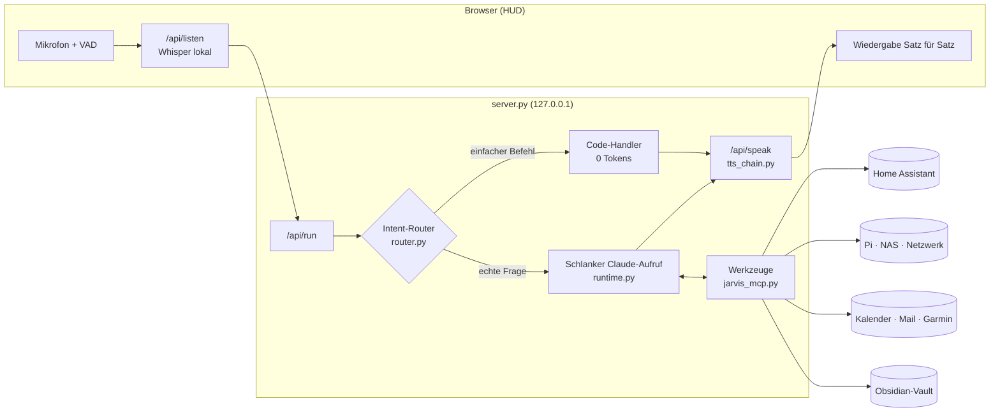

<div align="center">

# J.A.R.V.I.S.

**Persönlicher Sprachassistent mit Gedächtnis, Smart-Home-Steuerung und HUD — angetrieben von Claude Code**


-2ea44f)

</div>

---

JARVIS ist ein selbst gehosteter Sprachassistent im Stil des Iron-Man-Computers. Man spricht frei im Browser, er antwortet mit natürlicher Stimme, steuert das Smart Home, kennt Kalender, Postfach und Heimnetz, und er baut sich ein **dauerhaftes Gedächtnis** in einem Obsidian-Vault auf.

Das Sprachmodell ist die **Claude-Code-CLI** im Abo-Modus. Es gibt also keine API-Abrechnung pro Token. Damit das Kontingent lange reicht, beantwortet ein **lokaler Intent-Router** einfache Befehle komplett ohne LLM. Alles andere läuft als **schlanker, zustandsloser Aufruf** mit eigenem Kurz-Prompt und nur den Werkzeugen, die die Anfrage wirklich braucht.

## Inhalt

- [Highlights](#highlights)
- [Was alles möglich ist](#was-alles-möglich-ist)
- [Architektur](#architektur)
- [Schnellstart](#schnellstart)
- [Konfiguration](#konfiguration)
- [Bedienung](#bedienung)
- [Sprachausgabe: Anbieter-Kette](#sprachausgabe-anbieter-kette)
- [Effizienz: Router und schlanker Modus](#effizienz-router-und-schlanker-modus)
- [Gedächtnis](#gedächtnis)
- [Sicherheitsmodell](#sicherheitsmodell)
- [Projektstruktur](#projektstruktur)
- [Entwicklung und Diagnose](#entwicklung-und-diagnose)
- [Roadmap](#roadmap)

---

## Highlights

| | |
|---|---|
| 🎙️ **Freihändig sprechen** | Live-Mikrofon mit Pausen- und Satzende-Erkennung, Push-to-Talk, Unterbrechen durch Reinreden. |
| 🧠 **Echtes Gedächtnis** | Notizen nach Themen, automatisches Gesprächsprotokoll, selbstständiges Merken und Vergessen (Ablaufdaten, Papierkorb). |
| ⚡ **Lokaler Intent-Router** | Licht, Steckdosen, Musik, Uhrzeit, Wetter, Energie- und Systemstatus ohne LLM, mit Antwort in Millisekunden. |
| 🪶 **Schlanke LLM-Aufrufe** | Eigener Prompt statt Claude-Code-Standard, Werkzeuge nach Bedarf, automatische Modellwahl (Haiku/Sonnet). In Messungen **über 25× weniger Tokens** als ein Standard-Aufruf. |
| 🔊 **Ausfallsichere Stimme** | Kette aus Cloud-, lokalen GPU- und Gratis-Stimmen. Erschöpfte Anbieter werden bis zum Reset übersprungen, ohne hörbaren Abbruch. |
| 🏠 **Smart Home** | Home Assistant: schalten, Zustände abfragen, Energie (Solar/Speicher), Raumklima, Luftqualität. Optional der volle HA-MCP-Server für Automationen und Verlauf. |
| 🛰️ **Heimnetz** | Status von Raspberry Pi und Synology-NAS, Geräteliste, Wächter für neue Geräte im WLAN. |
| 📅 **Alltag** | Kalender (CalDAV/iCloud), Postfach (IMAP, nur lesen), Garmin-Gesundheitsdaten, Spotify, Websuche. |
| 🖥️ **HUD** | Dashboard mit Wetter- und Aktivitäts-Ampel, Haus, Gesundheit, Systeme, Post, 3D-Wissensgraph und Verbrauchsanzeige. |
| 🔐 **Kontrolliert** | Nur `localhost`, Bestätigungskarten für Systemeingriffe, geschützte Geräte, kein Selbstumbau zur Laufzeit. |

---

## Was alles möglich ist

Die Architektur trennt **Router** (Regeln), **Werkzeuge** (MCP-Server) und **Gedächtnis** (Markdown). Neue Fähigkeiten lassen sich deshalb meist mit wenigen Zeilen ergänzen.

**Im Alltag**
- *„Guten Morgen“* liefert ein Tagesbriefing mit Wetter, Terminen, Energie, fast leeren Batterien und neuen Mails.
- *„Kann ich heute noch eine Runde laufen / golfen?“* ergibt eine Ampel aus Wetter, Wind, Tageslicht und Arbeitszeit.
- *„Was steht morgen an?“* bzw. *„Trag mir Freitag um zehn den Zahnarzt ein“* (mit Bestätigung).
- *„Hab ich wichtige Mails?“* bringt eine Zusammenfassung ohne Newsletter.
- *„Merk dir, dass Anna am 3. Mai Geburtstag hat“* legt eine Notiz unter `Personen/Anna` an.

**Zuhause**
- *„Mach das Licht im Wohnzimmer auf 40 Prozent“*, *„Ist die Waschmaschine noch an?“*, *„Szene Kino“*
- *„Wie viel liefert die Solaranlage, und wie voll ist der Speicher?“*
- *„Welche Batterien muss ich tauschen?“*
- Mit dem HA-MCP-Server: *„Warum ist es im Schlafzimmer so kalt? Zeig mir den Verlauf.“*

**Technik und Netzwerk**
- *„Wie geht es dem Pi / dem NAS?“* liefert Temperatur, Speicher und Laufzeit, außerdem den Plattenstatus mit Warnung ab 85 %.
- *„Ist ein unbekanntes Gerät im WLAN?“* Neue Geräte meldet der Wächter von selbst.
- *„Starte die Container auf dem Pi neu“* (SSH, mit Bestätigung).

**Erweiterungsideen** (siehe [Roadmap](#roadmap))
- Fokus-Sitzungen mit Ablenkungs-Hinweisen, Kamera- oder Bildschirm-Kontext
- Aktivierungswort, Raum-Mikrofone (ESP32/Satelliten), mehrere Nutzerprofile
- Weitere Werkzeuggruppen: Paperless, Jellyfin/Plex, Proxmox, Unifi, Fahrzeug-APIs, Fitness-Plattformen
- Eigene Stimme per Sprachprobe (lokal), Mehrsprachigkeit

---

## Architektur



| Komponente | Aufgabe |
|---|---|
| `server.py` | HTTP-Server (nur `127.0.0.1`), HUD, API-Endpunkte, Bestätigungskarten, Verbrauchsprotokoll, Selbst-Neustart bei Codeänderungen |
| `router.py` | Intent-Router: lokale Handler, Wahl der Werkzeuggruppen und des Modells |
| `runtime.py` | Startet `claude -p` schlank (`--system-prompt`, `--tools`, `--strict-mcp-config`, `--setting-sources ""`, `--no-session-persistence`, `--effort`) mit vorgewärmtem Prozess-Pool |
| `commands.py` | Prompts, Gesprächsfenster, Zustandsdatei, Slash-Befehle |
| `jarvis_mcp.py` | MCP-Server mit allen Werkzeugen in Gruppen, Bestätigungs-Schranke, Ergebnis-Obergrenze |
| `memory.py` | Vault → Wissensgraph, Kern-Erinnerungen, Protokoll, Aufräumen |
| `voice.py` · `tts_chain.py` | Spracherkennung und Sprachausgabe-Kette mit Adaptern |
| `local_tts_server.py` | Lokale GPU-Stimme (Chatterbox Multilingual) in eigener Umgebung |
| `briefing.py` · `dashboard.py` | Tagesbriefing, Netzwerk-Wächter, HUD-Daten |
| `icloud_calendar.py` · `billing.py` | CalDAV-Kalender, API-Guthaben (Cost API) |
| `jarvis_profile.py` | Profil und Geräte-Zuordnung aus `.env` und `config/home.json` |
| `ui/` | HUD (Vanilla JS, 3D-Wissensgraph ohne Abhängigkeiten) |

---

## Schnellstart

**Voraussetzungen:** Windows 11 · Python 3.12 · Node.js · ein Claude-Abo. Optional: NVIDIA-GPU (CUDA 12.8) für Whisper `large-v3-turbo` und die lokale Stimme.

```powershell
# 1  Claude Code installieren und anmelden (Abo, kein API-Key)
npm.cmd install -g @anthropic-ai/claude-code
claude auth login

# 2  Python-Umgebung
py -3.12 -m venv .venv
.venv\Scripts\python.exe -m pip install -r requirements.txt

# 3  Konfiguration
copy .env.example .env                      # Werte eintragen
copy config\home.example.json config\home.json   # HA-Entity-IDs eintragen (optional)
mkdir vault\Erinnerungen

# 4  Start
start-jarvis.bat
```

**Lokale Stimmen (optional)**

```powershell
# Piper (CPU, sofort einsatzbereit)
mkdir models\piper
curl -L -o models\piper\de_DE-thorsten-high.onnx      https://huggingface.co/rhasspy/piper-voices/resolve/v1.0.0/de/de_DE/thorsten/high/de_DE-thorsten-high.onnx
curl -L -o models\piper\de_DE-thorsten-high.onnx.json https://huggingface.co/rhasspy/piper-voices/resolve/v1.0.0/de/de_DE/thorsten/high/de_DE-thorsten-high.onnx.json

# Chatterbox Multilingual (GPU, ~5 GB) — Details in requirements-tts.txt
py -3.12 -m venv .venv-tts
.venv-tts\Scripts\python.exe -m pip install torch torchaudio --index-url https://download.pytorch.org/whl/cu128
.venv-tts\Scripts\python.exe -m pip install --no-deps chatterbox-tts
.venv-tts\Scripts\python.exe -m pip install -r requirements-tts.txt
# Sprachprobe (~10 s, eigene Rechte): models\voice\reference.wav
```

Der Server startet die GPU-Stimme automatisch, sobald `.venv-tts` existiert.

---

## Konfiguration

Alle Einstellungen stehen kommentiert in [`.env.example`](.env.example). Persönliche Daten gehören ausschließlich in `.env` und `config/home.json`, beide sind in `.gitignore`.

| Bereich | Variablen | Zweck |
|---|---|---|
| Profil | `JARVIS_USER_NAME`, `JARVIS_PLACE`, `JARVIS_WEATHER_LAT/LON`, `JARVIS_TIMEZONE`, `JARVIS_BROWSER` | Anrede, Ort, Browser |
| Gehirn | `JARVIS_LEAN`, `JARVIS_LOCAL_ROUTER`, `JARVIS_MODEL_SIMPLE/SMART`, `JARVIS_EFFORT`, `JARVIS_MAX_OUTPUT_TOKENS`, `JARVIS_HISTORY_TURNS` | Router, Modellwahl, Kontextgröße |
| Stimme | `TTS_CHAIN`, `TTS_ANNOUNCE_SWITCH`, `FISH_AUDIO_*`, `ELEVENLABS_*`, `AZURE_*`, `GOOGLE_TTS_*`, `EDGE_*`, `LOCAL_TTS_URL` | Anbieter-Reihenfolge und Zugänge |
| Hören | `JARVIS_STT`, `WHISPER_LOCAL_*` | Spracherkennung |
| Dienste | `ICLOUD_*`, `MAIL_*`, `HA_*`, `SYNOLOGY_*`, `JARVIS_PI_*`, `GARMIN_*` | Integrationen; jede ist optional |
| Geräte | `config/home.json` | Zuordnung der Dashboard-Felder (Solar, Speicher, Räume, Router, Luft) zu Home-Assistant-Entities |

> **Wichtig:** `ANTHROPIC_API_KEY` nie setzen. Claude Code würde sonst per API statt über das Abo abrechnen. Der Server entfernt die Variable vorsorglich aus der Umgebung der Kindprozesse.

---

## Bedienung

| Aktion | So geht’s |
|---|---|
| Live-Modus | Klick auf **Live**. Der Button zeigt den Zustand: *Hört zu*, *Höre dich*, *Denkt*, *Spricht*, *Mikrofon blockiert*. |
| Push-to-Talk | Live-Button halten, sprechen, loslassen. |
| Unterbrechen | Reinreden, oder `Esc` bzw. Leertaste |
| Bestätigen | Karte anklicken oder „bestätigt“ / „nein“ sagen. Ein bloßes „ja“ zählt bewusst nicht. |
| Tippen | Eingabefeld, `Enter` |
| Befehle | `/new`, `/status`, `/recall <Begriff>`, `/graph`, `/help` |
| API-Guthaben | ✎ im Verbrauchsfeld: Stand eintragen, Ausgaben werden über die Cost API abgezogen |

---

## Sprachausgabe: Anbieter-Kette

```
Fish Audio ─▶ ElevenLabs ─▶ Lokal (Chatterbox GPU · Piper CPU) ─▶ Azure ─▶ Google ─▶ Edge
```

- **Einheitliches Interface:** Jeder Anbieter ist ein Adapter mit `configured()`, `synth()` und `balance()`. Die Reihenfolge steht in `TTS_CHAIN`.
- **Erschöpft** (402, Quota-/Credit-Fehler, ungültiger Key, Guthaben-API meldet 0): Der Anbieter ist bis zum Reset gesperrt, und das übersteht auch Neustarts. Als Reset gilt das Datum laut API, bei Free Tiers der Monatsanfang, bei ungültigem Key 6 h, sonst 24 h. Danach steht er automatisch wieder an seinem Platz.
- **Vorübergehend** (Netzwerk, Timeout, 5xx): Nur der aktuelle Satz wechselt den Anbieter und wird vollständig neu erzeugt. Es entsteht kein hörbarer Abbruch.
- **Transparenz:** Das Dashboard zeigt den aktiven Anbieter mit Restguthaben und die gesperrten Anbieter samt Datum. Beim Wechsel gibt es optional eine kurze Ansage.
- **Ton-Tags** wie `[dry]` werden von Anbietern umgesetzt, die sie beherrschen, und für alle anderen entfernt.
- Die Kette ist reiner Code, sie verbraucht keine LLM-Tokens.

---

## Effizienz: Router und schlanker Modus

Ein Standard-Aufruf von Claude Code schickt bei jeder Anfrage ~35.000 Tokens Grundlast mit:

| Bestandteil | Tokens |
|---|---|
| Eingebaute Werkzeuge | ~19.700 |
| Standard-Prompt | ~3.400 |
| Konnektoren | ~2.000 |
| Projekt-Prompt | (variabel) |

Dazu kommt bei jedem Werkzeug ein zusätzlicher Zwischenschritt.

**Messung** (Input-Tokens pro Anfrage, `scripts/measure_tokens.py`):

| Anfrage | Standard | JARVIS | Weg |
|---|---:|---:|---|
| Uhrzeit | 34.575 | **0** | lokal |
| Energiestatus | 110.515 | **0** | lokal |
| Wetter | 194.243 | **0** | lokal |
| Frage ans Gedächtnis | 34.999 | **3.981** | Haiku |
| Postfach | 110.851 | **9.591** | Haiku |
| Web-Recherche | 151.973 | **10.827** | Sonnet |

**Bausteine:**
- **Intent-Router** mit Regeln statt LLM. Fragen und Befehle werden getrennt, geschützte Geräte nie automatisch ausgeschaltet.
- **Eigener Prompt** (~1.300 Tokens): Stabiles steht vorn, damit der Prompt-Cache greift. Dynamisches (Uhrzeit, letzte Wortwechsel, passende Notizen) wandert in die Nachricht.
- **Werkzeuggruppen** (`memory`, `web`, `home`, `mail`, `calendar`, `systems`, `health`, `music`, `pc`): Pro Anfrage werden nur die passenden geladen, direkt und ohne Tool-Search.
- **Zustandslos:** kein wachsender Sitzungsverlauf, sondern ein gleitendes Fenster der letzten Wortwechsel.
- **Ergebnis-Obergrenze** pro Werkzeug, Haiku/Sonnet-Auswahl, `--effort low`, gedeckelte Antwortlänge.
- **Hintergrundjobs ohne LLM:** Dashboard, Netzwerk-Wächter, Briefing-Fakten.

Jede Anfrage landet in `logs/usage.jsonl` (Route, Modell, Gruppen, Input/Cache/Output, API-Aufrufe).

---

## Gedächtnis

```
vault/
├─ Erinnerungen/     Profil · Befehle · Vorlieben · Websites · Wissen · Netzwerk · Smart Home
│  ├─ Personen/      eine Notiz pro Person
│  ├─ Projekte/      eine Notiz pro Vorhaben
│  └─ Netzwerk-Geräte/   automatisch vom Netzwerk-Wächter angelegt
├─ Gespraeche/       Tagesprotokolle (automatisch)
└─ Papierkorb/       abgelaufene Notizen, nach 30 Tagen gelöscht
```

- **Obsidian-kompatibel:** Frontmatter mit `type`, `wichtigkeit` und optional `ablauf`, Verknüpfungen per `[[Wikilink]]`. Daraus entsteht der 3D-Graph im HUD.
- **Gezielter Abruf statt Komplett-Kontext:** Im Prompt stehen nur Profil und Befehle. Alles andere holt Jarvis über `memory_search` (Volltext, gewichtet) und `memory_read`.
- **Selbstständiges Merken** über `memory_save`, ohne dass man „merk dir“ sagen muss.
- **Vergessen mit System:** Ablaufdaten, dann der Papierkorb, dann die Löschung.

---

## Sicherheitsmodell

- **Nur lokal:** Der Server bindet an `127.0.0.1`. Jede Anfrage braucht ein pro Start erzeugtes Token, Host und Origin werden geprüft.
- **Bestätigungskarten:** Systemeingriffe laufen über Claude Codes `--permission-prompt-tool` zu einer Karte im HUD. Dazu gehören Shell-Befehle, Kalender-Einträge und Schreiben außerhalb des Vaults. Ohne Antwort wird nach 75 s abgelehnt.
- **Geschützte Geräte:** Router, PC, Server und Kühlschrank schaltet der Router nie selbst aus. Home Assistant schaltet ausschließlich `light`, `switch`, `fan`, `media_player` und `scene`.
- **Fragen schalten nie:** „Ist … an?“ wird gelesen, nie ausgeführt.
- **Kein Selbstumbau:** Zur Laufzeit gibt es keine Werkzeuge zum Bearbeiten von Code.
- **Daten bleiben lokal:** `.env`, `config/home.json`, `vault/`, `logs/`, `state.json` und Modelle stehen in `.gitignore`. Spracherkennung und GPU-Stimme laufen offline.

---

## Projektstruktur

```
├─ server.py · router.py · runtime.py · commands.py
├─ jarvis_mcp.py · memory.py · voice.py · tts_chain.py · local_tts_server.py
├─ briefing.py · dashboard.py · icloud_calendar.py · billing.py · jarvis_profile.py
├─ ui/                 index.html · app.js · graph.js · styles.css
├─ scripts/            measure_tokens.py · lean_probe.py · mail_to_trash.py
├─ config/             home.example.json   (home.json lokal)
├─ .env.example        Konfigurationsvorlage
├─ requirements.txt    Haupt-Umgebung
├─ requirements-tts.txt  GPU-Stimme
└─ start-jarvis.bat
```

---

## Entwicklung und Diagnose

```powershell
# Token-Messung: Bestandteile, Standard-Anfragen, schlanker Weg
.venv\Scripts\python.exe scripts\measure_tokens.py components
.venv\Scripts\python.exe scripts\measure_tokens.py new

# Router + schlanken Aufruf ohne Server testen
.venv\Scripts\python.exe scripts\lean_probe.py "Wie geht es dem NAS?"

# Testinstanz neben der laufenden (eigener Port, eigene Zustandsdatei)
set JARVIS_PORT=8721& set JARVIS_STATE=%TEMP%\state_test.json& .venv\Scripts\python.exe server.py
```

| Symptom | Ursache / Lösung |
|---|---|
| Live-Button tut nichts | `F5`. Bei „Mikrofon blockiert“ in der Adressleiste das Mikrofon freigeben. |
| Wird mitten im Satz abgeschnitten | `SILENCE_MS` / `UNFINISHED_HOLD_MS` in `ui/app.js` erhöhen |
| Unterbricht sich selbst | `BARGE_FACTOR` erhöhen oder Kopfhörer verwenden |
| Keine Stimme | Feld **STIMME** im Dashboard zeigt gesperrte Anbieter und den Grund |
| GPU-Stimme startet nicht | `logs/local_tts.log`; der erste Start lädt ~3 GB |
| Hoher Verbrauch | `logs/usage.jsonl` nach Route, Modell und Gruppen auswerten |

---

## Roadmap

- [ ] Aktivierungswort („Jarvis …“) als Alternative zum Dauer-Mikrofon
- [ ] Fokus-Sitzungen mit Ablenkungs-Hinweisen
- [ ] Bildschirm- und Kamera-Kontext auf Anfrage
- [ ] Mehrere Nutzerprofile und Raum-Satelliten (ESP32)
- [ ] Linux/macOS-Startskripte
- [ ] Weitere Werkzeuggruppen (Medienserver, Dokumente, Hypervisor, Netzwerk-Controller)
- [ ] Automatisierte Tests für Router und Stimmen-Kette

---

<sub>Ursprünglich inspiriert von <a href="https://github.com/Itsme23476/jarvis-claude-code">jarvis-claude-code</a>. Für eine eigenständige Weitergabe vorher die Lizenzlage der Vorlage klären.</sub>
