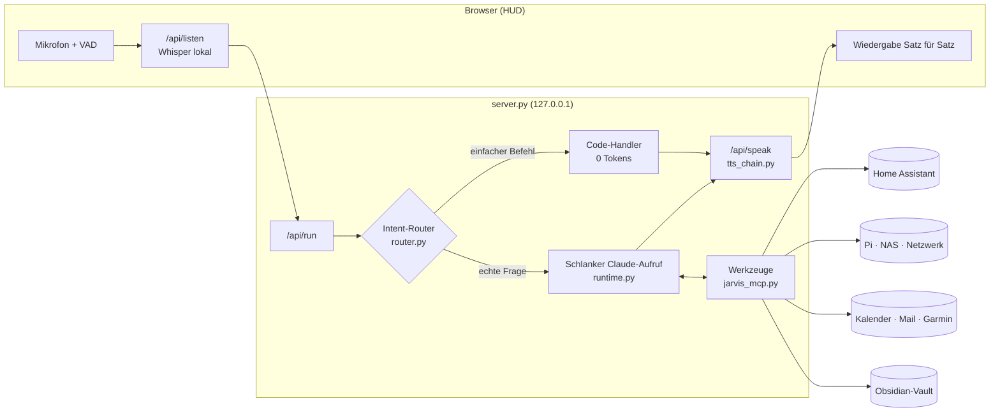

<div align="center">

# J.A.R.V.I.S.

**Persönlicher Sprachassistent mit Gedächtnis, Smart-Home-Steuerung und HUD — angetrieben von Claude Code**


-2ea44f)

</div>

---

JARVIS ist ein selbst gehosteter Sprachassistent im Stil des Iron-Man-Computers. Man spricht frei im Browser, er antwortet mit natürlicher Stimme, steuert das Smart Home, kennt Kalender, Postfach und Heimnetz, und er baut sich ein **dauerhaftes Gedächtnis** in einem Obsidian-Vault auf.

Das Sprachmodell ist die **Claude-Code-CLI** im Abo-Modus. Es gibt also keine API-Abrechnung pro Token. Damit das Kontingent lange reicht, beantwortet ein **lokaler Intent-Router** einfache Befehle komplett ohne LLM. Alles andere läuft als **schlanker, zustandsloser Aufruf** mit eigenem Kurz-Prompt und nur den Werkzeugen, die die Anfrage wirklich braucht.

<div align="center">


<sub>HUD am PC, Ansicht „Sonnenlauf“ · Instanz mit Beispielkonfiguration, keine persönlichen Daten</sub>

</div>

## Highlights

<table>
<tr>
<td width="50%" valign="top">🎙️ <b>Freihändig sprechen</b><br>Live-Mikrofon, Satzende-Erkennung, Reinreden unterbricht ihn. Aktivierungswort „Jarvis“ wahlweise lokal per openWakeWord.</td>
<td width="50%" valign="top">⚡ <b>0 Tokens für Alltägliches</b><br>Licht, Steckdosen, Musik, Timer, Wecker, Uhrzeit, Wetter: ein lokaler Intent-Router antwortet in Millisekunden, ohne LLM.</td>
</tr>
<tr>
<td valign="top">🪶 <b>Schlanke Claude-Aufrufe</b><br>Eigener Kurz-Prompt, nur die nötigen Werkzeuge, automatische Modellwahl. In Messungen über 25× weniger Tokens als ein Standard-Aufruf.</td>
<td valign="top">🧠 <b>Echtes Gedächtnis</b><br>Obsidian-Vault mit Themen-Notizen, Gesprächsprotokoll, Episoden je Tag, Ablaufdaten und Papierkorb. Jede Erinnerung mit prüfbarer Herkunft.</td>
</tr>
<tr>
<td valign="top">🏠 <b>Weiß, wo du bist</b><br>Präsenzmelder je Raum: Antwort aus dem Lautsprecher des Raums, Musik wandert mit, Heizung folgt, Morgen-Briefing beim ersten Gang ins Bad.</td>
<td valign="top">📣 <b>Meldet sich selbst</b><br>Waschmaschine fertig, Zeit loszufahren, Paket kommt, Speicher voll, Unwetter, neues Gerät im WLAN. Mit Ruhezeiten, nie ohne Karte.</td>
</tr>
<tr>
<td valign="top">🛟 <b>Notbetrieb</b><br>Fällt Claude aus, übernimmt eine kostenlose Kette Groq → Gemini → Ollama mit denselben Werkzeugen. Die Stimme hat ihre eigene Kette aus Cloud-, GPU- und Gratis-Anbietern.</td>
<td valign="top">🛡️ <b>Kontrolliert und ehrlich</b><br>Aktionsklassen im Code statt im Prompt, Bestätigungskarten, Schutz vor fremden Anweisungen in Mails und Webseiten, Audit-Log, Not-Aus, nur <code>localhost</code>.</td>
</tr>
</table>

Die vollständige Liste steht unter [Funktionen](docs/funktionen.md).

## Architektur



Der Browser hört zu und spricht, der Server (nur `127.0.0.1`) erkennt lokal mit Whisper, der Router beantwortet einfache Befehle selbst, alles andere geht als schlanker `claude -p`-Aufruf mit nur den passenden Werkzeugen an Claude. Die Komponenten im Einzelnen: [Architektur und Effizienz](docs/architektur.md).

## Schnellstart

**Voraussetzungen:** Windows 11 · Python 3.12 · Node.js · ein Claude-Abo. Optional: NVIDIA-GPU (CUDA 12.8) für Whisper `large-v3-turbo` und die lokale Stimme.

```powershell
# 1  Claude Code installieren und anmelden (Abo, kein API-Key)
npm.cmd install -g @anthropic-ai/claude-code
claude auth login

# 2  Python-Umgebung
py -3.12 -m venv .venv
.venv\Scripts\python.exe -m pip install -r requirements.txt
# mit NVIDIA-GPU zusätzlich: -r requirements-gpu.txt · auf dem Windows-PC: -r requirements-windows.txt

# 3  Konfiguration
copy .env.example .env                      # Werte eintragen
copy config\home.example.json config\home.json   # HA-Entity-IDs eintragen (optional)
mkdir vault\Erinnerungen

# 4  Start
start-jarvis.bat
```

Autostart, lokale Stimmen (Piper, Chatterbox auf der GPU) und alle Einstellungen: [Installation und Konfiguration](docs/installation.md).

## Dokumentation

| Seite | Inhalt |
|---|---|
| [Funktionen](docs/funktionen.md) | Highlights, alles was möglich ist, Funktionsliste |
| [Installation und Konfiguration](docs/installation.md) | Schnellstart, lokale Stimmen, `.env`, Entwicklung und Diagnose |
| [Bedienung](docs/bedienung.md) | Sprechen und tippen, Karten, Persönlichkeit, Alltag, iPhone/iPad, Handy |
| [Stimme und Sprach-Engine](docs/sprache.md) | Anbieter-Kette, Zuhören/Unterbrechen/Weitersprechen, Notbetrieb |
| [Gedächtnis und Lernen](docs/gedaechtnis.md) | Ressourcen, Kontext, Aufgaben, lernfähige Module, Vault |
| [Architektur und Effizienz](docs/architektur.md) | Komponenten, Router und schlanker Modus, Projektstruktur |
| [Sicherheitsmodell](docs/sicherheit.md) | Die Regeln im Code; Details in [SECURITY.md](SECURITY.md) |
| [ARCHITECTURE.md](ARCHITECTURE.md) · [SECURITY.md](SECURITY.md) · [ROADMAP.md](ROADMAP.md) | Modulkarte, Sicherheitsregeln und Ausbauplan für die Arbeit am Code |
| [pi/](pi/README.md) | Monitoring und Doku des Raspberry Pi, der Jarvis das Haus, das Netz und DNS liefert |

## Raspberry Pi: Monitoring und Doku

Der Pi im Heimnetz liefert Jarvis Home Assistant, DNS und das Monitoring; das HUD verlinkt beide Seiten oben rechts. Die Kopien unter [`pi/`](pi/README.md) sind anonymisiert.

<table>
<tr>
<td width="50%"></td>
<td width="50%"></td>
</tr>
<tr>
<td align="center"><sub>ORBIT Monitor (Port 8092): Geräteinventar mit Live-Status</sub></td>
<td align="center"><sub>Pi-Dokumentation (Port 8091): Hardware, Dienste, Abschnitt Jarvis</sub></td>
</tr>
</table>

---

<sub>Ursprünglich inspiriert von <a href="https://github.com/Itsme23476/jarvis-claude-code">jarvis-claude-code</a>. Für eine eigenständige Weitergabe vorher die Lizenzlage der Vorlage klären.</sub>
